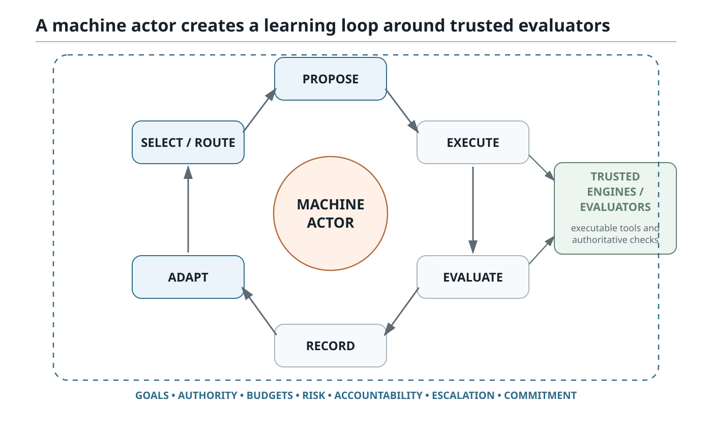
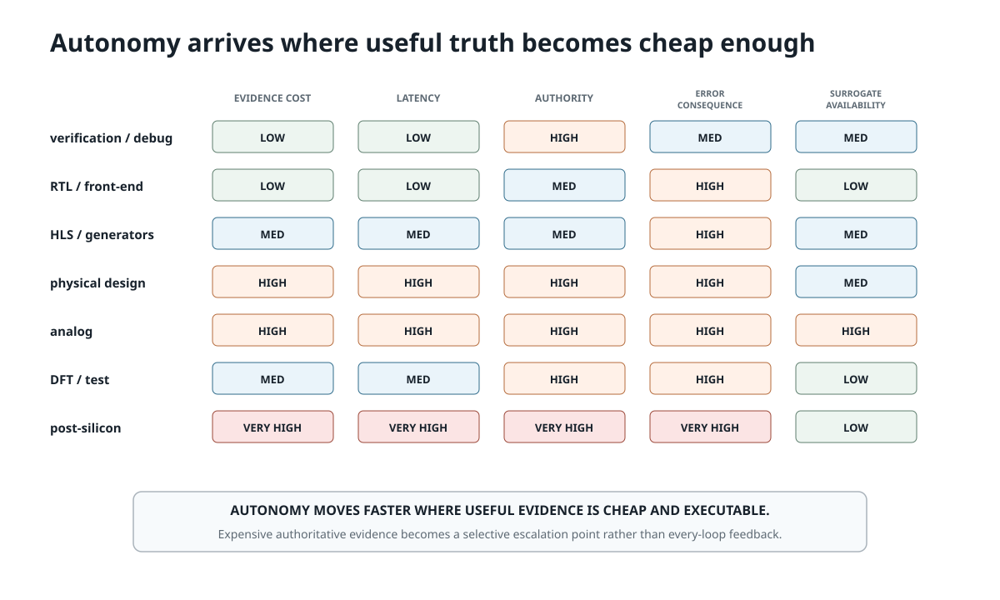
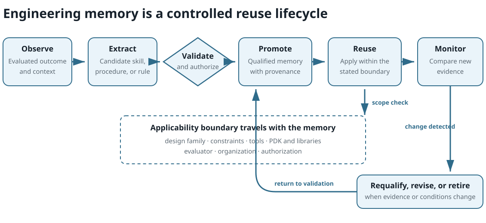
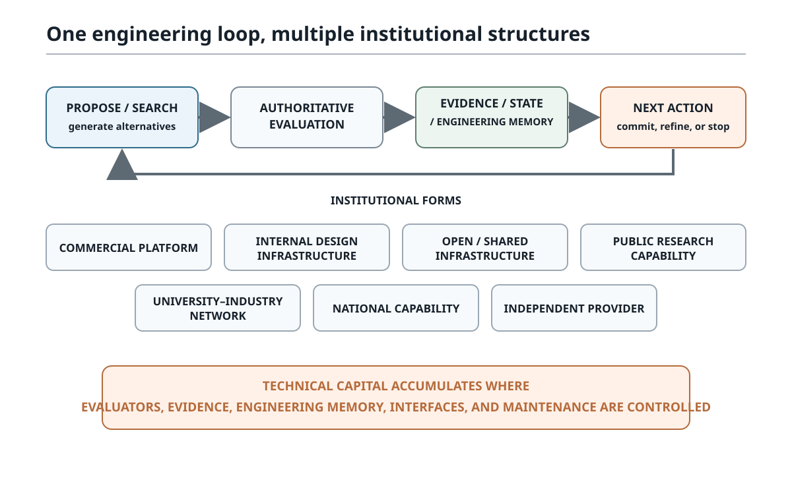
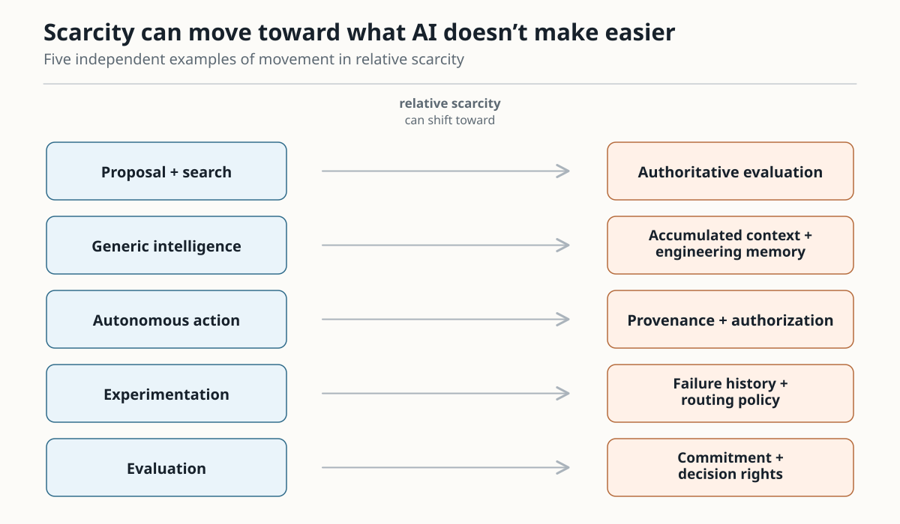
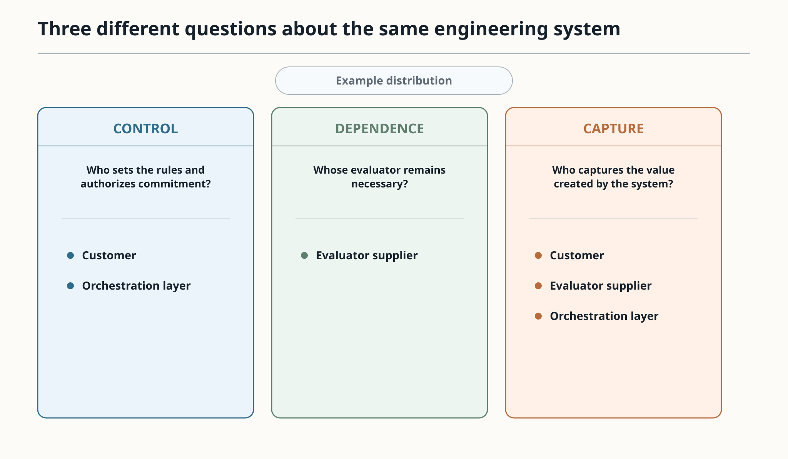
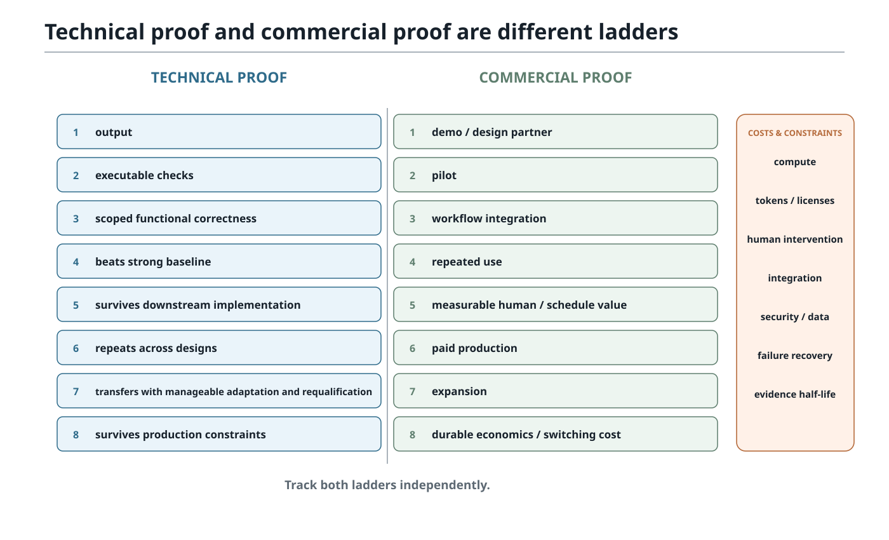
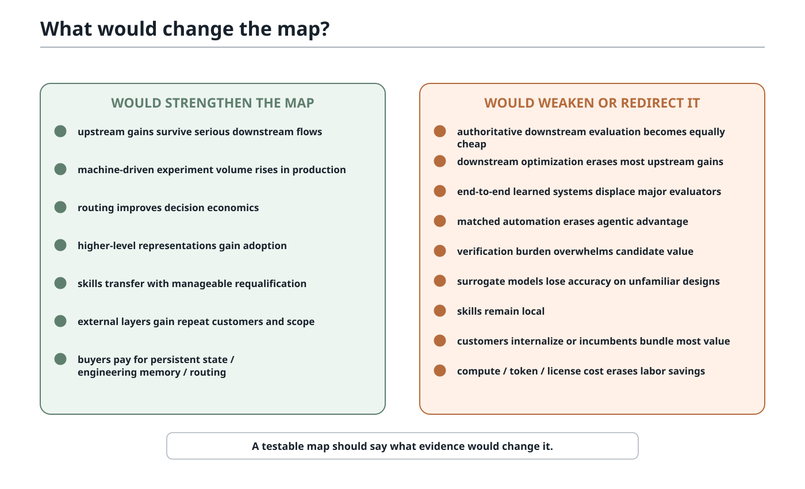

# When Design Exploration Gets Cheap

*Upstream Search, Downstream Truth, and the Migration of Scarcity in Chip Design*

<table class="paper-table"><tbody><tr><th><strong>Author and collaboration</strong> Brad Pierce in collaboration with an AI language model.</th></tr></tbody></table>

<table class="paper-table"><tbody><tr><th><strong>Contribution statement</strong> Brad Pierce developed the central formulation and retains final editorial responsibility. AI assisted in preparing the paper. This collaboration does not imply endorsement by any organization.</th></tr></tbody></table>

© 2026 Brad Pierce · CC BY-NC 4.0 · October 6, 2026 · DOI: [10.5281/zenodo.23256253](https://doi.org/10.5281/zenodo.23256253)

## Abstract

When AI lowers the cost of design exploration faster than it lowers the cost of authoritative evaluation, chip design reorganizes around what becomes relatively scarce: trusted evidence, accumulated context, engineering memory, and ultimately the authority to commit. The allocation problem is evaluator economics: deciding what evidence to obtain next, which evaluator has enough authority for the question at hand, when stronger evidence is worth its cost, and when to stop or escalate. EDA makes this evaluator-allocation problem unusually visible because its evaluators differ sharply in cost, latency, coverage, fidelity, authority, and consequence. The same cost asymmetry reorganizes control and value. Who controls the workflow, whose capability is difficult to substitute, and where economic value accrues are distinct questions and can have different answers. State, methodology, failure history, routing knowledge, and qualified integration can accumulate into technical capital even when they never become standalone software products. Separately owned technical capital can also operate as one engineering system when governed interfaces preserve authority, provenance, qualification, and ownership while allowing external evaluators to contribute authoritative evidence. Public evidence already shows the layered architecture in real deployment. That leaves four linked questions: where scarcity moves as exploration becomes cheap, what capital forms around the new scarcities, which ownership structures those conditions favor, and which of those assets can support durable economic value.

*Keywords:* electronic design automation, EDA, artificial intelligence, agentic AI, evaluator economics, routing capital, technical capital, technical capital intelligence, techcap, semiconductor design, design-space exploration

## Table of Contents

[**Executive Summary	3**](#executive-summary)

[**1. The New Economics of Search and Evidence	5**](#1-the-new-economics-of-search-and-evidence)

[1.1 The Stack Is Asymmetric	5](#1-1-the-stack-is-asymmetric)

[1.2 A New Computational Actor Enters the Design Flow	7](#1-2-a-new-computational-actor-enters-the-design-flow)

[1.3 Evaluator Economics: What Evidence Should the System Buy Next?	10](#1-3-evaluator-economics-what-evidence-should-the-system-buy-next)

[1.4 Which Constraints Does AI Actually Relax?	17](#1-4-which-constraints-does-ai-actually-relax)

[**2. What Exists Now	21**](#2-what-exists-now)

[2.1 Where Autonomy Arrives First	21](#2-1-where-autonomy-arrives-first)

[2.2 AI-driven EDA Is Already Several Markets	23](#2-2-ai-driven-eda-is-already-several-markets)

[**3. Control, State, and Technical Capital	28**](#3-control-state-and-technical-capital)

[3.1 How Is Control Distributed?	28](#3-1-how-is-control-distributed)

[3.2 Where Technical Capital Can Accumulate	35](#3-2-where-technical-capital-can-accumulate)

[3.3 Engineering Memory: From History to Reusable Skill	43](#3-3-engineering-memory-from-history-to-reusable-skill)

[**4. Similar Technical Loops, Different Institutional Structures	49**](#4-similar-technical-loops-different-institutional-structures)

[4.1 Technical Capital Across Ecosystems	49](#4-1-technical-capital-across-ecosystems)

[**5. Value Capture and Market Structure	52**](#5-value-capture-and-market-structure)

[5.1 Build, Buy, or Keep Internal?	52](#5-1-build-buy-or-keep-internal)

[5.2 Agentic EDA Economics and Industry Structure	55](#5-2-agentic-eda-economics-and-industry-structure)

[5.3 When Scarcity Moves	59](#5-3-when-scarcity-moves)

[**6. Diligence	69**](#6-diligence)

[6.1 From Demo to Decision-Grade Evidence	69](#6-1-from-demo-to-decision-grade-evidence)

[6.2 What Evidence Would Change the Map?	73](#6-2-what-evidence-would-change-the-map)

[**7. Conclusion — Where Scarcity and Value Move	75**](#7-conclusion-where-scarcity-and-value-move)

[**References	76**](#references)

[**Appendix A — Company and Capability Map	88**](#appendix-a-company-and-capability-map)

[**Appendix B — Evidence Summary for Major Claims	98**](#appendix-b-evidence-summary-for-major-claims)

[**Appendix C — Historical Cases: Which Constraints AI Relaxes	102**](#appendix-c-historical-cases-which-constraints-ai-relaxes)

[**Appendix D — Evaluator Economics Table	105**](#appendix-d-evaluator-economics-table)

[**Appendix E — Regional Evidence Coverage	106**](#appendix-e-regional-evidence-coverage)

[**Appendix F — Method and Evidence Limits	108**](#appendix-f-method-and-evidence-limits)

[**Appendix G — Survey Guide to AI and Automation in EDA	112**](#appendix-g-survey-guide-to-ai-and-automation-in-eda)

## Executive Summary

Chip design is entering an asymmetric regime: AI is reducing the cost of proposing, exploring, and revising alternatives faster than it’s reducing the cost of authoritative engineering evidence. Moving intelligence above mature EDA engines doesn’t make those engines dispensable. A machine actor can generate candidates, invoke tools, interpret results, remember outcomes, and try again while trusted engines continue to settle different engineering questions. Throughout this report, “truth” is shorthand for engineering evidence with enough domain-specific authority to settle a particular question under the relevant assumptions. [3, 7, 13, 15] As a deliberately informal shorthand, I call the cost of obtaining that question-settling evidence “dollars-per-truth.” As adjacent work gets cheap, scarcity can move toward whatever AI hasn’t made easier.

As alternatives get cheaper, deciding what evidence to buy next matters more. Evaluator economics asks which evaluator to run, when stronger evidence is worth its cost, when the evidence is sufficient, and when to stop or escalate. EDA makes the problem unusually visible because evaluators differ sharply in cost, latency, coverage, fidelity, authority, and consequence; authority isn’t the same as fidelity. Cheap proxies can widen search while stronger checks are invoked selectively as escalation points. [19, 185, 186, 187] The evaluator-economics framing draws on value-of-information analysis, value-of-computation analysis, engineering design decision analysis, multi-fidelity optimization, and risk-informed verification and validation. [22, 23, 24, 25, 51, 67, 188, 189] If evaluation also gets cheap, scarcity can move again toward commitment.

AI can take on more of the work above and between mature engines: proposing work, routing it, interpreting evidence, retaining state, and choosing the next experiment. It can also make automation approaches that used to be limited by human authoring, coordination, interpretation, or search effort more practical. AI can relax those constraints. It does much less for QoR limits, solver complexity, fidelity limits, process dependence, or physics. [9, 13, 14] Control, dependence, and economic capture are distinct questions: resource dependence shapes bargaining power, while complementary assets shape who captures value. [65, 77] Public evidence already shows incumbent-provider, design-organization, independent-provider, and hybrid arrangements. [3, 5, 6, 15, 18]

What underlies the agent can matter more than the visible interface: current design state, accepted constraints, provenance, evaluator results, methodology, experiment history, failure history, and authority boundaries. Engineering memory and routing policy become technical capital only when lessons remain tied to the conditions that made them valid. That capital can accumulate inside a design organization, an incumbent platform, a governed multi-party system, open infrastructure, or national capability; as workflows and constraints change, its strategic importance can shift even when it never becomes standalone software revenue. Who ultimately captures the value remains open.

The clearest publicly quantified commercial evidence already establishes real deployment: Synopsys reported its first 100 commercial DSO.ai tape-outs by February 2023; Cadence reports more than 1,000 Cerebrus tapeouts and expanding ChipStack deployments; and ChipAgents reports more than 200 semiconductor-enterprise deployments, with named workflow results from Andes, eMemory, Whalechip, and Ambiq. [1, 2, 3, 6, 145, 146, 147, 148, 149]

Those facts don’t establish long-run switching cost, retention, deployment burden, cross-organization ownership of engineering memory, or category economics. The technical architecture is more visible than the eventual ownership and market structure. The business questions are where scarcity moves, what accumulates around it, which actors can capture or retain those assets under current conditions, how transferable those assets are, and which assets can support durable economic value.

<table class="paper-table"><tbody><tr><th><strong>Evidence state</strong></th><th><strong>Meaning</strong></th><th><strong>Where the report stands</strong></th></tr><tr><td>SUPPORTED</td><td>Public evidence is sufficient within the stated scope. Company-reported metrics count for what they show, not more: deployment doesn’t prove retention, switching cost, or durable economics.</td><td>Agentic systems can operate above trusted EDA engines. AI-driven optimization and agentic verification have entered real enterprise deployment. Differences in evaluator cost and authority strongly shape how much autonomy is practical. Different parts of the loop can be controlled by incumbent providers, design organizations, independent providers, or hybrid arrangements. Cross-design reusable engineering skill is technically demonstrated. Different ecosystems converge on similar architectures linking search, trusted evaluation, evidence and state, and the next experiment.</td></tr><tr><td>CONDITIONAL / SCENARIO</td><td>The mechanism or direction is credible, but public evidence doesn’t justify a categorical conclusion.</td><td>Engineering memory creates a durable vendor advantage. A vendor-neutral orchestration layer becomes a major control point. Higher-level representation vendors become large standalone markets. Agentic AI raises total EDA industry spending. Usage-based pricing broadly displaces seat licensing. The right to commit becomes a major organizational constraint as search scales.</td></tr><tr><td>OPEN — PUBLIC EVIDENCE INSUFFICIENT</td><td>Public evidence is insufficient to conclude. OPEN means unresolved, not false; decisive facts may be private or unobservable.</td><td>Private procurement and build-versus-buy logic. Renewal, churn, and net retention for new agentic vendors. Deployment-services burden. Cross-organization ownership of persistent engineering memory. Industry-wide total-cost elasticity. Detailed commercial dollars-per-truth curves across evaluator classes.</td></tr></tbody></table>

## 1. The New Economics of Search and Evidence

### 1.1 The Stack Is Asymmetric

Electronic design automation is often discussed as if it were a single stack that AI either replaces or fails to replace. That framing hides the most important asymmetry.

At the top of the design process, the problem is still plastic. Architecture can change. Microarchitecture can change. Numerical representation can change. Work can move between hardware and software. Memory organization, pipelining, parallelism, interfaces, and control structure can still be reconsidered. Higher-level representations can generate families of implementations instead of one fixed RTL description.

Farther downstream, the design becomes progressively entangled with physical reality. Timing closure, congestion, parasitics, power integrity, clock distribution, process corners, analog behavior, manufacturing rules, design-rule checking and layout-versus-schematic verification (DRC/LVS), electromigration and IR-drop analysis (EM/IR), packaging, libraries, and foundry qualification become increasingly expensive to approximate and costly to get wrong.

The asymmetric design flow produces two opposing gradients. Upstream, optionality and reversibility are high; downstream, the cost and authority of truth rise.

*Figure 1. AI can make proposal and exploration dramatically cheaper while reducing the cost of authoritative physical and manufacturing evidence much less. The resulting opportunity is asymmetric: search can move rapidly without similarly dispersing qualification, process integration, and trusted downstream evaluation.*

AI changes upstream and downstream search economics differently; calling one “easy” and the other “hard” hides the mechanism.

A synthesis engine can optimize a given RTL description extremely well. A place-and-route tool can search a huge implementation space. A signoff tool can tell a team whether a candidate meets a demanding set of physical constraints. But no downstream optimizer can recover an architecture that was never proposed.

Upstream optionality matters because the largest design gains often occur before the implementation problem hardens. A different memory hierarchy, precision choice, accelerator boundary, pipeline strategy, or HW/SW partition can dominate a local downstream optimization. Better downstream tools can't compensate for choices that were excluded from the search space.

AI makes upstream exploration more valuable because proposing alternatives is becoming cheaper. An agent can rewrite, compile, simulate, synthesize, compare, reject, and retry continuously. It can operate representations that humans may find tedious. It can keep track of previous experiments. It can ask downstream tools for evidence earlier.

Shift-left methods extend that logic by moving downstream information and correlated proxies earlier in the flow while making fidelity itself a design constraint. [173]

At the same time, AI does much less to reduce the difficulty of reproducing the strongest downstream assets. Process models, foundry relationships, qualified flows, accumulated corner cases, integration, support, and trust are specialized assets that generic models don't supply. They’re long-lived technical capital.

In the emerging architecture, some intelligence about what to try next can move above mature EDA engines without making those engines dispensable. Synopsys, Cadence, Siemens, OpenROAD-based research, CEA architecture exploration, and multiple university systems all fit versions of this pattern. [1, 2, 15, 182]

Physical design is changing too. Learned placement, differentiable optimization, early physical prediction, and AI-assisted analog design all show that downstream domains can become more programmable. But a clever model may predict signoff. It doesn't automatically become signoff.

Recent reviews map both human-guided AI across the analog flow and the open deterministic layout infrastructure that makes layout-in-the-loop optimization possible. [170, 174, 175]

Analog also resists a simple front-end/back-end split. Expert reasoning and high-fidelity physical evaluation interact throughout the design process, and accurate circuit simulation can be expensive even early. What matters more is how reversible a decision is, how authoritative the available evidence is, and how much that evidence costs—not whether the work sits in a nominal front end or back end.

### 1.2 A New Computational Actor Enters the Design Flow

The new computational actor is an agentic system that works across a toolchain as a persistent experimenter: proposing work, invoking tools, interpreting evidence, retaining state, and choosing what to try next.

A useful abstraction is a five-stage loop:

<table class="paper-table"><tbody><tr><th><strong>Stage</strong></th><th><strong>What happens</strong></th></tr><tr><td>Propose</td><td>Propose architecture choices, RTL edits, constraints, scripts, parameters, verification collateral, or flow changes.</td></tr><tr><td>Execute</td><td>Established tools execute those proposals.</td></tr><tr><td>Judge</td><td>Simulation, formal, synthesis, P&amp;R, DRC, timing, and other evaluators return evidence.</td></tr><tr><td>Remember</td><td>The system records what happened.</td></tr><tr><td>Adapt</td><td>A repair or search policy changes, and the next experiment is chosen.</td></tr></tbody></table>

*Figure 2. The new actor isn’t automatically the judge. It proposes and adapts around executable tools and evaluators while humans still set goals, govern risk and budgets, decide when to escalate, and retain the right to commit.*

The propose–execute–judge–remember–adapt loop is increasingly visible in real systems.

Recent surveys organize agentic EDA around handoffs among specialized producers and consumers, hierarchical feedback, persistent context, and acceptance evidence; an NSF workshop report separately identifies data access, benchmarks, integration, and expert knowledge as shared infrastructure needs. Together, the surveys and workshop report map the field and its open problems. [95, 96, 97]

Appendix G provides a multilingual guide to surveys and reviews covering LLM and agentic EDA, shift-left methods, intelligent routing, FPGA automation, high-level synthesis, and analog design.

Earlier systems such as ChatEDA and ChipNeMo show the lineage from tool-using agents and domain-adapted engineering assistance to today’s persistent orchestration. [111, 112]

Cadence ChipStack orchestrates multiple engineering tasks over native design and verification tools and has entered named enterprise deployment. [3] Siemens describes long-running agents that continuously validate their actions against physics-based EDA tools rather than relying on model confidence alone. [15] Synopsys’s public progression runs from DSO.ai optimization and search, through Synopsys.ai Copilot assistance and AgentEngineer workflows, to Synopsys Autopilot and the announced GPT-Synopsys specialized model. Synopsys and OpenAI describe GPT-Synopsys as operating Synopsys tools, interpreting results, implementing changes, and iterating toward verified outcomes for engineer review. [1, 69, 70, 72, 92, 94] Rule2DRC uses an LLM to generate DRC scripts but judges them by executing them against real layouts. [181]

Verification is a natural early beachhead because the evaluator is unusually machine-readable. Regression results, logs, waveforms, assertions, coverage, formal counterexamples, and pass/fail tests already exist in executable form. A machine can often make progress without being allowed to commit a physical design.

The same propose–evaluate–remember loop applies more broadly. A hardware generator becomes an action space. Synthesis becomes an evaluator. Place-and-route becomes a source of physical evidence. SPICE becomes an expensive circuit-level evaluator. A design database becomes persistent state. A skill library becomes memory.

The greater the consequences of the model’s freedom, the more important the evaluator becomes.

Recent work makes the evaluator boundary more explicit:

<table class="paper-table"><tbody><tr><th><strong>Benchmark</strong></th><th><strong>Evaluator boundary</strong></th></tr><tr><td><strong>Long-Horizon Analog Design Bench</strong></td><td><strong>Uses an isolated hidden verifier after two-hour schematic-design attempts.</strong></td></tr><tr><td><strong>BEHAVE</strong></td><td><strong>Checks both agent-written RTL and behavioral models against hidden references.</strong></td></tr><tr><td><strong>PolyHDL</strong></td><td><strong>Uses equivalence-based oracles to expose synthesis and simulation defects.</strong></td></tr><tr><td><strong>SpecRead</strong></td><td><strong>Separates specification comprehension from code generation.</strong></td></tr></tbody></table>

These evaluators answer different questions, and none by itself establishes complete signoff or silicon readiness. [116, 117, 141, 142]

Formal verification makes the separation between evaluator quality and generation or repair quality especially clear. A solver can establish that a candidate violates a property and can often produce a counterexample. But Artificial Incorrectness shows that having a strong judge doesn't automatically give the LLM a strong repair policy. [8] Generator quality, evaluator quality, and repair policy are separate technical assets.

An open-silicon verify-before-ship architecture provides a narrower example: deterministic engines remain the core, an agent operates the flow, and a gate preserves verified results before release. Its two public tasks document the architecture at narrow scale, below production-scale autonomous signoff. [103]

WaveletECO and ResizerAgent show controllers choosing repair or timing strategies around fixed EDA engines. Both are evidence of bounded optimization loops rather than complete signoff. [143, 144]

As autonomy increases, human governance doesn’t disappear from the architecture. Current production-oriented systems still rely on explicit goals, budgets, guardrails, escalation paths, accountability, and people with the right to commit. Current public evidence and established human-automation research support an architecture in which agents receive bounded authority and people retain escalation and commitment rights. [3, 15, 68] Control of the loop can be split among different actors.

<table class="paper-table"><tbody><tr><th><strong>Actor</strong></th><th><strong>Common control or contribution</strong></th></tr><tr><td>Incumbent provider</td><td>Tool access, product knowledge, evaluator integration, and the design-organization interface.</td></tr><tr><td>Design organization</td><td>Intent, private design history, accumulated methodology and domain experience, internal tools, and cross-vendor workflow state. [70, 71]</td></tr><tr><td>Independent provider</td><td>Neutral orchestration, domain expertise, agent infrastructure, or a specialized representation.</td></tr><tr><td>Hybrid</td><td>Organization-specific engineering context and internal infrastructure coupled to incumbent agent/tool machinery; NVIDIA and Cadence provide one current example.</td></tr></tbody></table>

A persistent computational experimenter can operate around the engines instead of replacing them. Ownership of the surrounding loop is therefore separate from ownership of the engines.

### 1.3 Evaluator Economics: What Evidence Should the System Buy Next?

Once proposal and search become cheap, the next scarce decision is often which evidence to buy: which evaluator to invoke, when stronger evidence is worth its cost, and when to stop or escalate.

Established disciplines already study versions of this allocation problem. The following table separates their native questions, contributions, and the additional problem evaluator economics addresses. [22, 23, 24, 25, 51, 67, 188, 189]

<table class="paper-table"><tbody><tr><th><strong>Antecedent</strong></th><th><strong>Native question</strong></th><th><strong>Contribution</strong></th><th><strong>Evaluator economics adds</strong></th></tr><tr><td>Value-of-information analysis</td><td>Is more information worth its cost?</td><td>Expected decision improvement versus acquisition cost. [22, 188, 189]</td><td>Treats information as one form of evaluator evidence.</td></tr><tr><td>Engineering design decision analysis</td><td>Is another analysis or source worth running?</td><td>Cost, quality, and sequential information-source choice. [22, 189]</td><td>Generalizes from analyses and sources to evaluator portfolios and escalation.</td></tr><tr><td>Multi-fidelity optimization</td><td>Which fidelity should be evaluated next?</td><td>Cost-aware management of cheap and expensive approximations. [23]</td><td>Extends beyond one response at different fidelities; evaluators may answer different questions.</td></tr><tr><td>Value-of-computation analysis</td><td>Is another computation worth the resources?</td><td>Metareasoning about limited computation. [24]</td><td>Connects computation choice to engineering evidence, stopping, and escalation.</td></tr><tr><td>V&amp;V / credibility</td><td>How credible must evidence be for this decision?</td><td>Rigor commensurate with reliance and consequence of error. [25]</td><td>Adds decision rights and consequence to evaluator allocation.</td></tr></tbody></table>

A broad multi-fidelity survey reviews adaptation, fusion, and filtering methods while emphasizing that even the highest-fidelity model remains an approximation. Cost-aware Bayesian optimization further shows why dividing expected improvement by cost can overfavor cheap evaluations when valuable optima are expensive. [100, 101]

Value-of-information analysis, engineering design decision analysis, multi-fidelity optimization, value-of-computation analysis, and risk-informed verification and validation motivate evaluator economics: allocating effort among evaluators that answer different questions and differ in cost, latency, coverage, fidelity, authority, and risk. Cheap search makes stopping and escalation policy as important as candidate generation.

Concurrent work calls the same resource problem validation congestion: abundant generated candidates compete for scarce validation capacity, and multi-fidelity rankings determine which candidates receive stronger checks. [118] In analog routing, APEC-Route provides a concrete proxy-escalation example: learned capacitance estimates guide search while field-solver references supply stronger evaluation. [140]

Economics supplies another antecedent: as prediction becomes cheaper, judgment and complementary organizational inputs can become relatively scarcer, with consequences for contracts and firm boundaries. EDA differs: proposal generation is not prediction, and qualified engineering evaluation is not generic judgment. The same relative-scarcity mechanism makes evaluation and organizational judgment more valuable as proposal generation becomes cheaper. [102, 113]

<table class="paper-table"><tbody><tr><th><strong>EVALUATOR ECONOMICS</strong> Evaluator economics is the engineering concept of allocating evaluation effort among mechanisms that differ in cost, latency, fidelity, authority, coverage, and risk, including deciding when inexpensive evidence is sufficient and when the expected value of greater certainty justifies escalation to a more costly evaluator. <strong>Practical question:</strong> What evidence should the engineering system buy next?</th></tr></tbody></table>

The eval.qa guide uses “evaluator economics” for the staffing, quality, and annotation costs of building AI-evaluation teams. [74] This report uses the term for engineering evidence allocation.

#### Fidelity and Authority Are Different Dimensions

It’s tempting to picture evidence on one ladder: rough approximations at the bottom and increasingly faithful answers at the top. But fidelity and authority are different properties of evidence. That distinction is general, not peculiar to EDA. [25, 75] EDA makes it unusually visible because design flows contain many different evaluators, qualification boundaries, and explicit signoff decisions.

Fidelity asks how closely an evaluation represents the phenomenon, behavior, or result it’s standing in for. Authority asks what engineering question the methodology accepts that result as settling. A result can have high authority for a bounded question without being a detailed physical model, and a high-fidelity analysis can reveal a great deal without settling the engineering gate.

Qualified signoff DRC makes the distinction concrete. A foundry-qualified DRC run can authoritatively answer whether a layout satisfies the encoded design rules for that signoff flow. Its authority comes from the qualified rule deck and methodology. It isn’t trying to reproduce lithography, etching, deposition, process variation, and the rest of fabrication physics in detail. [48]

The opposite case is just as important. A detailed process, lithography, or TCAD analysis can model particular physical mechanisms much more directly. Engineers may use that kind of analysis to understand why a violation occurs, how a structure is likely to behave, or which physical mechanism is driving a problem. That richer physical picture can be exactly what the team needs, even when the analysis is expensive. But unless that analysis is part of the qualified signoff methodology for the question at hand, physical fidelity by itself doesn’t give the result signoff authority. [49, 212]

The distinction becomes clearest in a failure loop. An authoritative evaluator says that the design can’t proceed and reports a violation. Engineers then spend more resources on a higher-fidelity investigation because they need to understand why. The higher-fidelity analysis helps diagnose the mechanism and guides the repair. The repaired design then returns to the authoritative evaluator for closure. The extra fidelity was purchased for understanding, not for permission.

Evidence can settle an engineering question without giving anyone permission to act. Organizational authority determines who may approve a tapeout, accept a risk, spend a budget, or commit a consequential change. [76] Those decisions belong to the governance of the engineering system, not to the strength or fidelity of the evidence.

The distinction between fidelity and authority changes how an engineering system allocates evaluation effort. The system isn’t simply climbing from cheap, low-fidelity evidence toward expensive, high-fidelity evidence. Sometimes it spends more to obtain a better physical explanation. Sometimes it spends to obtain evidence with enough authority to close a particular engineering question. Sometimes those needs coincide, and sometimes they’re served by different evaluators. The routing problem is therefore not “which evaluator is highest on the ladder?” It is “what evidence does this decision need next?”

Recent hardware-modeling work reinforces the boundary: an abstraction can answer its intended question efficiently only when its assumptions and validity range remain explicit. [133]

**Fidelity and Authority Answer Different Questions**

<table class="paper-table"><tbody><tr><th><strong>Example</strong></th><th><strong>What it gives you</strong></th><th><strong>What it doesn’t give you</strong></th></tr><tr><td>Qualified signoff DRC</td><td>Authority to settle encoded design-rule compliance</td><td>A detailed physical model of fabrication</td></tr><tr><td>Detailed physical/process analysis</td><td>High physical-fidelity evidence for diagnosis and understanding</td><td>Signoff authority merely because the analysis is physically detailed</td></tr></tbody></table>

Evaluator selection is iterative:

<table class="paper-table"><tbody><tr><th><strong>Condition</strong></th><th><strong>Action</strong></th></tr><tr><td>Inexpensive evidence is sufficient for the decision</td><td>Use inexpensive evidence.</td></tr><tr><td>Available evidence is sufficient</td><td>Stop.</td></tr><tr><td>Uncertainty or consequence makes stronger evidence worth the cost</td><td>Escalate to stronger evidence.</td></tr><tr><td>A decision has been made</td><td>Preserve what was learned so the next decision begins better informed.</td></tr></tbody></table>

Evaluator economics is a routing and stopping problem as much as an accuracy problem. At sufficiently high throughput, scarcity can move again toward commitment.

Chip design makes evaluator economics unusually visible. Its evaluators span enormous differences in cost and latency, and they differ in their fidelity and in what they're authoritative about. Compilation can reject invalid artifacts; formal can settle specified properties; DRC can settle encoded geometric rules; signoff and SPICE answer narrower physical questions at much higher cost; silicon supplies empirical evidence at still another level.

*Figure 3. Evaluator economics treats evaluation as a resource-allocation problem: which evidence to obtain next, when stronger evidence is worth its cost, when available evidence is sufficient, and when to stop or escalate. Different evaluators can be authoritative over different questions, so authority can’t be reduced to a single fidelity ladder.*

Evaluators combine cost, fidelity, and authority differently. Some are authoritative within a defined scope; others provide useful evidence without settling the decision:

<table class="paper-table"><tbody><tr><th><strong>Evaluator</strong></th><th><strong>What it can settle / enable</strong></th><th><strong>Cost, authority, and main limitation</strong></th></tr><tr><td>Syntax and compilation</td><td>Reject invalid artifacts quickly.</td><td>Very low cost and latency; little evidence about intended behavior.</td></tr><tr><td>Simulation and tests</td><td>Provide machine-readable behavioral feedback over exercised workloads and tests.</td><td>Low to medium cost; rich but incomplete state-space coverage.</td></tr><tr><td>Formal and DRC</td><td>Formal can establish specified properties; DRC can establish encoded geometric rules. Rule2DRC shows the value of execution-guided selection. [181]</td><td>Authority is high within the specified rule/property scope, but strong judges don’t automatically provide strong repair policies; Artificial Incorrectness makes that gap explicit. [8]</td></tr><tr><td>HLS synthesis</td><td>Provides a deterministic compiler/synthesis loop and structured inner-loop evidence.</td><td>Medium cost; strong for synthesizability, but historical evidence shows a persistent QoR gap versus strong RTL. [9]</td></tr><tr><td>Learned surrogates and virtual prototypes</td><td>Rank or evaluate many candidates cheaply; VPSim reports up to 600 MIPS for architecture exploration. [182]</td><td>Fidelity is model-dependent, and authority is limited to the questions for which the model has been validated. Analog multi-fidelity work reports replacing ~96.5% of candidate SPICE evaluations and ~20× lower simulation time while retaining selective SPICE checks. [19]</td></tr><tr><td>Trial physical implementation</td><td>Provides stronger physical evidence than analytical or learned estimates.</td><td>Medium cost; more accessible and programmable than full advanced-node production flow, but less authoritative than production signoff.</td></tr><tr><td>Full P&amp;R, signoff, high-fidelity SPICE</td><td>Answer demanding physical, timing, and circuit questions under qualified assumptions.</td><td>High cost and latency; substantially more authoritative for the questions they cover.</td></tr><tr><td>Silicon</td><td>Provides ultimate empirical behavior.</td><td>Extreme cost and latency; unsuitable for ordinary inner-loop search.</td></tr></tbody></table>

Differences in evaluator cost and fidelity lead naturally to multi-fidelity search.

#### CASE STUDY 1 — COST OF STRONGER EVIDENCE: Multi-fidelity analog optimization

<table class="paper-table"><tbody><tr><th><strong>Dimension</strong></th><th><strong>Finding</strong></th></tr><tr><td>Technical mechanism</td><td>A learned surrogate screens or ranks many candidate circuits. Selected candidates are sent to SPICE for higher-fidelity evaluation, and those results can update the surrogate and the search policy.</td></tr><tr><td>Evaluator and evidence structure</td><td>The surrogate provides fast, approximate predictions. SPICE provides stronger circuit-level evidence under the device models, solver settings, and analyses being used; it’s still a model of circuit behavior, not silicon.</td></tr><tr><td>Ownership and control paths</td><td>The cited studies don’t establish a dominant ownership pattern. The optimization layer could be built inside a design organization or supplied externally, while the higher-fidelity simulator can remain incumbent or internal infrastructure.</td></tr><tr><td>Evidence</td><td>One 2026 study evaluates four operational-amplifier topologies. Its surrogate-guided mode replaces about 96.5% of SPICE calls and reports about 20x lower total simulation time; its adaptive multi-fidelity mode reduces SPICE use by roughly 90%. [19] A separate 2024 study on three analog circuits reports 56%, 59%, and 83% reductions in SPICE calls. [185] Other studies report more than 15x speedup for a Bayesian Monte Carlo surrogate and 3.49–8.18x speedup from asynchronous batch optimization. [186, 187] Those results measure different mechanisms and shouldn’t be treated as the same result.</td></tr><tr><td>Demonstrated engineering value</td><td>The demonstrated value is engineering leverage: fewer high-cost simulations and shorter optimization runs in the tested research settings. That can support more search for the same simulation budget, but the cited studies don’t measure generalized production dollar savings or provider economics.</td></tr><tr><td>Potential durable advantage</td><td>Reusable surrogates, training data, calibration history, and routing policies can become engineering assets, but the cited work doesn’t show that they create a durable advantage across projects or organizations. Changes in topology, process node, objectives, or simulator settings can require retraining or requalification. Control could remain inside a design organization, sit with an incumbent platform, or be split between an external optimization layer and an authoritative simulator.</td></tr><tr><td>What remains open</td><td>Production-scale robustness; deployment and maintenance burden; retraining or requalification cost as designs, nodes, tools, and objectives change; transfer across projects or organizations; and whether routing knowledge creates switching cost or durable external pricing power.</td></tr></tbody></table>

Operationally, the evaluator hierarchy in Figure 3 becomes a simple loop:

<table class="paper-table"><tbody><tr><th><strong>Stage</strong></th><th><strong>Action</strong></th></tr><tr><td>Generate</td><td>Generate many candidates.</td></tr><tr><td>Filter</td><td>Use cheap evaluators to reject obvious failures.</td></tr><tr><td>Escalate</td><td>Escalate uncertain or promising candidates.</td></tr><tr><td>Verify</td><td>Invoke higher-cost evidence selectively.</td></tr><tr><td>Learn</td><td>Feed that evidence back into the search policy.</td></tr></tbody></table>

A multi-fidelity evaluation system can create value at several leverage points:

<table class="paper-table"><tbody><tr><th><strong>Leverage point</strong></th><th><strong>Source of value</strong></th></tr><tr><td>Generator</td><td>Proposes better candidates and expands the useful search space.</td></tr><tr><td>Evaluator</td><td>Makes evidence cheaper or more available, allowing more candidates to be judged.</td></tr><tr><td>Escalation policy</td><td>Concentrates higher-cost evidence on uncertain or promising candidates when stronger evidence is worth buying.</td></tr><tr><td>Repair policy</td><td>Turns evaluator feedback into a better next candidate rather than merely detecting failure.</td></tr><tr><td>Engineering memory and routing</td><td>Preserves results, learns which evaluator is needed, and lets the next decision begin better informed.</td></tr></tbody></table>

Differences in evaluator cost, fidelity, and authority help explain why domains reach autonomy at different rates. Verification has relatively cheap strong judges. Analog has expensive but usable simulators plus improving surrogates. Architecture has fast models but lower fidelity. Signoff has high authority and high cost. The categories differ less by how much AI they contain than by how cheaply a machine can obtain evidence strong enough to keep moving.

Evaluator cost and authority shape how much search is practical, where autonomy arrives first, and which evaluators control strategically important evidence. Public evidence doesn’t yet show that evaluator routing by itself creates a durable standalone business advantage.

Differences in evaluator cost and authority raise a historical question: which automation approaches were held back mainly by constraints AI can now relax, and which remain limited by constraints AI leaves largely intact?

### 1.4 Which Constraints Does AI Actually Relax?

Many current AI-driven EDA approaches have clear predecessors. What matters is which constraints limited those earlier approaches and whether AI relaxes those constraints.

<table class="paper-table"><tbody><tr><th><strong>Architecture</strong></th><th><strong>Original objective</strong></th><th><strong>Prior limiting constraints</strong></th></tr><tr><td>High-level synthesis</td><td>Move design above RTL and let a compiler produce implementation.</td><td>QoR gap, hardware-aware restructuring, predictability and debug, directive expertise, and workflow adoption.</td></tr><tr><td>Hardware construction languages and generators</td><td>Represent families of circuits and reusable structural intent rather than isolated instances.</td><td>Language and ecosystem learning cost, generator debugging, methodology change, and entrenched RTL workflows.</td></tr><tr><td>Virtual prototyping</td><td>Move software and architectural feedback earlier through executable system models.</td><td>Model-building and maintenance cost, calibration, specialist operation, and fidelity limits.</td></tr><tr><td>Design-space exploration</td><td>Search alternatives systematically rather than rely only on human intuition.</td><td>Workflow integration, usability, solver and simulation cost, organizational adoption, and commercialization difficulty.</td></tr><tr><td>Analog automation</td><td>Encode and reuse sizing rules, topology knowledge, generators, and expert procedures.</td><td>Tacit knowledge, process dependence, expensive simulation, and limited transfer across topologies and nodes.</td></tr><tr><td>Formal methods</td><td>Turn correctness into executable evidence through proofs and solvers.</td><td>Specification burden, solver scalability, and expert interpretation of counterexamples.</td></tr><tr><td>Unified design databases</td><td>Preserve design state across fragmented tools.</td><td>Cross-tool integration and organizational fit.</td></tr></tbody></table>

These ideas weren’t waiting for AI because everyone had missed an obvious insight. They faced real constraints. Some were expensive for humans to operate. Some imposed training and workflow costs. Some faced QoR or fidelity limits. Some had hard solver-scaling limits. Some were process-dependent. Some never fit organizational practice.

*Figure 4. AI can relax some of the constraints that limited an EDA approach. If the limiting factor was expert human effort, then the economics can change substantially. If the limiting factor was QoR, solver complexity, fidelity, process dependence, or physics, then the economics don’t change much.*

<table class="paper-table"><tbody><tr><th><strong>Architecture</strong></th><th><strong>What AI relaxes</strong></th><th><strong>What still limits the approach</strong></th><th><strong>Evidence / implication</strong></th></tr><tr><td>High-level synthesis</td><td>Restructures high-level code, interprets reports, explores directives, and runs more experiments around a deterministic compiler/synthesis loop.</td><td>Algorithms or mappings poorly suited to HLS don’t become suitable; downstream physical constraints still apply; QoR can still lag expert RTL.</td><td>A 2018 survey across 46 papers and 118 applications found development time around one-third of RTL and average productivity above four times RTL, while RTL generally retained better QoR. [9] Japanese reviews trace the same lineage through the mechanisms that made HLS practical and the languages and systems used to raise FPGA design above RTL. [167, 168] AI can reduce the expert effort needed to operate and explore around the compiler, but it doesn’t eliminate the QoR gap.</td></tr><tr><td>Hardware generators and construction languages</td><td>Creates and modifies generators, searches parameter spaces, and translates intent into structured design actions without requiring the same human investment in learning the language and methodology.</td><td>Generator bugs can propagate widely; verification and downstream integration are still mandatory.</td><td>Structural reuse and parameterized design become attractive machine action spaces, although production-market evidence remains uneven.</td></tr><tr><td>Virtual prototyping</td><td>Maintains models, runs workloads, interprets results, and schedules experiments continuously.</td><td>Model fidelity and correlation with the eventual implementation still determine whether fast feedback is useful.</td><td>CEA’s VPSim and related architecture-exploration work demonstrate the use of executable models to explore architectural choices before RTL. [182] AI can reduce the effort required to build and use those models, but they still have to predict the later implementation accurately enough to guide good decisions.</td></tr><tr><td>Analog automation</td><td>Ingests design knowledge, generates candidates, searches, and orchestrates simulator loops, reducing the expert effort needed to encode knowledge and explore alternatives.</td><td>High-fidelity simulation, process dependence, topology variation, generalization, and silicon behavior continue to impose substantial cost.</td><td>French CAIRO/OCEANE work and Iskander, Louërat, and Kaiser’s dependency-graph approach to operating-point computation and design-plan generation provide older executable-knowledge lineage. A current Japanese program explicitly aims to capture analog intent, constraints, and evaluation criteria for reuse. [110, 114] Reinforcement learning, Bayesian optimization, and surrogate models extend this boundary; physics still sets the limit.</td></tr><tr><td>Formal methods</td><td>Assists specification, tool use, and counterexample interpretation.</td><td>Solver complexity doesn’t disappear, nor does the gap between proving a design wrong and finding a good repair.</td><td>Artificial Incorrectness shows strong formal validation without reliable repair from counterexamples alone. [8] AI complements formal methods; it doesn&#x27;t remove their hard problems.</td></tr></tbody></table>

AI can make some of these approaches more practical by reducing the expert effort needed for authoring, coordination, interpretation, and search. But QoR limits, fidelity limits, solver complexity, process dependence, and physics will still put real limits on how far they can go.

#### CASE STUDY 2 — HIGHER-LEVEL SEARCH: SoC Planner and agentic HLS

<table class="paper-table"><tbody><tr><th><strong>Dimension</strong></th><th><strong>Finding</strong></th></tr><tr><td>Technical mechanism</td><td>SoC Planner is an integrated flow: CEA A-DECA explores and evaluates architectures, Innova PDM coordinates workflow and engineering data, and Defacto SoC Compiler turns selected architectures into synthesizable RTL. UCLA’s AHRR is a separate research workflow in which an agent works in HLS C++, Vitis HLS generates RTL, and an agent can refine that RTL. The shared pattern is higher-level search coupled back to deterministic downstream tooling.</td></tr><tr><td>Evaluator and evidence structure</td><td>SoC Planner evaluates architecture candidates with analytical models and simulation before selected configurations move downstream to RTL. In AHRR, Vitis HLS is primarily a translator; candidate quality is judged by correctness tests, RTL simulation, simulated cycle count, post-route clock period, and resource ceilings on an AMD U55C. These evidence sources differ in fidelity and authority, and the FPGA results aren’t ASIC production signoff.</td></tr><tr><td>Ownership and control paths</td><td>SoC Planner spans CEA, Defacto, and Innova; Defacto entered a Siemens ownership transition in 2026; Rise demonstrates an independent-vendor route. Internal generators, open compiler infrastructure, public/research systems, independent vendors, and incumbent platforms are all live paths. Public evidence doesn’t establish a dominant one.</td></tr><tr><td>Evidence</td><td>SoC Planner first-party sources describe an integrated architecture-to-RTL flow, two industrial validation scenarios, and up to 30–40% shorter exploration cycles. [13] Ding et al. report, on an 11-task FPGA benchmark, 2.62× geometric-mean execution-time speedup for AHRR over Direct RTL on valid paired cases and 2.31× for Agent-HLS alone. [50] A historical HLS survey reports average development time about one third of RTL and more than 4× designer productivity, while RTL QoR remained better on average. [9]</td></tr><tr><td>Demonstrated engineering value</td><td>The demonstrated value appears in three different metric families: SoC Planner reports shorter exploration cycles in early-adopter validation; UCLA AHRR reports faster generated-hardware execution in a controlled FPGA benchmark; historical HLS literature reports human development-time and productivity gains. These results show engineering leverage at higher abstraction, but they don’t establish generalized dollar savings, reduced human burden in the UCLA experiment, or a standalone software revenue pool.</td></tr><tr><td>Potential durable advantage</td><td>Reusable representation/compiler infrastructure, workflow integration, architecture/evaluation data, and generation/refinement patterns could become durable engineering assets. Public evidence doesn’t yet show cross-project compounding, switching costs, or durable pricing power, and changes in target, toolchain, design class, or QoR requirements can limit transfer.</td></tr><tr><td>What remains open</td><td>Broad production adoption; repeatability and generalization of agentic results; engineering effort to build and maintain these flows; QoR and maintainability relative to strong RTL; transfer across designs, devices, and toolchains; who captures value; and whether design organizations prefer external higher-level providers or internal generator/HLS infrastructure.</td></tr></tbody></table>

## 2. What Exists Now

### 2.1 Where Autonomy Arrives First

Autonomy doesn't arrive on a single maturity curve. It arrives first where a machine can obtain useful evidence cheaply, execute the relevant checks, and trust the results enough to keep moving.

*Figure 5. Model capability alone doesn’t determine autonomy. A domain becomes easier to automate when useful evidence is cheap, executable, and authoritative enough for the decision being made.*

<table class="paper-table"><tbody><tr><th><strong>Domain</strong></th><th><strong>Evaluator structure</strong></th><th><strong>Why autonomy is easier or harder</strong></th><th><strong>Limit AI doesn’t remove</strong></th></tr><tr><td>Verification and debug</td><td>Regression results, logs, waveforms, assertions, coverage, tests, and formal counterexamples provide executable feedback.</td><td>Relatively strong, machine-readable judges let a system run, compare, reject, and retry without committing a physical design.</td><td>Evidence is bounded by the tests, properties, workloads, and specifications being exercised.</td></tr><tr><td>Front-end RTL generation</td><td>Compilation and simulation provide fast feedback, but they provide much less complete evidence of intended behavior across all relevant conditions.</td><td>Candidate generation is cheap and executable; establishing semantic correctness is substantially harder.</td><td>Hardware-specific failures persist in sequencing, handshakes, assignment semantics, and state modeling. [17]</td></tr><tr><td>HLS and generators</td><td>Compilers enforce representation semantics and produce deterministic implementation artifacts that can be evaluated downstream.</td><td>A structured action space and deterministic compilation make repeated agent operation attractive.</td><td>QoR and maintainability still have to compete with strong RTL methodology.</td></tr><tr><td>Physical design</td><td>Placement, routing, sizing, and physical-aware optimization expose objective functions and executable tools, with downstream validation available.</td><td>The domain is highly programmable and has measurable objectives.</td><td>Generalization across designs and process nodes is difficult; production use still requires strong downstream validation.</td></tr><tr><td>Analog</td><td>High-fidelity simulation supplies strong but expensive evidence; learned surrogates and Bayesian methods provide cheaper approximate evaluations.</td><td>Multi-fidelity routing can reserve expensive simulation for uncertain or promising candidates and greatly expand search.</td><td>Process dependence, topology variation, high-fidelity simulation cost, and silicon behavior continue to limit what’s practical.</td></tr><tr><td>DFT, test, and post-silicon</td><td>DFT and test provide structured generation and checking; post-silicon work provides rich logs and observable failures.</td><td>Repetitive, correctness-sensitive work with explicit checks is comparatively automation-friendly.</td><td>Post-silicon evidence comes with expensive physical context, and generated test structures still require trustworthy checking.</td></tr></tbody></table>

Across these domains, autonomy turns on a practical question: how cheaply can the machine know whether it's right? Evaluator economics begins there. Differences in evaluator cost and authority determine how much search a system can afford, which forms of truth become relatively scarce, and where control and value can accumulate.

### 2.2 AI-driven EDA Is Already Several Markets

Public evidence already spans several distinct AI-driven EDA markets.

AI-driven EDA market categories have different evaluator structures: different costs of truth, domains of authority, executability, privacy constraints, integration burdens, and ownership tendencies. That gives verification agents, analog optimization, higher-level design, physical optimization, workflow state, and incumbent platforms different economic shapes.

The examples show where technical architectures are being tried and commercialized while long-run winners and market structure remain open.

*Figure 6. AI-driven EDA already spans several markets. Different wedges act on different representations, evaluators, buyers, control points, compounding assets, and pressures toward platform integration or internalization by design organizations. Examples in the open/shared category include OpenROAD/CIRCT/XLS and iEDA/AiEDA.*

<table class="paper-table"><tbody><tr><th><strong>Market wedge</strong></th><th><strong>Architecture / evaluator structure</strong></th><th><strong>Economic boundary</strong></th></tr><tr><td><strong>Incumbent agent platforms</strong></td><td><strong>Cadence, Siemens, and Synopsys extend established engines into assistants, orchestration, goal-directed engineering, and specialized model layers. [3, 15, 69, 70, 72, 92, 94]</strong></td><td><strong>Native engine access, documentation, support history, customer relationships, and qualified flows are advantages; design environments vary widely and are strategically sensitive, which limits complete control.</strong></td></tr><tr><td><strong>Front-end design agents</strong></td><td><strong>Systems such as ChipAgents and academic spec-to-implementation agents work across specification, RTL, verification collateral, microarchitecture, and debug. ChipAgents reports named production workflows, on-premises deployment, and customer-controlled design data. [145, 146, 148, 150, 153]</strong></td><td><strong>High iteration before physical signoff is attractive. Named results establish bounded workflow gains; maintainability, integration burden, renewal, and differentiation require separate evidence.</strong></td></tr><tr><td><strong>Verification and debug</strong></td><td><strong>Bronco, MooresLabAI, ChipAgents verification workflows, Rule2DRC, and related systems work against logs, coverage, assertions, regressions, formal engines, waveforms, and failure artifacts. ChipAgents reports bounded verification and root-cause workflow results. [147, 151, 152]</strong></td><td><strong>Strong executable evidence makes verification an early autonomy beachhead; production value still depends on integration, coverage, and human review.</strong></td></tr><tr><td><strong>Higher-level design</strong></td><td><strong>Rise, HLS-based systems, XLS, Chisel, ITDA-style structured generation, and related approaches change the representation rather than merely improving direct RTL generation.</strong></td><td><strong>Larger action spaces compete with adoption friction, QoR risk, and RTL-methodology integration.</strong></td></tr><tr><td><strong>Physical optimization</strong></td><td><strong>RL, Bayesian optimization, graph methods, differentiable optimization, and learned predictors optimize placement, routing, sizing, and physical-aware decisions.</strong></td><td><strong>Technical value is real; generalization, downstream correlation, and incumbent response still shape the outcome.</strong></td></tr><tr><td><strong>Analog automation</strong></td><td><strong>RL, Bayesian optimization, generators, and surrogates reduce search cost while high-fidelity simulation often supplies the evaluator.</strong></td><td><strong>Autonomy is still limited because methods may not generalize across processes, topologies, or operating conditions, and high-fidelity simulation remains expensive.</strong></td></tr><tr><td><strong>Workflow and system of record</strong></td><td><strong>DSM Pro, Defacto-style persistent design databases, Innova, and incumbent data layers focus on authoritative state, provenance, configuration, resource use, and history.</strong></td><td><strong>The visible agent may become easier to replicate than the underlying data and infrastructure that maintain authoritative design state.</strong></td></tr><tr><td><strong>Surrogates and models</strong></td><td><strong>Learned models can provide cheaper approximations of expensive physical or circuit evaluations, allowing larger search loops to use high-cost analysis more selectively.</strong></td><td><strong>They may change exploration economics without owning the user interface.</strong></td></tr><tr><td><strong>DFT, test, and post-silicon</strong></td><td><strong>Automation extends into test, validation, bring-up, and diagnosis.</strong></td><td><strong>Evaluator, buyer, and integration requirements differ materially from front-end design.</strong></td></tr><tr><td><strong>Open infrastructure</strong></td><td>OpenROAD, CIRCT, XLS, Chisel, Amaranth, OpenFASoC, Hammer, iEDA/AiEDA, and related projects expose programmable infrastructure and lower experimentation cost. [16, 36, 38, 39, 40, 42, 156, 193, 194, 195]</td><td><strong>They can make inner loops cheaper without themselves becoming standalone vendor categories.</strong></td></tr></tbody></table>

What separates these categories economically is where they create leverage: some reduce the cost of evaluation, some operate trusted engineering engines, and some maintain the state and infrastructure around them. Commercial evidence remains uneven across these categories.

AI-driven implementation optimization is clearly production-grade. Synopsys reported its first 100 commercial DSO.ai tape-outs by February 2023 and DSO.ai in production in about 20% of its top 100 Place & Route customers as of the end of 2023. [1, 179] Cadence Cerebrus has named production customers and more than 1,000 tapeouts. [2, 3]

Agentic verification has also crossed the threshold from demo to enterprise deployment. Cadence has reported more than ten early ChipStack customers, including Altera, NVIDIA, Qualcomm, and Tenstorrent. [3] ChipAgents reports named workflows at Andes, eMemory, Whalechip, and Ambiq, bounded gains in elapsed time, engineering effort, and test generation, expansion beyond evaluation at Ambiq, and more than 200 semiconductor-enterprise deployments as of October 2026. [6, 145, 146, 147, 148, 149]

Public commercial evidence is thinner in other categories. Higher-level representations, neutral orchestration, persistent engineering memory, and analog automation have credible technical rationales, but public evidence on renewal, switching costs, and durable pricing power remains limited.

A technically important capability may not support a standalone company. The company-shaped/capability-shaped distinction describes current commercial forces, not a permanent end state.

<table class="paper-table"><tbody><tr><th><strong>Commercial category</strong></th><th><strong>Defining condition</strong></th><th><strong>Likely outcome</strong></th></tr><tr><td>Company-shaped</td><td>A focused product can attract repeated purchases, expand within organizations, create switching costs, and build an asset that grows more valuable with use.</td><td>A durable independent company is economically plausible.</td></tr><tr><td>Capability-shaped</td><td>A capability can be technically important even when it doesn’t support a standalone product. Its value may instead be realized when an incumbent integrates it into a broader platform, a design organization uses it internally, an open ecosystem maintains it as shared infrastructure, or a provider delivers it through services.</td><td>The capability may remain valuable without developing into a durable standalone software business.</td></tr></tbody></table>

Five commercial questions help distinguish the two:

<table class="paper-table"><tbody><tr><th><strong>Commercial criterion</strong></th><th><strong>Question</strong></th></tr><tr><td>Repeated purchase</td><td>Does a buyer repeatedly purchase it rather than build it?</td></tr><tr><td>Vendor asset that grows with use</td><td>Does repeated use build knowledge, data, or other assets that grow more valuable over time? Can the vendor retain them under the relevant IP, privacy, and contractual rules?</td></tr><tr><td>Integration depth</td><td>Does deeper integration make the product more valuable and harder to replace, or make the capability easier to absorb into a broader platform?</td></tr><tr><td>Market durability</td><td>Can the product sustain a distinct market if incumbents integrate similar capability into broader platforms or design organizations build it internally?</td></tr><tr><td>Customer budget</td><td>Do customers have a recurring budget large enough to support a standalone business?</td></tr></tbody></table>

#### CASE STUDY 3 — INCUMBENT AI OPTIMIZATION IN PRODUCTION: Synopsys DSO.ai

<table class="paper-table"><tbody><tr><th><strong>Dimension</strong></th><th><strong>Finding</strong></th></tr><tr><td>Technical mechanism</td><td>DSO.ai uses reinforcement learning to search large digital-implementation spaces. It analyzes data from Synopsys design tools and adjusts design choices, technology parameters, and workflow settings toward multidimensional power, performance, and area objectives. [1, 87, 88]</td></tr><tr><td>Evaluator and evidence structure</td><td>The search is evaluated through results generated inside Synopsys’s digital-implementation flow. Fusion Compiler combines implementation with built-in signoff timing, parasitic extraction, and power analysis, so DSO.ai can act on strong engineering evidence while the underlying implementation and signoff engines remain the source of that evidence. [89, 90]</td></tr><tr><td>Ownership and control</td><td>DSO.ai and the implementation/signoff engines are Synopsys offerings. The design organization still sets objectives, constraints, workflow policy, compute budgets, and approval boundaries around the platform, so product ownership and system-level control can remain distinct. [87, 88, 89, 90]</td></tr><tr><td>Emerging specialized-model layer</td><td>GPT-Synopsys adds a jointly developed, OpenAI-hosted specialized model above Synopsys tools and evaluators. The announced architecture distributes control across layers: OpenAI hosts the model; Synopsys supplies tools, engineering context, domain agents, and ground-truth engines; customers may use their own agent harnesses; engineers review outcomes. Early technology engagements are underway, but the announcement reports no realized productivity or broad deployment results. [92, 93]</td></tr><tr><td>Evidence</td><td>Synopsys reported the first 100 commercial DSO.ai tape-outs by February 2023, including named users STMicroelectronics and SK hynix. At its 2024 Investor Day, Synopsys reported DSO.ai in production in about 20% of its top 100 Place &amp; Route customers as of the end of 2023. [1, 179]</td></tr><tr><td>Demonstrated engineering value and commercial evidence</td><td>Named customer results include STMicroelectronics reporting more than 3x PPA-exploration productivity and SK hynix reporting a 15% cell-area reduction and 5% die shrink. Synopsys separately reported about 20% uplift versus baseline Fusion contract value, with the baseline defined as Fusion contract value before DSO.ai. Together, these provide direct evidence of engineering gains for named customers and commercial value for Synopsys in the reported deployments. [1, 179]</td></tr><tr><td>Potential durable advantage</td><td>DSO.ai benefits from close integration with Synopsys implementation/signoff infrastructure and from reusable learned state. Synopsys states that learned models can be applied across projects. In a January 2024 related-node retargeting example, reuse of a 5 nm training database at 4 nm reduced the Fusion Compiler workload from 30 parallel jobs over three iterations to 15 jobs in one iteration—a sixfold reduction versus cold start. This bounded reuse shows how learned state can make the optimization capability more valuable with repeated use inside the broader platform. [87, 88, 89, 90, 91]</td></tr><tr><td>What remains open</td><td>Public evidence establishes production use, named-customer engineering gains, commercial adoption, and bounded reuse of learned state. The remaining questions are how broadly that learned state transfers beyond related designs and how much of the reported contract-value uplift should be attributed specifically to DSO.ai versus the broader Fusion relationship. [1, 91, 179]</td></tr></tbody></table>

## 3. Control, State, and Technical Capital

### 3.1 How Is Control Distributed?

The central strategic question is no longer whether agents can operate EDA tools. Public evidence increasingly shows that they can. Control can be split among different actors. The harder question is how that distribution changes as capabilities and constraints change, which control points become economically important, and where durable value begins to accumulate.

Control can be distributed among multiple actors. Decision rights locate authority, resource dependence shapes bargaining power, transaction costs influence organizational boundaries, and complementary assets shape value capture. [65, 76, 77, 78] Different actors can set goals, define proposal policy, grant evaluator access, maintain authoritative design state and engineering memory, choose routing and escalation policy, allocate compute and license budgets, and retain the right to commit.

*Figure 7. Control of the agent–evaluator engineering loop can be distributed among multiple actors. Incumbent providers, design organizations, independent providers, and shared infrastructure can control different parts of the same engineering system. Independent markets persist when a capability is valuable enough to buy, difficult for design organizations to internalize, and uneconomic for incumbents to incorporate into broader platforms.*

#### Control Points Across the Engineering Loop

Control can be distributed across several parts of the loop:

<table class="paper-table"><tbody><tr><th><strong>Control point</strong></th><th><strong>Governs</strong></th></tr><tr><td>Goals and intent</td><td>What the system is trying to achieve and which tradeoffs matter.</td></tr><tr><td>Proposal policy and action space</td><td>What changes may be proposed and which alternatives are considered.</td></tr><tr><td>Tool and evaluator access</td><td>Which engines and evidence sources may be invoked.</td></tr><tr><td>Authoritative design state</td><td>Which design version, constraints, and state count as current.</td></tr><tr><td>Evidence and system of record</td><td>Which results are retained as authoritative evidence.</td></tr><tr><td>Engineering memory and learned skills</td><td>What experience persists and can shape later work.</td></tr><tr><td>Evaluator-routing and escalation policy</td><td>Which evaluator is used when and when stronger evidence is required.</td></tr><tr><td>Compute, token, and license budgets</td><td>How much compute, model, and tool capacity the system may spend.</td></tr><tr><td>Commitment and governance</td><td>Who may approve, commit, or govern consequential changes.</td></tr></tbody></table>

An actor can gain durable leverage by controlling several control points even when no party controls the whole loop.

<table class="paper-table"><tbody><tr><th><strong>Control plane</strong></th><th><strong>Current advantage</strong></th><th><strong>Implication for control</strong></th></tr><tr><td><strong>Incumbent provider</strong></td><td><strong>Major engines, product documentation, support history, customer relationships, integration knowledge, and direct reach into simulation, formal, synthesis, P&amp;R, and signoff.</strong></td><td><strong>Natural-language invocation alone may be difficult to sustain as a distinct external product when tool vendors can incorporate comparable interaction patterns into broader platforms.</strong></td></tr><tr><td><strong>Design organization</strong></td><td>Can build and retain proprietary methodology, design history, internal tools, private data, APIs, state, and cross-vendor workflow context. Google and Apple provide public examples. [5, 18, 183, 184]</td><td><strong>When a design organization can create large value by building the capability internally, control can stay inside the organization even without an external software market.</strong></td></tr><tr><td><strong>Independent provider</strong></td><td><strong>Cross-vendor neutrality, specialized evaluator or representation infrastructure, secure deployment, integration expertise, and reusable provider assets. ChipAgents, Bronco, Rise, Chipmind, and others show the layer is real; the ChipAgents case adds named workflow gains, on-premises deployment, and customer-controlled design data. [6, 26, 27, 29, 145, 146, 147, 148, 150, 153]</strong></td><td><strong>An independent provider can retain control when customers value capabilities incumbents don’t readily absorb and design organizations don’t prefer to build. The durable position depends on portable integrations and learning, manageable deployment effort, and customer renewal.</strong></td></tr><tr><td><strong>Hybrid</strong></td><td><strong>A design organization can retain its own context, models, engineering memory, or infrastructure while relying on provider-owned evaluators and agent execution. NVIDIA + Cadence is a public example. GPT-Synopsys shows another hybrid pattern: OpenAI hosts a jointly developed specialized model; Synopsys supplies the tools, engineering context, domain agents, and ground-truth engines; customers may use their own agent harnesses; and engineers review outcomes. [4, 92, 93]</strong></td><td><strong>Different actors can control different parts of the loop without any one of them controlling the whole system.</strong></td></tr></tbody></table>

Customer demand, asset retention, security, integration, knowledge transfer, and internal-build economics determine whether a capability supports an independent provider or shifts into a broader platform, the design organization, open infrastructure, services, or sovereign capability.

#### CASE STUDY 4 — DESIGN-ORGANIZATION CONTROL PLANE: Apple and Google

<table class="paper-table"><tbody><tr><th><strong>Analytical dimension</strong></th><th><strong>Case finding</strong></th></tr><tr><td><strong>Internal integration layer</strong></td><td><strong>Google and Apple describe internal CAD and design environments that connect company-specific flows, interfaces, data, metrics, and automation to commercial and internal engineering tools. The internal layer coordinates work across design stages; it doesn’t replace every underlying engine.</strong></td></tr><tr><td><strong>Evaluator boundary</strong></td><td><strong>Commercial EDA engines and internal analysis or checking tools produce question-specific engineering evidence. The internal environment governs how tools are connected, invoked, monitored, and incorporated into company methodology. Signoff authority still comes from the qualified checks used for the decision.</strong></td></tr><tr><td><strong>Organizational control</strong></td><td>The design organization controls its internal environment, proprietary interfaces, methodology, flow state, metrics, and decisions about which tools and evidence to use. Dependence remains layered: Google explicitly combines first- and third-party tools, and Apple works directly with EDA vendors. [5, 18, 77, 183]</td></tr><tr><td><strong>Google evidence</strong></td><td><strong>Google describes its silicon design environment as a coherent system of first- and third-party tools, industry-standard and Google-specific APIs/data formats, scalable flows, shared methodology, and procedural and AI-first approaches. The posting assigns development and deployment responsibility; it doesn’t report realized productivity or ROI. [5]</strong></td></tr><tr><td><strong>Apple evidence</strong></td><td>Apple describes signoff dashboards and metrics used across SoC groups, a Signoff AI assistant, custom implementation and signoff tools, ML/GenAI methods, RTL-construction automation, documentation and training, and direct work with EDA vendors. These descriptions show a broad internal CAD capability; they don’t measure the resulting productivity or economics. [18, 183, 184]</td></tr><tr><td><strong>Economic mechanism</strong></td><td>An internal control layer can lower coordination costs, preserve company-specific methodology, and spread tooling across projects and design teams. The sources show internal capability building and stated productivity goals; they don’t quantify realized cost, schedule, or ROI. [5, 18, 78, 83, 183, 184]</td></tr><tr><td><strong>Durability and dependence</strong></td><td>Flows, interfaces, metrics, documentation, and operating knowledge can become more useful through reuse. Their value can also depreciate or require requalification when tools, process nodes, methodologies, or product architectures change. External engines and vendor expertise can remain essential. [5, 18, 60, 61, 62, 63, 183]</td></tr><tr><td><strong>What remains open</strong></td><td><strong>Public job descriptions don’t disclose realized productivity, internal cost, portfolio-wide adoption, procurement rationale, switching costs, requalification burden, ownership of learned AI artifacts, or which functions the companies deliberately buy rather than build.</strong></td></tr></tbody></table>

#### CASE STUDY 5 — INDEPENDENT AGENT PROVIDER: ChipAgents

<table class="paper-table"><tbody><tr><th><strong>Analytical question</strong></th><th><strong>What the evidence shows</strong></th></tr><tr><td><strong>What does the provider supply?</strong></td><td><strong>ChipAgents supplies agent software for specification, RTL, testbench and stimulus generation, simulation orchestration, debug, coverage, and root-cause analysis. The agents operate above customer engineering environments and invoke established EDA tools as evaluators.</strong></td></tr><tr><td><strong>What produces the decisive engineering evidence?</strong></td><td><strong>Simulators, regressions, coverage, formal methods, timing and design-rule checks, foundry rules, and golden simulations produce the decisive engineering evidence. Agents invoke and interpret these evaluators; engineers set acceptance criteria, review the evidence, and retain signoff authority. [151, 135]</strong></td></tr><tr><td><strong>What does the customer control?</strong></td><td><strong>Renoir supports on-premises and air-gapped deployment. ChipAgents states that customers control deployment, design data, and security policy and that customer RTL, waveforms, and logs aren’t used to train models. These controls establish a data and deployment boundary. Public materials leave telemetry, update procedures, remote support, derived-artifact ownership, and cross-customer reuse to contract and diligence. [150, 153]</strong></td></tr><tr><td><strong>What’s been demonstrated in named workflows?</strong></td><td><strong>Andes Technology — Processor-customization time fell from 8.5 to 6 weeks; BIU verification fell from two to three months to about three weeks; stimulus generation fell from one to two weeks to one to two days across multiple production projects.</strong> <strong>eMemory — An NVM-IP functional-model workflow used about 80% less effort, fell from four days to five hours, and generated 18% more test patterns.</strong> <strong>Whalechip — Root-cause-analysis rounds fell from days to 15–60 minutes in a bounded four-bug episode involving 60 hours of engineering effort.</strong> <strong>These are participant-reported deployment results for specific workflows, not controlled estimates of typical performance. [146, 147, 148]</strong></td></tr><tr><td><strong>What shows adoption and scale?</strong></td><td><strong>Ambiq moved from evaluation to deployment across additional engineering teams. As of October 2026, ChipAgents reports more than 200 semiconductor-enterprise deployments. This is a time-stamped provider count, not an audited measure of market share, retention, or deployment depth. [145, 149]</strong></td></tr><tr><td><strong>How does the system create customer value?</strong></td><td><strong>The reported value comes from reaching credible engineering evidence sooner: generating artifacts, running evaluators, narrowing failure hypotheses, and iterating before another manual cycle. The named reports show bounded gains in elapsed time, engineering effort, and test generation. They provide no category-wide productivity rate.</strong></td></tr><tr><td><strong>What does deployment require?</strong></td><td><strong>Production deployment still requires integration with customer tools and environments, handling of design-specific corner cases, human guidance, and measurement of return on investment. ChipAgents’ own DVCon workshop description identifies each of these as a practical deployment problem, and its RCA account describes remaining limits at subsystem and SoC scale. [151, 152]</strong></td></tr><tr><td><strong>What can accumulate?</strong></td><td><strong>The provider can accumulate tool integrations, orchestration patterns, evaluator interfaces, deployment methods, and support experience across customers. The customer can accumulate local workflows, acceptance criteria, qualified prompts or procedures, audit trails, and evidence about when the system can be trusted. The reusable value of each asset depends on portability, contractual control, and requalification in the next design context.</strong></td></tr><tr><td><strong>Which dependencies and ownership alternatives matter?</strong></td><td><strong>ChipAgents depends on customer design state, EDA engines, infrastructure, vendor interfaces, and human decision authority. Customers can internalize orchestration, use bundled capabilities from incumbent EDA vendors, combine providers, or retain a specialist layer while keeping data and execution inside their own environment. The economic position turns on which integrations, learning, and qualified workflows remain portable.</strong></td></tr><tr><td><strong>What remains to be established?</strong></td><td><strong>Remaining diligence questions include renewal and expansion, independently verified deployment depth, service effort per deployment, telemetry and update arrangements, ownership and reuse of learned artifacts, requalification burden, and customer switching behavior. The published reports establish use and outcomes in specific workflows. These questions determine how much of that use becomes durable provider advantage.</strong></td></tr></tbody></table>

Design organizations may build and retain the following capabilities internally:

<table class="paper-table"><tbody><tr><th><strong>Capability</strong></th><th><strong>Why organizations may build and retain it internally</strong></th></tr><tr><td>Company-specific methodology agents</td><td>They encode proprietary methodology, workflow context, and engineering judgment specific to the organization.</td></tr><tr><td>Private failure-history databases</td><td>Private failure histories can reveal proprietary architecture, recurring failure modes, and how engineers diagnose and fix them. That knowledge can be highly valuable to the organization, and letting it escape can expose both the design and the organization’s engineering methods.</td></tr><tr><td>Internal evaluator-routing policies</td><td>Evaluator-routing policies encode private choices about cost, risk, and methodology, and about when stronger evidence is required. Keeping those choices internal preserves the organization’s control over how work is evaluated and escalated.</td></tr><tr><td>Proprietary design-state integration</td><td>The integration connects directly to internal APIs, data formats, tools, and the design state the organization treats as authoritative. Moving it outside the organization can require exposing or recreating those private interfaces and state.</td></tr><tr><td>Cross-project memory coupled to product architecture</td><td>Cross-project memory can carry lessons that depend on the organization’s product architecture. Moving that memory outside the organization can expose proprietary design knowledge, while the lessons themselves may lose value when separated from the context that made them useful.</td></tr><tr><td>Internal search policies</td><td>Internal search policies determine which alternatives the organization explores, which constraints it treats as fixed, and where it spends engineering effort. Those choices reflect product and engineering strategy that the organization may not want to expose.</td></tr></tbody></table>

Company-specific methodology, engineering memory, integration, and search capabilities can create substantial value for a design organization even when it never sells them as software.

Security can favor keeping the capability and its data inside an organization-controlled environment. FedEDA is designed to avoid centralizing raw circuit data because that data can be too sensitive to share. [11] Japanese local-LLM programs likewise keep design knowledge inside controlled environments, and incumbents and startups increasingly support on-prem or organization-controlled deployment.

The architecture doesn’t dictate how ownership of the control plane is divided. Public evidence shows incumbent-provider, design-organization, independent-provider, and hybrid arrangements. Which arrangement captures the most long-term value remains open.

### 3.2 Where Technical Capital Can Accumulate

As capable foundation models become more widely available, durable advantage in AI-driven EDA may depend less on the model itself and more on what an organization builds around it. If intelligence gets cheaper, what stays scarce? The harder-to-copy assets may be the knowledge and systems an organization has built over time and continues to improve through use.

Strategy and capability-building research has long treated technical capability and organization-specific knowledge as accumulated organizational assets. [63, 79, 80] Organizational memory, reusable design rationale, and tacit engineering knowledge explain how these assets become more valuable through repeated use within one organization. [62, 81, 82] Current EDA accounts from Synopsys, Diamantidis, and Andersen describe company-specific methodology, accumulated domain experience, preserved rationale, and learning loops. [70, 71, 73, 91]

*Figure 8. As capable foundation models become more widely available, durable advantage will depend even more on technical capital accumulated in design organizations, incumbent providers, foundries, ecosystems, and national programs. Much of that technical capital creates value primarily by improving the holder’s own engineering capability rather than by being sold separately.*

<table class="paper-table"><tbody><tr><th><strong>Technical-capital asset</strong></th><th><strong>What sustains its value</strong></th><th><strong>Transferability / market implication</strong></th></tr><tr><td><strong>Foundry qualification and physical models</strong></td><td><strong>These models take substantial process knowledge and qualification work to build, and their value depends heavily on the specific manufacturing process and on the confidence engineers can place in them.</strong></td><td><strong>Because these models depend on a specific manufacturing process and on qualification accepted by the engineers who use them, their value is difficult to transfer away from the foundry or established provider that maintains them.</strong></td></tr><tr><td><strong>Proprietary design history</strong></td><td><strong>It records failed experiments, important exceptions, constraints that proved consequential, and the reasons the design flow changed over time.</strong></td><td><strong>Its value is often greatest inside the design organization that created it because the history is proprietary and tightly tied to that organization’s architecture and methodology. That makes it difficult to package as a transferable external product.</strong></td></tr><tr><td><strong>Workflow state and system of record</strong></td><td><strong>It keeps track of which design state is current, which constraints have been accepted, which methodology and tool settings produced the results, what the evaluators reported, where those results came from, what experiments failed, and who has authority to make the next decision.</strong></td><td><strong>The organization that maintains the authoritative design state and its history can retain an advantage even as the agent layer becomes easier to reproduce.</strong></td></tr><tr><td><strong>Tool integration</strong></td><td><strong>Its value comes from reliably connecting complex environments, proprietary data formats, security boundaries, and design methodology that’s accumulated over years.</strong></td><td><strong>When an integration reaches deeply into proprietary formats, security boundaries, and long-lived methodology, and is difficult for others to reproduce, the organization that built and maintains it can retain a durable advantage.</strong></td></tr><tr><td><strong>Evaluator access</strong></td><td><strong>Access to trusted evaluators lets a system check proposed actions against reliable engineering evidence and use stronger checks when the stakes require them.</strong></td><td><strong>Reliable access to trusted evaluators can remain a source of advantage even as capable foundation models become more widely available.</strong></td></tr><tr><td><strong>Domain-specific representations</strong></td><td><strong>Representations such as XLS, HLS, generators, and other domain-specific abstractions encode design structure explicitly, so the system can work with meaningful design choices instead of searching over unconstrained low-level changes.</strong></td><td><strong>These representations can create substantial engineering value. It remains uncertain whether they can support a durable external product or business.</strong></td></tr><tr><td><strong>Reusable generators and skills</strong></td><td><strong>Parameterized design assets and validated skills can be reused and improved across projects. Trace2Skill shows verifier-guided later-task improvement within its task regime; Dr. RTL establishes fold-isolated cross-design reuse; ChipMEM adds transfer from a frozen library to tasks not used to build that library. [10, 20, 98]</strong></td><td><strong>Repeated use can make these assets more valuable, but each result has an applicability boundary. Cross-tool, cross-node, and cross-organization transfer, requalification burden, ownership, maintenance, and negative transfer remain open.</strong></td></tr><tr><td><strong>Failure histories</strong></td><td><strong>Failure histories can keep the system from repeating unproductive experiments, help it choose appropriate validation, and signal when stronger evidence or human review is needed.</strong></td><td><strong>Failure histories often depend on proprietary architecture, internal methodology, and local context. Moving them outside the organization can expose proprietary information, and without that context failure histories are often much less useful.</strong></td></tr><tr><td><strong>Security and local deployment</strong></td><td><strong>For an externally supplied AI-driven EDA system, security requirements can determine where the system is allowed to run. Proprietary design information may be acceptable in infrastructure controlled by the design organization but not in a provider-controlled cloud service.</strong></td><td><strong>For some design organizations, support for on-prem or organization-controlled deployment can be a requirement for buying and using the product. A provider that can’t meet those security requirements may be excluded regardless of the system’s technical capability.</strong></td></tr><tr><td><strong>Support and trust</strong></td><td><strong>When engineering organizations choose a provider, the value comes not only from the algorithms but also from accountability, accumulated knowledge of corner cases, and a proven history of support.</strong></td><td><strong>Trust built through repeated successful use, responsive support, and accountability can take years to establish and is difficult for a new provider to reproduce.</strong></td></tr></tbody></table>

The technical-capital assets in the preceding table matter because capable foundation models may become more widely available while other sources of advantage remain difficult to reproduce. Durable value can remain in authoritative engineering evidence, authoritative design state, proprietary history, integration, security, support, trust, and reusable knowledge that stays valid as tools and processes change. The important distinction is between creating value and being transferable across organizations. Across these asset classes, five economic behaviors recur.

<table class="paper-table"><tbody><tr><th><strong>Asset behavior</strong></th><th><strong>Economic consequence</strong></th></tr><tr><td>Becomes more valuable through repeated use within one organization but transfers poorly</td><td>High internal value doesn’t guarantee that an asset can be sold to other organizations.</td></tr><tr><td>Transfers readily across organizations but can lose differentiation as similar offerings become widely available</td><td>Broad reuse doesn’t necessarily create durable pricing power.</td></tr><tr><td>Requires qualification</td><td>Moving the asset to a new process, project, or operating environment often requires requalification before engineers can rely on it.</td></tr><tr><td>Makes it costly for customers to switch providers</td><td>If customers incur meaningful costs when switching providers, the asset can help support a durable external business.</td></tr><tr><td>Serves as shared infrastructure</td><td>Shared infrastructure can create substantial value across an ecosystem. That value doesn’t necessarily support a standalone product or a durable advantage for any one vendor.</td></tr></tbody></table>

Simply accumulating more data doesn’t by itself create durable advantage in this sector. For any candidate asset, five ownership and reuse questions matter:

<table class="paper-table"><tbody><tr><th><strong>Decision dimension</strong></th><th><strong>Diagnostic question</strong></th></tr><tr><td>Favored ownership structure</td><td>Which ownership structure do current conditions favor?</td></tr><tr><td>Value from reuse</td><td>Does the asset become more valuable as it’s reused on more designs, incorporates more failure history, or is used by more organizations?</td></tr><tr><td>Transferability</td><td>Can the asset be transferred to another organization without exposing proprietary information or losing much of its usefulness?</td></tr><tr><td>Requalification</td><td>Does the asset require requalification when the tools, processes, or operating conditions it depends on change?</td></tr><tr><td>Value capture</td><td>Does the asset create pricing power for a provider or improve productivity inside the organization using it?</td></tr></tbody></table>

Open and public research institutions can accumulate technical capital through shared infrastructure, evaluated artifacts, maintained interfaces, and repeated engineering use. The next two cases examine how that accumulation works under different institutional arrangements.

#### CASE STUDY 6 — OPEN-RESEARCH ECOSYSTEM TECHNICAL CAPITAL: iEDA, AiEDA, and ECOS

<table class="paper-table"><tbody><tr><th><strong>Dimension</strong></th><th><strong>Finding</strong></th></tr><tr><td><strong>Technical system and accumulation mechanism</strong></td><td>iEDA provides an open physical-design infrastructure, public tools, common data structures, and interfaces for building additional EDA capability. AiEDA turns design-flow results into structured data and vector representations for repeatable AI research and evaluation. ECOS extends the active lineage through open IP, SoC, PDK, education, and RTL-to-chip integration. The demonstrated accumulation path runs from design-flow results to machine-usable evidence and then into AI-aided-design work. Repeated design, teaching, debugging, and tapeout activity creates further opportunities to improve the system. [16, 42, 109, 154, 156, 202]</td></tr><tr><td><strong>Engineering evidence and maturity</strong></td><td>Engineering reality is established at several levels. The current iEDA homepage reports five tapeouts—two at 110 nm and three at 28 nm—and eleven tools, while the current repository and a 2024 peer-reviewed project-team paper report four; a 2023 project-team paper reports that the first 110 nm chip had booted. A 2026 conference abstract by an ECOS engineer reports fabrication of a 55 nm 100 MHz RetroSoC and use of ECOS Studio in One Student One Chip. The evidence closes returned-silicon status only for the first iEDA chip and leaves tool coverage for later tapeouts and production qualification of the current open PDK unresolved. [42, 154, 155, 202, 204]</td></tr><tr><td><strong>Ownership and control</strong></td><td>Public code, repositories, documentation, issue and contribution paths, examples, and part of the design data are reusable outside one firm. Operational control remains distributed and unequal: maintainers control releases, the complete paper-scale dataset isn’t yet public, foundries control process collateral, and commercial evaluators remain authoritative at parts of the flow. Current ECOS documentation says that the ECOS Team combines the original iEDA and One Student One Chip teams. This structure supports the paper’s label “technical capital accumulated in an open research ecosystem.” Legal ownership and formal ecosystem-wide governance remain asset-specific or undocumented. [16, 42, 109, 155, 156, 202, 203, 204]</td></tr><tr><td><strong>Evidence</strong></td><td>The evidence combines live project sites and repositories, peer-reviewed project-team papers, a 101 GB public iDATA release, current ECOS and ICsprout55 documentation, and a 2026 conference abstract by an ECOS engineer. Together, these sources establish active technical infrastructure, research use, silicon-facing work, and a continuing organizational lineage. Independent production adoption and commercial scale remain open questions. [16, 42, 109, 154, 155, 156, 202, 203, 204]</td></tr><tr><td><strong>Demonstrated engineering value</strong></td><td>iEDA and AiEDA provide maintained infrastructure, common interfaces, design-to-vector machinery, examples, evaluators, and a public research dataset; the surrounding ecosystem adds education, reusable design materials, and repeated silicon-facing work. These assets lower the setup cost for experiments, make results easier to reproduce and compare, and allow researchers to build on a common technical base. The evidence demonstrates engineering and research value. Financial returns and broad industrial adoption haven’t been measured. [16, 42, 109, 154, 155, 156, 202, 204, 205, 206]</td></tr><tr><td><strong>Potential durable advantage</strong></td><td>Open code and data spread capability, while persistent interfaces, accumulated examples, tested flows, and maintainer know-how can make the ecosystem faster at running and interpreting the next experiment. Durability depends on maintenance, requalification as tools and PDKs change, portability across design contexts, institutional continuity, and renewal of tacit knowledge. Open diffusion broadens ecosystem value while making exclusive capture by any single participant less likely. [16, 42, 109, 154, 156, 201, 202, 203, 204, 205, 206]</td></tr><tr><td><strong>What remains open</strong></td><td><strong>Formal decision rights across OSCC and ECOS assets; identities, returned-silicon status, and tool coverage for later tapeouts; completion and terms of the full approximately 600 GB iDATA release; maturity of AiEDA beyond its current iEDA-centered implementation; the boundary between open flows and commercial or foundry-controlled authority; independent external reuse; the strength of education-to-contribution and tapeout-to-tool-improvement loops; and where economic value is ultimately captured.</strong></td></tr></tbody></table>

#### CASE STUDY 7 — PUBLIC-RESEARCH TECHNICAL CAPABILITY: QiMeng

<table class="paper-table"><tbody><tr><th><strong>Dimension</strong></th><th><strong>Finding</strong></th></tr><tr><td><strong>Technical mechanism</strong></td><td>QiMeng is an evolving public-research umbrella for automated processor hardware and supporting software rather than a finished integrated system. QiMeng-CPU-v1 learns BSD-based RISC-V core logic from finite external input-output observations drawn from processor verification/reference behavior; the paper reports extremely high validation accuracy, but not exhaustive formal correctness over every possible input and state. QiMeng-CPU-v2 tackles a different problem: State-BSD predicts inter-instruction dependencies from internal processor state, bypasses dependencies it can’t predict safely, and uses SMT to verify predictor precision. Work now presented under the broader QiMeng umbrella also includes automated OS configuration and neural-symbolic transcompilation, some of which predates the umbrella framing. [41, 157, 159, 161, 162] The public portfolio also includes repositories for QiMeng-CPU-v1, QiMeng-Kernel, and QiMeng-MuPa. [198, 199, 200]</td></tr><tr><td><strong>Evaluator regimes and evidentiary limits</strong></td><td>QiMeng-associated projects use different evaluator regimes. QiMeng-CPU-v1 is learned from finite input-output examples and evaluated with large validation suites. The paper uses the Pentium 4 verification regime to motivate a target error on the order of 10⁻¹³; it doesn’t report that threshold as a measured end-to-end validation result or an exhaustive formal proof of whole-CPU behavior. QiMeng-CPU-v2 formally checks State-BSD predictor precision with SMT and also uses commercial simulation, FPGA execution, Linux, SPEC, Dhrystone, and CoreMark for behavioral and performance evidence. The researchers explicitly retain conventional EDA in the broader automation architecture for implementation, evaluation, and verification. [157, 160, 161]</td></tr><tr><td><strong>Institutional locus and control</strong></td><td>Under the current institutional arrangement, the hardware research is centered in public CAS research organizations, with software-side collaboration and repeated grant support documented in published work. This supports “public-research technical capability” as an institutional-locus description, not as a complete legal-ownership map. Publications and repositories make some methods, code, and designs externally available. Repeated research likely creates tacit integration and debugging knowledge in the participating institutions, but that tacit asset is inferred rather than directly inventoried. [41, 160, 161, 196, 197]</td></tr><tr><td><strong>Evidence</strong></td><td><strong>The QiMeng-CPU-v1 project-team paper reports generating the BSD-based CPU core in about five hours on a 68-server cluster; that timing excludes the rest of the SoC and backend circuit design. The generated logic was subsequently implemented and taped out, and the authors report Linux operation and Dhrystone performance comparable to Intel 80486SX. QiMeng-CPU-v2 is a roughly 17-million-gate four-ALU superscalar RISC-V-32IA design. Its project-team paper reports FPGA validation with Linux and SPEC, Dhrystone/CoreMark evaluation, and a Dhrystone-based comparison near Cortex-A53; at publication, 28 nm tapeout was in progress. The 2025 umbrella paper reported that QiMeng was still in phase one, with comprehensive integration future work; a fresh 2026 search found newer component papers but no primary source closing that integration gap. AutoOS and QiMeng-Xpiler show software-side breadth in work now grouped under the umbrella. [157, 158, 159, 161, 162]</strong></td></tr><tr><td><strong>Demonstrated engineering value and economic limits</strong></td><td><strong>Public evidence demonstrates substantial task automation and measured technical results, not a complete accounting of total engineering labor or economic value. The v1 authors report about five hours for BSD-based CPU-core generation but explicitly exclude SoC/backend work and use substantial cluster compute. AutoOS reports up to roughly 25% performance improvement over vendor-provided configurations in tested settings. QiMeng-Xpiler reports about 95% average translation accuracy across evaluated cases, while its computation accuracy varies by direction and expert-optimized vendor libraries remain stronger on average performance. These results show useful automation in bounded workflows; they don’t establish program-level dollar ROI, national economic return, total labor savings, external pricing power, or commercial reproduction cost. [157, 159, 161, 162]</strong></td></tr><tr><td><strong>Potential durable advantage</strong></td><td>The observable portfolio extends beyond any one generated CPU: design methods, evaluation and search machinery, code, processor artifacts, benchmarks, and public research artifacts accumulate across the line of work. Public release makes some of those assets portable and available for external reuse, but meaningful diffusion outside the originating research network isn’t established by availability alone. Repeated debugging, integration, and fabrication work likely creates tacit know-how, while unreleased data/training assets and specialized evaluation access remain less transferable; those tacit and transferability claims should be treated as analytical inferences unless directly evidenced. [41, 159, 162, 198, 199, 200]</td></tr><tr><td><strong>Alternative institutional structures</strong></td><td>The same kinds of methods and artifacts could be organized differently. An EDA incumbent could integrate processor-design automation with its trusted tools; a chip company could internalize the methods and keep design context private; an independent company could commercialize the automation; an open ecosystem could distribute reusable artifacts. QiMeng makes another institutional path concrete: public research can develop and retain a broad portfolio without requiring a standalone software vendor. Whether that portfolio compounds into durable advantage across future processor families remains open.</td></tr><tr><td><strong>What remains open</strong></td><td><strong>Public evidence doesn’t yet establish completed 28 nm fabrication or post-silicon measurements for QiMeng-CPU-v2, a finished integrated/self-evolving QiMeng system, complete public release of the data and training infrastructure behind every component, meaningful independent external reuse at scale, legal ownership/governance of all umbrella assets, or program-level total-cost and economic returns. It also remains unclear how much of the accumulated portfolio transfers to future processor families without substantial revalidation, retraining, or redesign.</strong></td></tr></tbody></table>

Open-research and public-research arrangements shape where technical capital accumulates and who can maintain, qualify, and reuse it. The next question is how evaluated engineering experience becomes a reusable asset across later tasks and designs.

### 3.3 Engineering Memory: From History to Reusable Skill

Recent evidence shows that engineering experience can be preserved, validated, and reused across later tasks or designs. That establishes engineering memory as a technical asset. Whether a provider can turn that reusable knowledge into a durable business advantage remains unresolved.

A stateless assistant sees a prompt, produces an answer, and stops. A persistent engineering system can preserve what happens from proposal through evaluation and decision, record why a candidate succeeded or failed, turn that experience into a validated reusable skill, and apply the skill to a later design.

*Figure 9. Evaluated engineering experience can become a reusable technical asset only when it’s preserved together with the relevant design state, tool versions, constraints, decision authority, evidence, and assumptions. Whether that knowledge can transfer across organizations or produce durable business advantage remains unresolved.*

Trace2Skill demonstrates that execution traces and verifier feedback can be used to produce explicit skills that improve later agent behavior. [10]

ChipMEM distinguishes a library that continues learning from a frozen library applied to tasks not used to build it. Its verification-grounded skills improve accepted outcomes in small experiments, while broader transfer, runtime, and long-term validity remain open. [98]

A tool-interactive RTL-to-GDS benchmark reaches a complementary result: structured interfaces, persistent context, and skills can improve local completion, yet similar milestone scores can carry very different runtime and token costs. [99]

Recent research on engineering memory distinguishes several evidence states. The following table separates them by mechanism, transfer test, and governance so endpoint success doesn’t stand in for evidence quality.

<table class="paper-table"><tbody><tr><th><strong>Evidence pattern</strong></th><th><strong>What the source tests</strong></th><th><strong>What the evidence supports</strong></th></tr><tr><td>Frozen skill transfer</td><td>ChipMEM compares an evolving skill library with transfer from a frozen library to EDA tasks withheld from skill development. [98]</td><td>Shows bounded transfer to tasks not used for skill development; broader task, organization, and time horizons remain open.</td></tr><tr><td>Frozen meta-skills</td><td>Meta-skills construct tools, state, and controllers for tasks withheld from meta-skill development. [119]</td><td>Separates reusable support-design knowledge from a finished task solution.</td></tr><tr><td>Capability-grounded transfer</td><td>EngramBench separates capability overlap from solution reuse with frozen deliveries and hidden evaluators. [120]</td><td>Supports a transfer protocol within a small non-EDA experiment.</td></tr></tbody></table>

<table class="paper-table"><tbody><tr><th><strong>Evidence pattern</strong></th><th><strong>What the source tests</strong></th><th><strong>What the evidence supports</strong></th></tr><tr><td>Memory with continued adaptation</td><td>SAGE uses hardware-tested NPU-kernel outcomes while continuing to update memory on a new library. [121]</td><td>Demonstrates accumulation and adaptation, rather than frozen unseen-task transfer.</td></tr><tr><td>Construction-order sensitivity</td><td>RoutePrism changes the order of identical source records and tests which evidence survives. [122]</td><td>A larger memory can still lose decision-relevant evidence.</td></tr><tr><td>Learned policy parameters</td><td>PCPO moves accumulated search experience into model parameters. [115]</td><td>This is a different asset from an explicit, inspectable skill library.</td></tr><tr><td>Adaptive skills and harnesses</td><td>Vestrum, EASE, SkillSpec, GenMem, CodeSkill, SkillVine, Beyond the Model, and Component-Aware Feedback test different ways to update, gate, represent, branch, and evaluate skills. [124, 125, 126, 127, 128, 129, 130, 131]</td><td>Maps distinct mechanisms in software and memory benchmarks; transfer to EDA requires separate validation.</td></tr><tr><td>File- and source-preserving memory</td><td>CAMG, MemCodex, and MemFit study file-based, layered, or append-only memory. [137, 138, 139]</td><td>Lower write cost or source retention can move work to retrieval, summarization, and recombination.</td></tr><tr><td>Authorization-bound memory</td><td>Audience-bound memory carries read authorization with stored and derived memories. [132]</td><td>Read authorization doesn’t settle write integrity, action authority, ownership, or reuse rights.</td></tr></tbody></table>

Dr. RTL provides semiconductor-specific evidence that reusable skills can transfer across designs. The study evaluates a library of 47 interpretable pattern-strategy entries on 20 real-world RTL designs in an industrial EDA workflow. Relative to an industry-leading commercial synthesis tool, it reports average WNS improvement of 21%, average TNS improvement of 17%, and average area reduction of 6%. [20]

Engineering experience can produce reusable EDA skills that transfer across designs in controlled research settings. DSO.ai adds a bounded commercial example: Synopsys reports that reuse of a 5 nm training database at 4 nm reduced a related-node Fusion Compiler retargeting workload sixfold versus cold start. [20, 91] These results establish reuse across specific designs and related nodes, while broader transfer and durable provider advantage remain separate questions. Five conditions affect whether engineering memory continues to generate value:

<table class="paper-table"><tbody><tr><th><strong>Memory condition</strong></th><th><strong>Why it matters</strong></th></tr><tr><td>Transfer scope</td><td>A skill that transfers across blocks within one benchmark or design organization may not transfer to different architectures, process nodes, tool versions, or organization-specific methodologies.</td></tr><tr><td>Validity over time</td><td>Libraries, PDKs, constraints, and tool behavior change. A skill that was valid under earlier conditions may need to be revalidated when those conditions change.</td></tr><tr><td>Ownership</td><td>A design organization may treat failure history and methodology as proprietary information. An external provider may manage the memory system without owning that information or having the right to reuse it for other customers.</td></tr><tr><td>Privacy</td><td>Cross-organization learning can create value, but it can also expose proprietary information. FedEDA shows that privacy constraints in EDA can motivate federated learning rather than centralized data sharing. [11]</td></tr><tr><td>Validation</td><td>Stored engineering experience becomes reusable only when it records the conditions under which a lesson is valid, the evidence and provenance supporting it, and what changes would require the lesson to be revalidated.</td></tr></tbody></table>

Engineering memory doesn't have to be encoded in the base model. Skills, playbooks, constraints, and evidence histories can remain explicit and inspectable rather than being represented only in model weights.

Keeping engineering memory explicit and inspectable raises five governance questions:

<table class="paper-table"><tbody><tr><th><strong>Governance dimension</strong></th><th><strong>Question</strong></th></tr><tr><td>Learning</td><td>What did the system learn?</td></tr><tr><td>Evidence</td><td>What evidence supports the stored knowledge?</td></tr><tr><td>Applicability</td><td>Under what conditions does the stored knowledge apply?</td></tr><tr><td>Approval</td><td>Who approved the stored knowledge for reuse?</td></tr><tr><td>Expiration</td><td>When should the stored knowledge no longer be treated as valid for reuse?</td></tr></tbody></table>

Engineering memory becomes an explicit engineering artifact with defined evidence, applicability, approval, and validity.

#### CASE STUDY 8 — ENGINEERING MEMORY: Three Tests of Transfer

Engineering memory matters when an evaluated result improves a later engineering decision. Three systems test increasingly demanding forms of reuse relevant to transfer: Trace2Skill evolves a task-specific natural-language skill from verifier-guided traces; Dr. RTL tests a pattern–strategy library across designs; and ChipMEM tests a frozen library on unseen tasks. [10, 20, 98]

<table class="paper-table"><tbody><tr><th><strong>Evidence regime</strong></th><th><strong>What was tested</strong></th><th><strong>What it establishes</strong></th></tr><tr><td><strong>Trace2Skill</strong></td><td><strong>Repeated rollouts on difficult Verilog tasks were distilled into task-specific natural-language skills, with sanitized verifier feedback available during skill evolution.</strong></td><td><strong>Verifier-guided later-task improvement without weight updates. Frozen-library, cross-design, cross-tool, and cross-organization transfer remain untested. [10]</strong></td></tr><tr><td><strong>Dr. RTL</strong></td><td><strong>Dr. RTL’s 47-entry library captures evaluated synthesis experience. In the four-fold skill-generalization test, the library was reset for each fold, skills were extracted from 15 designs, and applied to five unseen designs under an industrial EDA workflow.</strong></td><td><strong>The fold-isolated evaluation establishes cross-design skill reuse on unseen designs. The full Dr. RTL system reports average improvements of 21% in WNS, 17% in TNS, and 6% in area compared with an industry-leading commercial synthesis tool. [20]</strong></td></tr><tr><td><strong>ChipMEM</strong></td><td><strong>Procedural memories admitted after synthesis, simulation, or formal checks were tested with evolving and frozen libraries on tasks that weren’t part of the initial library-development set.</strong></td><td><strong>Transfer from a frozen procedural memory library to new testbench-generation tasks. ChipMEM produced accepted testbenches for all 20 CVDP tasks that weren’t used to build the library, versus 18 of 20 without a procedural memory library; it also reports 39 of 54 versus 35 of 54 equivalence-passing outputs overall. Each configuration was evaluated once. [98]</strong></td></tr><tr><td><strong>Industrial corroboration — Synopsys DSO.ai</strong></td><td><strong>A 4 nm retargeting run was warm-started from prior search knowledge developed on a related 5 nm RISC-V design.</strong></td><td><strong>Provider-reported related-node reuse: 15 jobs in one iteration rather than 30 jobs over three iterations for the cold start, described as a sixfold reduction and one day with zero human intervention. The demonstrated boundary is related-node retargeting. [91]</strong></td></tr></tbody></table>

The evidence forms a ladder: improvement within a task regime, reuse across designs, and frozen reuse on unseen tasks. The DSO.ai example adds bounded production evidence for a related-node warm start. Each step expands the applicability claim and the requalification burden.

<table class="paper-table"><tbody><tr><th><strong>Decision question</strong></th><th><strong>Case finding</strong></th></tr><tr><td><strong>What’s the memory artifact?</strong></td><td><strong>The reusable asset may be a natural-language skill, a pattern–strategy entry, a verified procedure, outcome statistics, or qualified search state. Its value depends on the artifact, its provenance, its applicability boundary, and the evidence that admitted it.</strong></td></tr><tr><td><strong>What does the evaluator establish?</strong></td><td><strong>Synthesis, simulation, formal checks, or a task verifier establish that a result met specified criteria under a particular configuration. Future reuse requires separate validation of the extraction method, applicability boundary, and authorization.</strong></td></tr><tr><td><strong>Where can the memory transfer?</strong></td><td><strong>Applicability must name the transfer boundary: later task, design family, constraints, tool and version, PDK and libraries, process node, evaluator, organization, and security domain.</strong></td></tr><tr><td><strong>When must the memory be requalified?</strong></td><td><strong>Changed tools, libraries, constraints, architectures, design populations, evaluators, or authorization boundaries can invalidate prior lessons. New outcomes determine whether memory is retained, revised, requalified, or retired.</strong></td></tr><tr><td><strong>Who controls the memory?</strong></td><td><strong>Control can be split among the design organization, model or service provider, EDA platform, and shared infrastructure. Practical control belongs to the parties that can inspect, validate, update, revoke, export, and reuse the artifact and its underlying evidence. Bargaining power follows evaluator access, qualified-flow integration, and reuse rights; switching costs rise when organization-specific memory can’t move.</strong></td></tr><tr><td><strong>How can qualified memory create economic value?</strong></td><td><strong>Qualified memory improves routing by raising the expected value of the next transformation, evaluator, or search direction. Reuse can reduce repeated search and evaluator calls, shorten retargeting, preserve scarce expertise, and improve later decisions. Public evidence measures technical and workflow outcomes. Revenue and customer-retention effects remain unmeasured.</strong></td></tr><tr><td><strong>What evidence is still needed?</strong></td><td><strong>Independent replication, larger-scale durability, negative-transfer rates, maintenance burden, and cross-tool and cross-node portability remain open. [119, 120, 122] Cross-organization reuse requires explicit authorization, provenance, and security controls. [132] The distribution of value among customers, EDA platforms, and independent providers also remains open.</strong></td></tr></tbody></table>

A reliable engineering memory system treats reuse as a controlled lifecycle.

*Figure 10. Engineering memory becomes durable when an evaluated lesson meets explicit criteria for reuse, travels with its supporting evidence and applicability boundary, and is requalified when conditions change.*

Engineering memory becomes an economic asset when the organization can tell which lesson applies, who may use it, which evaluator supplied the supporting evidence, and what changes require requalification. Storage creates potential; governed reuse creates cumulative advantage.

Persistent engineering memory depends on a reliable system of record. An agent can't reliably learn from prior work unless the organization can identify which design version, constraints, tool settings, and evaluator results were authoritative at the time.

Low-cost computational search creates strategic value only when an engineering system can obtain authoritative evidence and preserve what it learns across iterations. It must also build reusable assets that remain valid and can be used or transferred without violating qualification, security, or IP constraints.

## 4. Similar Technical Loops, Different Institutional Structures

### 4.1 Technical Capital Across Ecosystems

Chip design across ecosystems relies on a recurring engineering loop: systems propose or search, authoritative evaluators produce evidence, organizations preserve what was learned, and the result changes the next action. The loop operates inside commercial platforms, internal design organizations, open infrastructure, public research programs, universities, and national capability initiatives.

Institutional settings differ in who controls evaluators, owns data and interfaces, maintains tools, carries qualification costs, and retains engineering memory. Those control and ownership choices determine which assets accumulate, who can reuse them, what travels across tools or organizations, where dependence forms, and who can capture value.

Technical capital can accumulate in incumbent platforms, internal design organizations, independent providers, open infrastructure, public research programs, and reusable engineering-memory systems. Across ecosystems, the underlying engineering loop recurs even as ownership and institutional organization differ.

*Figure 11. The engineering loop recurs across institutional settings. Ownership of evaluators, evidence, engineering memory, interfaces, and maintenance determines where technical capital accumulates and how it can be transferred or commercialized.*

Representative evidence from ten ecosystems shows how the recurring loop is embedded in different institutional structures:

<table class="paper-table"><tbody><tr><th><strong>Ecosystem</strong></th><th><strong>Representative evidence</strong></th><th><strong>Institutional form of technical capital</strong></th></tr><tr><td><strong>China — PRC</strong></td><td><strong>iEDA/AiEDA/ECOS open design infrastructure and education/tapeout networks; QiMeng processor-design and supporting-software research. [16, 41, 42, 109, 157, 159, 160, 161, 162, 196, 197, 202, 204]</strong></td><td><strong>Open research infrastructure and public-research capability distribute control across maintained tools, shared interfaces, evaluators, repositories, research institutions, and repeated engineering use.</strong></td></tr><tr><td><strong>China — Taiwan</strong></td><td><strong>National Taiwan University and MediaTek-linked research on AI for EDA, physical design, and AI-assisted chip design. [43, 207]</strong></td><td><strong>University–industry and foundry-adjacent networks accumulate technical capital through shared research, integration expertise, and commercialization channels.</strong></td></tr><tr><td><strong>France</strong></td><td><strong>CEA A-DECA and VPSim; SoC Planner; LIP6 CAIRO/OCEANE/Coriolis; Defacto and Innova. [13, 30, 32, 109, 114, 182]</strong></td><td><strong>Public research infrastructure, independent vendors, workflow-data systems, and incumbent ownership connect long-lived automation machinery to commercial design flows.</strong></td></tr><tr><td><strong>Germany</strong></td><td><strong>Fraunhofer Chip AI and FRAUKE programs for AI-assisted chip design, analog automation, verification, and certification. [44, 208]</strong></td><td><strong>Public research and industrial collaboration organize technical capital around assured deployment, domain expertise, and reusable engineering infrastructure.</strong></td></tr><tr><td><strong>India</strong></td><td><strong>ChipIN/DLI shared EDA infrastructure and CaretEDA’s commercial open-stack program. [45, 209]</strong></td><td><strong>Publicly supported tool access and independent open-stack commercialization combine ecosystem capacity with a product and services path.</strong></td></tr><tr><td><strong>Israel</strong></td><td><strong>National AI and semiconductor-design strategy and vendor-neutral post-silicon validation infrastructure. [47, 211]</strong></td><td><strong>National capability programs coexist with independent service platforms built around integration, validation, and semiconductor engineering talent.</strong></td></tr><tr><td><strong>Japan</strong></td><td><strong>GenAI and HLS programs, local-model-aided design, analog knowledge formalization, and established HLS and design-automation traditions. [14, 110, 167, 168]</strong></td><td><strong>National programs, local deployment, tacit engineering knowledge, and long-lived automation machinery keep technical capital close to controlled design environments.</strong></td></tr><tr><td><strong>South Korea</strong></td><td><strong>Rule2DRC; university work in physical prediction, differentiable optimization, analog sizing, and synthetic data; privacy-preserving federated EDA. [7, 11, 181]</strong></td><td><strong>University research, execution-grounded evaluation, and privacy-preserving collaboration make evaluator access and data governance central to accumulated capability.</strong></td></tr><tr><td><strong>United Kingdom</strong></td><td><strong>National AI-hardware planning and proof-centric RTL-agent research represented by APRIL/PRAMANA. [46, 210]</strong></td><td><strong>Public capability programs and research networks organize technical capital around formal assurance, evidence, and reusable design capability.</strong></td></tr><tr><td><strong>United States</strong></td><td><strong>Incumbent EDA platforms, corporate design-automation research, open compiler and EDA infrastructure, and AI-native providers. [1, 2, 3, 4, 6, 15, 36, 38, 39]</strong></td><td><strong>Commercial platforms, internal design infrastructure, open projects, and independent providers compete over orchestration, evaluator integration, engineering memory, and workflow control.</strong></td></tr></tbody></table>

Technical capital can accumulate in a commercial platform, an internal design environment, an open stack, a public research portfolio, a university–industry network, or a national capability program. Each institutional form assigns control of evaluators, evidence, engineering memory, interfaces, and maintenance to different actors, shaping access, switching costs, transfer, qualification, and the path from engineering capability to durable economic value.

## 5. Value Capture and Market Structure

### 5.1 Build, Buy, or Keep Internal?

The ownership structures described here will change as technical and economic conditions change. Security, internal-build capacity, integration burden, evaluator access, methodology importance, transferability, and platform economics all affect whether a capability is built internally, bought, integrated into a broader platform, shared, maintained as a national capability, or offered as an independent product. Watching those forces over time can show when a different ownership structure is becoming more attractive.

Choosing whether to build, buy, or keep a capability internal is an economic as well as technical decision. Internal ownership becomes more attractive when the capability becomes a valuable organization-specific resource, creates costly dependence on external suppliers, is cheaper to coordinate within the organization, or secures complementary assets needed to capture value. [65, 77, 78, 83]

Current Synopsys–Amazon and AWS–ChipAgents materials link cloud architecture, IP access, private execution environments, and orchestration. [134, 135] They establish current collaboration patterns while leaving AI-attributable economics, ownership of engineering memory, and switching cost open.

*Figure 12. The same capability can be owned and supplied in different ways as conditions change. Security, methodology importance, internal-build capacity, cross-vendor need, and willingness to share learning influence whether it’s bought, built internally, integrated into a broader platform, shared, or kept private. Those choices also affect the economics of offering it as a standalone product.*

<table class="paper-table"><tbody><tr><th><strong>Buyer type</strong></th><th><strong>Distinctive objective / constraint</strong></th><th><strong>Likely ownership structure</strong></th></tr><tr><td>Traditional semiconductor companies</td><td>Traditional semiconductor companies need compatibility with established flows, qualified results, mature methodology, and low integration risk. Internal CAD teams may retain substantial control over workflow and methodology.</td><td>Often hybrid: companies buy established EDA engines while retaining important methodology and workflow capabilities internally.</td></tr><tr><td>Hyperscaler and platform silicon teams</td><td>Large design scale and strong internal engineering capacity can justify substantial investment in internal design environments. Google and Apple provide direct public evidence. [5, 18, 183, 184]</td><td>These teams may buy commercial EDA engines while building the surrounding control, design-state, search, and AI-assistance layers internally.</td></tr><tr><td>Chip startups</td><td>Chip startups need to reach first silicon quickly, explore architectures efficiently, and make scarce specialist expertise go farther. They often have less capacity to build and maintain large internal EDA platforms.</td><td>Chip startups are likely to rely on external EDA tools or hybrid arrangements instead of building large internal EDA platforms.</td></tr><tr><td>Automotive and system companies entering silicon</td><td>Automotive and system companies entering silicon may have deep system expertise but less established EDA infrastructure. They need tools that are usable, predictable, and easy to integrate with software-development workflows.</td><td>These companies are likely to rely on integrated external EDA tools or hybrid arrangements instead of building extensive internal EDA infrastructure.</td></tr><tr><td>Design services</td><td>Design-service firms work across different customers and tool environments. Cross-vendor neutrality and repeatability are core requirements, while throughput and visibility into project state affect how efficiently they can deliver work.</td><td>Design-service firms are likely to favor vendor-neutral or hybrid orchestration that can work across multiple customer tool environments.</td></tr><tr><td>Foundries and enablement providers</td><td>Foundries and enablement providers need qualified implementation flows tied closely to process requirements and effective support for customers using those flows.</td><td>Foundries and enablement providers are likely to retain control over process-specific enablement and qualification while integrating commercial EDA and AI-assisted tools into qualified flows.</td></tr><tr><td>Government and national programs</td><td>Government and national programs may prioritize domestic technical capability, workforce development, and resilience over standalone software revenue.</td><td>These capabilities may be maintained directly by public institutions, supported through public-private arrangements, or combined with commercial tools and infrastructure.</td></tr><tr><td>Universities and open ecosystems</td><td>Universities and open ecosystems generally prioritize accessibility, reproducibility, and the ability to experiment freely.</td><td>These environments often rely on shared or open infrastructure maintained by universities, public programs, consortia, or contributor communities rather than a single commercial owner.</td></tr></tbody></table>

Buyer type is only a rough guide. Ownership depends more directly on internal engineering capacity, security requirements, cross-vendor needs, methodology importance, and willingness to share engineering knowledge outside the organization. Those factors influence whether a capability is bought or built internally, used as a standalone capability or integrated into a broader platform, and shared or kept private. Usability also matters because EDA purchasing decisions depend on more than PPA.

A small PPA improvement may not justify weeks of engineering time, rare expertise, or a more fragile flow. The engineering decision depends on the business outcome under engineering and schedule constraints, with PPA as one input.

<table class="paper-table"><tbody><tr><th><strong>Objective dimension</strong></th><th><strong>What it measures / why it matters</strong></th></tr><tr><td>Engineer-hours per accepted design improvement</td><td>How much engineering time is required to produce and validate a design improvement before it can be accepted.</td></tr><tr><td>Time to first good implementation</td><td>How quickly the flow produces an implementation worth carrying forward.</td></tr><tr><td>Onboarding</td><td>The effort required for a team to begin using the capability productively.</td></tr><tr><td>Diagnosability</td><td>Whether engineers can determine why a failure occurred and what to change next.</td></tr><tr><td>Reproducibility</td><td>Whether repeated runs under controlled conditions produce consistent results.</td></tr><tr><td>Failure recovery</td><td>How much effort is required to recover when the automated flow fails.</td></tr><tr><td>Verification burden</td><td>How much verification is required before generated or optimized output can be accepted.</td></tr><tr><td>Compute / license cost</td><td>The cost of compute resources and licenses required to obtain the engineering result.</td></tr><tr><td>Design optionality</td><td>How much useful design freedom remains as more design decisions are made.</td></tr><tr><td>Schedule risk</td><td>Whether the capability makes delivery timing easier or harder to predict.</td></tr></tbody></table>

Security can shift the build-versus-buy boundary. Sensitive design data, PDKs, layout data, and failure history can make cloud-hosted or provider-controlled engineering memory unacceptable even when the underlying capability is strong.

Conventional market analysis can miss an important category here: technical capital that’s strategically valuable but not well suited to sale as a standalone product.

Technical importance and suitability for sale as a standalone product are different properties. A capability can create enormous value within an enterprise or for a nation while making little sense as a standalone software product.

Strategically valuable internal technical capital includes internal methodology, authoritative state, private history, evaluator policy, security architecture, and other capabilities often owned by the organization that controls the relevant context, holds the relevant authority, or bears the relevant risk. Changes in security requirements, transferability, evaluator access, or internal-build economics can shift the build-versus-buy boundary. A hyperscaler can create enormous value with an internal methodology agent without ever buying or selling it as a product.

### 5.2 Agentic EDA Economics and Industry Structure

Agentic EDA can change how tools are consumed even when the underlying engines stay the same. Human-driven flows typically use licensed seats operated by experts, with scheduled runs and manually selected experiments; machine-driven flows can consume the same tools very differently.

*Figure 13. When agents automate much of the proposal-and-evaluation loop, less expert-engineer time is needed to run it, but evaluator use can increase. As proposing and evaluating alternatives become cheaper, the scarce resource can shift toward organizational commitment: when to stop, which tradeoff to accept, and who bears the consequences.*

<table class="paper-table"><tbody><tr><th><strong>Loop step</strong></th><th><strong>Effect on evaluator use</strong></th></tr><tr><td>Propose</td><td>Agents can generate many alternatives for evaluation.</td></tr><tr><td>Invoke</td><td>Each alternative can invoke simulation, formal verification, synthesis, HLS, timing analysis, physical estimation, or place-and-route tools.</td></tr><tr><td>Filter</td><td>Lower-cost evaluators can filter candidates.</td></tr><tr><td>Escalate</td><td>A subset of candidates can be passed to higher-cost evaluators when stronger evidence is needed.</td></tr><tr><td>Learn</td><td>Results from each batch can be retained and used to guide the next.</td></tr></tbody></table>

Machine-driven flows can increase evaluator use in some stages while reducing downstream use through filtering or substitution in others.

<table class="paper-table"><tbody><tr><th><strong>Spending pattern</strong></th><th><strong>Mechanism</strong></th><th><strong>Public evidence / observable effect</strong></th></tr><tr><td>Expansion</td><td>Higher proposal volume can drive higher evaluator use.</td><td>NVIDIA and Cadence describe agent loops that run hundreds of simulations and formal checks, execute millions of verification tests, and consume very large amounts of compute. [4] Synopsys FlexEDA supports by-the-minute metering, large-scale parallel access, and budget controls. [12] Synopsys also reports contract uplift associated with DSO.ai customers. [179]</td></tr><tr><td>Filtering / substitution</td><td>A lower-cost inner loop can filter out candidates before they reach higher-cost downstream evaluators.</td><td>Open-source flows, HLS, virtual prototypes, or learned surrogates can filter candidates before higher-cost commercial signoff tools are used.</td></tr></tbody></table>

These patterns can coexist at different stages of a flow. Agentic operation can increase some forms of spending while reducing others or shifting where costs occur, so greater automation doesn’t imply uniformly higher costs.

<table class="paper-table"><tbody><tr><th><strong>What can increase</strong></th><th><strong>What can decrease or shift</strong></th><th><strong>Why</strong></th></tr><tr><td>Lower-cost compute</td><td>Expert engineering attention per alternative.</td><td>Automated loops can explore more alternatives without requiring expert engineering attention to increase proportionally.</td></tr><tr><td>Simulation and other lower-cost evaluator calls</td><td>Higher-cost signoff runs on candidates unlikely to meet signoff requirements.</td><td>Lower-cost evaluators can filter out candidates unlikely to meet signoff requirements before higher-cost signoff runs are performed.</td></tr><tr><td>Use of incumbent vendors’ EDA tools</td><td>Engineer time spent on manual tool operation.</td><td>Automated loops can use incumbent vendors’ EDA tools more often while reducing the engineer time spent operating them manually.</td></tr><tr><td>Usage-based spending on cloud compute, model tokens, or EDA tools</td><td>Share of spending on seat licenses and other largely fixed costs.</td><td>Automated operation can shift spending toward usage-based charges without necessarily increasing total spending.</td></tr></tbody></table>

Industry participants report that token efficiency and budget predictability are becoming operational considerations in agentic EDA. [21] The same technical architecture can be embedded in different industry structures.

<table class="paper-table"><tbody><tr><th><strong>Evidence state</strong></th><th><strong>What current public evidence supports</strong></th></tr><tr><td>SUPPORTED</td><td>EDA is available under usage-based pricing models. Agentic workflows can generate high volumes of tool calls. Model and token costs are becoming explicit items in engineering budgets. At least one incumbent EDA vendor reports higher contract values associated with AI-driven optimization.</td></tr><tr><td>SCENARIO-DEPENDENT</td><td>Total EDA spending increases. Usage-based pricing broadly replaces seat-based licensing. A vendor-neutral orchestration layer becomes a major control point. Who controls usage metering becomes a central question in EDA industry economics.</td></tr></tbody></table>

<table class="paper-table"><tbody><tr><th><strong>Scenario</strong></th><th><strong>Ownership and control structure</strong></th><th><strong>Economic implication</strong></th></tr><tr><td>Incumbent EDA vendors integrate the agent layer</td><td>The agent layer is integrated into incumbent platforms built around established engines and access to evaluators.</td><td>If comparable functionality becomes part of incumbent platforms, independent interaction layers may be less viable as standalone products. More of the economic value may then accrue to the incumbent platform and the existing workflow around it.</td></tr><tr><td>Vendor-neutral orchestration gains meaningful control over the workflow</td><td>An independent layer coordinates work across multiple vendors, evaluators, and systems used by design organizations.</td><td>A standalone market can persist if buyers continue to pay for vendor neutrality, integration, and orchestration instead of building those capabilities internally or obtaining comparable functionality as part of a larger platform.</td></tr><tr><td>Design organizations build internal silicon platforms and purchase EDA engines</td><td>The design organization develops its own control plane, methodology, search policy, and internal AI, maintains control of its design state, and licenses authoritative EDA engines from vendors.</td><td>Design organizations can create substantial value internally and continue to rely on commercial evaluators without needing a separate control-plane provider.</td></tr><tr><td>Design organizations use higher-level representation platforms as the primary authoring environment for some designs</td><td>An external provider controls the higher-level representation and compiler layer, while downstream implementation and signoff remain in separate EDA engines.</td><td>If design organizations adopt the higher-level representation and can manage downstream QoR and verification obligations, the company supplying that representation and compiler layer can capture more economic value.</td></tr><tr><td>Specialized vendors control important domain-specific workflows</td><td>Specialized vendors control workflows in verification, analog, DFT, post-silicon, and other domains, but authoritative evaluation remains with incumbent EDA tools or evaluators developed inside design organizations.</td><td>Specialized vendors can sustain standalone markets when it’s uneconomic for broader platform vendors to absorb their domain expertise, integration, and workflow knowledge and for design organizations to reproduce those capabilities internally.</td></tr><tr><td>Open tools or approximate evaluators handle most design exploration</td><td>Exploration relies on open or low-cost search tools and approximate evaluators, but commercial EDA tools remain authoritative for downstream implementation and signoff.</td><td>As exploration becomes cheaper and more widely available, economic value can remain concentrated with vendors that supply authoritative downstream implementation and signoff tools.</td></tr></tbody></table>

Across these scenarios, two boundaries matter: what broader platform vendors can absorb economically and what design organizations can justify building internally. Standalone markets can emerge between them, but public evidence doesn’t yet show who captures the value.

### 5.3 When Scarcity Moves

When technology makes one activity abundant, scarcity can move. As capabilities improve, costs fall, constraints shift, and organizational boundaries change, economic value can move to other parts of the agent–evaluator engineering loop. Proposal and exploration get cheaper, control splits across the loop, and technical capital accumulates in state and engineering memory.

#### Scarcity Migrates

Lower-cost generation is one way scarcity moves. A machine actor can propose more alternatives, revise them more often, and keep searching long after a human team would stop for lack of time or attention. As the candidate stream grows, the quality and cost of evaluation matter more because more evidence is needed to determine which candidates deserve further work.

The strategic value of high-authority evaluators can rise even if their costs don’t fall. Lower-cost screening can reject obvious failures, allowing these evaluators to be used selectively for uncertain, promising, or consequential cases. Value comes both from the evaluator itself and from knowing when stronger evidence is worth the additional cost. Multi-fidelity optimization shows the routing pattern: inexpensive approximations broaden the search, and higher-cost checks are applied selectively when stronger evidence is needed. [19, 185, 186, 187]

If the cost of evaluation falls far enough, scarcity can shift again. A system may generate so many alternatives that, even after testing them, more candidates pass evaluation than an organization can responsibly compare and choose among. Automation shifts difficult residual work toward supervision, exception handling, and consequential decisions. [68, 84] Current engineering-agent accounts place people at requirements, checkpoints, validation, and evidence review. [72, 73] The scarce resource then becomes commitment: deciding when the evidence is sufficient, which tradeoff to accept, when exploration should stop, and who owns the consequences of that decision.

As broadly available AI models become more capable and less expensive, accumulated context becomes relatively more valuable. The more actions AI systems take without human intervention, the more important provenance and authorization become. As experimentation becomes easier and more frequent, failure history and routing policy become more valuable because they prevent the system from repeatedly paying to obtain evidence it already has.

AI can shift where engineering scarcity appears, but evidence, qualification, trust, and responsibility still shape what can be deployed, at what cost, and by whom.

*Figure 14. Reducing the cost of one engineering activity shifts relative scarcity to other parts of the engineering process.*

#### Control, Dependence, and Economic Value Can Move Separately

<table class="paper-table"><tbody><tr><th><strong>Dimension</strong></th><th><strong>What it asks</strong></th></tr><tr><td>Control</td><td>Who decides what happens next: who sets intent, controls state and routing, allocates budgets, orchestrates the workflow, and has authority to commit.</td></tr><tr><td>Dependence</td><td>Which capabilities the system can&#x27;t readily do without. A design organization may control its workflow and still depend on external simulation, formal verification, implementation, signoff, circuit analysis, or other authoritative evaluators.</td></tr><tr><td>Economic value</td><td>Where economic value accumulates and who captures it. Control of the workflow doesn’t determine who captures the value, and supplying an indispensable evaluator doesn’t determine who controls the surrounding workflow.</td></tr></tbody></table>

A design organization can bring orchestration in-house while continuing to rely on external evaluation. Public examples already show organizations running proprietary design environments that combine commercial and internal tools, while hybrid arrangements keep organization-specific context separate from provider-owned evaluators and execution. [4, 5, 18, 183] Control over the workflow can move to the design organization without eliminating dependence on authoritative external evaluators, and ownership of the surrounding technical capital doesn’t have to follow either control or dependence. [65, 66, 77]

Strategic discussions often conflate control, dependence, and economic value in a single question: Who “owns the platform”? In AI-driven EDA, one actor may supply an indispensable capability, another may control the surrounding workflow, and economic value may accrue elsewhere.

*Figure 15. Control, dependence, and economic value can be distributed differently across the same system. A design organization can direct the workflow while relying on an external evaluator, with economic value distributed across several actors.*

#### From Product Portfolios to Evaluator Portfolios

<table class="paper-table"><tbody><tr><th><strong>Portfolio</strong></th><th><strong>What it asks</strong></th></tr><tr><td>Product portfolio</td><td>How capabilities are grouped into products; category growth, market size, margin, retention, competitive position, and sales of additional products to existing customers.</td></tr></tbody></table>

<table class="paper-table"><tbody><tr><th><strong>Portfolio</strong></th><th><strong>What it asks</strong></th></tr><tr><td>Evaluator portfolio</td><td>What engineering question each capability can settle; how authoritative its answer is; what each evaluation costs in time, compute, license capacity, and organizational attention; which lower-cost checks can screen candidates before escalation; which evaluators can substitute for one another and which answer different questions; and when evidence must pass a qualification boundary before a decision can be made.</td></tr></tbody></table>

Research on algorithm selection and verification tools treats tool choice as a match among the task, required evidence, and resource constraints. [54, 55] An evaluator portfolio turns those choices into an engineering evidence architecture. Commercial packaging concerns how tools are sold and bundled.

A broad collection of engineering tools can become an evidence system rather than just a catalog when candidates can move from lower-cost screening to stronger evidence without losing state, provenance, and context along the way.

Portfolio breadth alone creates little advantage. Value comes from making authoritative evaluators, qualified integrations, persistent state, and routing policy work together as an evidence system. Technical capital accumulates in the qualified connections to those evaluators, the state preserved across handoffs, and the learned routing policy for choosing a useful path through the portfolio.

#### Routing Capital: What Evidence to Buy Next

An engineering system doesn’t finish thinking when an evaluator returns a result. It needs to decide whether the result is enough, whether a different evaluator can settle the remaining question, whether stronger evidence is worth its cost, or whether the search should stop. Repeated evidence-routing decisions can become an organizational asset. Routing capital is accumulated, provenance-bound organizational capability for deciding what engineering evidence to buy next: which evaluator to invoke, at what fidelity, in what sequence, when to escalate, and when enough evidence has accumulated to stop. What counts as enough depends on the engineering question, the current design state, and the consequence of error. [51, 52, 53] Pyke uses the phrase “routing capital” slightly differently, to describe a firm’s ability to decide where intelligence should happen. [59] We use it more narrowly for the organizational capability to decide what engineering evidence to buy next.

Computer science and engineering already route work among computational experts, models, algorithms, and levels of evaluation. [54, 55, 56, 57, 58]

<table class="paper-table"><tbody><tr><th><strong>Established tradition</strong></th><th><strong>Routing question</strong></th></tr><tr><td>Mixture-of-experts systems</td><td>Which computational expert should receive an input?</td></tr><tr><td>Model routing</td><td>Which model offers the best expected quality for the cost?</td></tr><tr><td>Algorithm selection and verification portfolios</td><td>Which tool best fits the problem features and predicted performance?</td></tr><tr><td>Multi-fidelity optimization</td><td>When is a more expensive evaluation worth invoking?</td></tr></tbody></table>

Engineering evidence routing adds four dimensions that a simple destination choice can hide:

<table class="paper-table"><tbody><tr><th><strong>Engineering dimension</strong></th><th><strong>Routing consequence</strong></th></tr><tr><td>Question fit</td><td>An evaluator can be decisive for one question and irrelevant to another.</td></tr><tr><td>Required design state</td><td>An evaluator can run only when the necessary state and assumptions exist.</td></tr><tr><td>Qualification boundary</td><td>Evidence carries authority only within the context in which it was qualified.</td></tr><tr><td>Decision authority</td><td>High fidelity alone doesn’t give a result authority to settle the decision.</td></tr></tbody></table>

Engineering evidence routing is sequential and stateful and includes the choice to stop.

Routing capital forms when an organization learns from its evidence-routing choices. The router is infrastructure; the capital lies in validated organizational capability expressed across records, policies, integrations, and practices. A useful learning record preserves seven kinds of information:

<table class="paper-table"><tbody><tr><th><strong>Record element</strong></th><th><strong>What it preserves</strong></th></tr><tr><td>Evaluator</td><td>Which evaluator was run</td></tr><tr><td>State and assumptions</td><td>What the evaluator saw</td></tr><tr><td>Cost and finding</td><td>What the evaluation cost and what it found</td></tr><tr><td>Decision effect</td><td>Whether the result changed the decision</td></tr><tr><td>Human intervention</td><td>When engineers overrode the route and what forced escalation</td></tr><tr><td>Stopping evidence</td><td>When additional evidence proved unnecessary</td></tr><tr><td>Validity context</td><td>Tool and PDK versions, design population, qualification history, failure record, and decision consequence</td></tr></tbody></table>

The learning record makes observations usable by tying each result to the state, assumptions, cost, evaluator, and decision effect that produced it. A routing policy is capitalized experience about what evidence is worth buying next. Routing capital improves productivity through five routing moves. [60, 62, 63]

<table class="paper-table"><tbody><tr><th><strong>How routing capital can improve productivity</strong></th></tr><tr><td>Reject obvious failures with cheap evaluations.</td></tr><tr><td>Send uncertain or consequential cases to stronger evaluators sooner.</td></tr><tr><td>Order evaluations so early evidence changes later choices.</td></tr><tr><td>Avoid expensive runs unlikely to change the decision.</td></tr><tr><td>Stop when further evidence has little expected value.</td></tr></tbody></table>

Routing capital can compound. More evaluated decisions can improve the policy; better routing can make later evaluation more efficient; better-selected evaluations can produce cleaner learning signals; and those signals can improve the next route. Compounding depends on four validity conditions:

<table class="paper-table"><tbody><tr><th><strong>Validity condition</strong></th><th><strong>What must hold</strong></th></tr><tr><td>Observed outcomes</td><td>The organization observes whether the evidence changed the decision, rather than merely recording that an evaluation ran.</td></tr><tr><td>Legible provenance</td><td>Each result remains tied to the state, assumptions, and evaluator that produced it.</td></tr><tr><td>Decision-linked success criteria</td><td>Success corresponds to the engineering decision the route was meant to support.</td></tr><tr><td>Change detection</td><td>The organization notices when tools, PDKs, design populations, evaluators, or methods change.</td></tr></tbody></table>

A silent evaluator defect, a biased design population, or a missing record of human overrides can turn experience into accumulated error. Activity alone doesn’t create cumulative advantage. Routing capital compounds through the governed ability to distinguish valid experience from stale or misleading experience. [60, 61]

![A conceptual two-timescale model. Within one engineering decision, the engineering question and current design state lead to a routing choice, evaluator evidence, and a decision to act, escalate, or stop. Across decisions, observed outcomes and human overrides are preserved with provenance and pass through a validity gate. Supported and relevant experience updates validated organizational capability and guides the next route. Tool, PDK, design, or method drift triggers retesting, requalification, or retirement. Experience that fails or bypasses the gate can become accumulated error and misguide future routes.](figures/figure-16.svg "How routing decisions can become routing capital")

*Figure 16. Routing capital connects two timescales. Within a decision, an engineering system routes the next evaluation and decides whether to act, escalate, or stop. Across decisions, observed outcomes become routing capital when provenance and validity checks preserve what remains reliable. Drift triggers retesting, requalification, or retirement. Experience that bypasses the validity gate accumulates error and can misguide later routes.*

Some parts of routing capital are easier to transfer than others. Policy logic may move, while the evidence and operating context that made the policy reliable stay behind. A decision tree can be easy to export even when the design state, interfaces, cost structure, methodology, risk tolerance, evaluator behavior, and qualification history that gave it meaning remain local. Replacing an evaluator can require state translation, policy retraining, renewed evidence about failure modes, and requalification before engineers trust the new path’s stopping and escalation rules. Five mechanisms distinguish what can move from what must be paid or relearned:

<table class="paper-table"><tbody><tr><th><strong>Mechanism</strong></th><th><strong>Question it answers</strong></th></tr><tr><td>Transferability</td><td>What can move?</td></tr><tr><td>Context dependence</td><td>What loses value when separated from the organization, workflow, tools, data, and methods that made it useful?</td></tr><tr><td>Switching cost</td><td>What must be paid to change?</td></tr><tr><td>Requalification</td><td>What evidence must be regenerated before reliance is restored?</td></tr><tr><td>Path dependence</td><td>How do earlier choices constrain later ones?</td></tr></tbody></table>

EDA switching costs can arise when policy logic moves without its supporting context, when a new route must be requalified, or when earlier choices constrain later ones. [58, 60, 61, 64]

In EDA, routing capital is assembled from assets controlled by different parties:

<table class="paper-table"><tbody><tr><th><strong>Position</strong></th><th><strong>What it controls</strong></th><th><strong>What remains elsewhere</strong></th></tr><tr><td>Design organization</td><td>Workflow direction</td><td>An authoritative signoff engine may remain with a vendor.</td></tr><tr><td>Platform provider</td><td>Route execution environment</td><td>The customer may retain the learning record and evaluation criteria.</td></tr><tr><td>Evaluator provider</td><td>A difficult-to-substitute evaluator</td><td>Other actors may retain the workflow, learning record, and design state.</td></tr></tbody></table>

Split control separates technical custody, legal ownership, workflow control, dependence, bargaining power, and value capture. Complementary assets, substitutability, qualification, and governance distribute control and value capture across the ecosystem. A hard-to-replace segment creates leverage; the surrounding system determines how much of that leverage becomes captured value. [65, 66]

Routing capital has a half-life, and its depreciation rate depends on the operating context. Managing depreciation requires an explicit response to each source of change:

<table class="paper-table"><tbody><tr><th><strong>Validity challenge</strong></th><th><strong>Response</strong></th></tr><tr><td>Tool, PDK, library, or evaluator change</td><td>Retest affected routes and requalify evidence before relying on them.</td></tr><tr><td>New design population or failure mode</td><td>Re-establish where the policy predicts useful evidence.</td></tr><tr><td>Revised methodology or evidence requirement</td><td>Update stopping and escalation rules.</td></tr><tr><td>Rule that no longer predicts useful evidence</td><td>Retire it.</td></tr></tbody></table>

Stable decision logic can survive changes in tools, PDKs, libraries, evaluators, design populations, and methods; context-bound lessons expire when the conditions that produced them change. [60, 61]

<table class="paper-table"><tbody><tr><th><strong>Questions for assessing routing capital</strong></th></tr><tr><td>What routing knowledge are we accumulating?</td></tr><tr><td>What proves that it remains valid?</td></tr><tr><td>Can we inspect and export the evidence history and routing record?</td></tr><tr><td>Who can use and update it?</td></tr><tr><td>What can move, what must be relearned, and what becomes stranded?</td></tr><tr><td>Who controls the capability, who depends on it, and who captures the return?</td></tr></tbody></table>

Answers to these routing-capital diligence questions reveal who governs the evidence, which capabilities travel, where dependence accumulates, and who captures the return.

#### Trust Across Ownership Boundaries

A design organization can retain proprietary design state, methodology, failure history, and engineering memory, and an external provider can supply an authoritative evaluator. Another layer may coordinate the interaction. Separately owned assets can still form one engineering system when the boundaries between them preserve what makes each asset valuable.

Across ownership boundaries, trust has a concrete architectural meaning. The system needs to establish:

<table class="paper-table"><tbody><tr><th><strong>Trust dimension</strong></th><th><strong>What must be established</strong></th></tr><tr><td>Information flow</td><td>What information may cross the boundary</td></tr><tr><td>Authoritative state</td><td>Which state governs the interaction</td></tr><tr><td>Provenance</td><td>What record of origin and execution accompanies a result</td></tr><tr><td>Evaluator authority</td><td>Who may invoke a costly or sensitive evaluator</td></tr><tr><td>Commitment authority</td><td>Who may approve or commit a change</td></tr><tr><td>Reproducibility</td><td>How the result can be reproduced</td></tr><tr><td>Knowledge retention</td><td>What private knowledge the external party may not retain</td></tr></tbody></table>

Security and privacy are part of the boundary; authorization, evidence sufficiency, auditability, and ownership matter too. An autonomous system needs to support not only finding a promising answer but also establishing why the organization has authority to act on it.

An external provider can become more useful as the design organization’s technical capital compounds, even though the provider doesn’t own that capital. Richer private history can improve the questions sent to an evaluator; better methodology can improve routing; more complete state can make external evidence more relevant. The design organization can retain its most valuable private assets while getting more value from the external capability.

If the boundary lacks sufficient controls, the design organization may withhold context the system needs. If a provider can capture economic value only by owning the engineering memory, that ownership model may itself limit adoption. FedEDA is one example of a federated response to EDA privacy constraints. [11]

The mechanisms that let separately owned technical capital interact safely can become a strategic asset: qualifications, policies, interfaces, and accumulated confidence.

*Figure 17. Separately owned technical capital can still operate as one engineering system through a governed interface. Bounded context can pass to an external authoritative evaluator and evidence can return without transferring ownership of the underlying capital. In the figure, ‘customer-controlled’ refers to ownership and authority over the technical capital, not to where it’s deployed.*

#### From Technical Capital to Economic Value

Over time, the important questions are what accumulates as a capability is used, who can retain that asset under current constraints, whether it transfers without losing value or leaking IP, how often it must be requalified, and whether it can support external pricing power. The same questions apply to products, internal engineering systems, acquisitions, partnerships, open infrastructure, and national capability.

Technical assets and arrangements create value through different mechanisms:

<table class="paper-table"><tbody><tr><th><strong>Asset or arrangement</strong></th><th><strong>Economic implication</strong></th></tr><tr><td><strong>Technically impressive capability</strong></td><td><strong>May not support durable standalone economics when its most valuable learning depends on proprietary context that can’t be transferred or governed externally.</strong></td></tr><tr><td><strong>Ordinary integration</strong></td><td><strong>Can be strategically important when it preserves authoritative state across several difficult evaluators.</strong></td></tr><tr><td><strong>Acquisition</strong></td><td><strong>Can add functionality without adding a durable control point, while a qualified integration can strengthen several scarce assets at once.</strong></td></tr><tr><td><strong>Reusable skill</strong></td><td><strong>May create large internal productivity gains without creating switching cost.</strong></td></tr><tr><td><strong>Trusted external evaluator</strong></td><td><strong>Can retain commercial power even when the design organization owns orchestration and engineering memory.</strong></td></tr></tbody></table>

Technical importance, technical-capital formation, and commercial asset formation are three different things.

<table class="paper-table"><tbody><tr><th><strong>Capital-allocation questions</strong></th></tr><tr><td>What knowledge, infrastructure, qualifications, routing policies, trust boundaries, or decision rights accumulate around that scarcity?</td></tr><tr><td>Which ownership structure do current conditions favor?</td></tr><tr><td>How transferable is it?</td></tr><tr><td>Who can turn it into durable economic value?</td></tr></tbody></table>

Following where scarcity moves can reveal the next layer of value even while ownership remains unsettled.

## 6. Diligence

### 6.1 From Demo to Decision-Grade Evidence

Engineering and capital decisions in AI-driven EDA depend on whether reported gains hold up in real evaluation and deployment. Impressive demonstrations can be especially easy to overinterpret.

<table class="paper-table"><tbody><tr><th><strong>Observed signal</strong></th><th><strong>What it doesn’t establish</strong></th></tr><tr><td>A generated block compiles.</td><td>That the block implements the intended behavior correctly.</td></tr><tr><td>A PPA result is reported.</td><td>That the result beats a strong baseline under fair, comparable budgets.</td></tr><tr><td>A productivity claim is reported.</td><td>That the gain holds up through verification, cleanup, and the rest of the real workflow.</td></tr><tr><td>A customer logo is present.</td><td>Durable production deployment, repeated use, renewal, or switching cost.</td></tr><tr><td>A benchmark result is strong.</td><td>That the result holds up beyond the benchmark or that systematic failure modes are absent.</td></tr></tbody></table>

<table class="paper-table"><tbody><tr><th><strong>Observed signal</strong></th><th><strong>What it doesn’t establish</strong></th></tr><tr><td>A production tool has real customers.</td><td>That its strongest technical claim holds beyond the customers, designs, or conditions actually demonstrated.</td></tr></tbody></table>

Technical proof and commercial proof require separate evidence. Technology-readiness frameworks assess technical maturity. [85] Investment-readiness and customer-development frameworks assess adoption and business-model viability. [86]

Recent benchmarks make the early technical rungs more precise:

<table class="paper-table"><tbody><tr><th><strong>Benchmark</strong></th><th><strong>Capability tested</strong></th></tr><tr><td><strong>Phoenix-bench</strong></td><td><strong>Repository-scale hardware repair with executable feedback</strong></td></tr><tr><td><strong>ChipBench</strong></td><td><strong>Generation, debugging, and reference-model construction</strong></td></tr><tr><td><strong>PDAgent-Bench</strong></td><td><strong>Tool-centric physical-design execution</strong></td></tr><tr><td><strong>EDATracer</strong></td><td><strong>Evidence-grounded analysis across large artifact collections</strong></td></tr></tbody></table>

Each benchmark defines a different capability, budget, and evaluator, so their scores shouldn’t be collapsed into one autonomy measure. [104, 105, 106, 107]

Claim-specific verification sharpens this distinction: a successful endpoint score can conceal failed components or a bypassed verifier. [123] A recent practitioner account likewise distinguishes reaching GDS from repeatable convergence, signoff trust, and measured learning. [136] The account supplies contemporaneous framing rather than independent benchmark evidence.

*Figure 18. Technical and commercial success follow different evidence ladders. Commercial adoption can precede evidence that technical results generalize broadly.*

<table class="paper-table"><tbody><tr><th><strong>Rung</strong></th><th><strong>Technical evidence</strong></th><th><strong>Commercial evidence</strong></th></tr><tr><td>1</td><td>Generates output.</td><td>Demo or design partner.</td></tr><tr><td>2</td><td>Passes executable checks.</td><td>Pilot.</td></tr><tr><td>3</td><td>Is functionally correct within the tested scope.</td><td>Integrated into a real workflow.</td></tr><tr><td>4</td><td>Beats a strong baseline under fair, comparable budgets.</td><td>Repeated use.</td></tr><tr><td>5</td><td>Holds up through downstream implementation.</td><td>Measurable savings in engineering time or schedule.</td></tr><tr><td>6</td><td>Works across multiple designs.</td><td>Paid production.</td></tr><tr><td>7</td><td>Works in new settings without extensive retuning or requalification.</td><td>Expansion across teams or projects.</td></tr><tr><td>8</td><td>Holds up under production constraints.</td><td>Durable economics or switching cost.</td></tr></tbody></table>

Neither ladder substitutes for the other.

<table class="paper-table"><tbody><tr><th><strong>Example</strong></th><th><strong>What the evidence establishes</strong></th><th><strong>Next uncertainty</strong></th></tr><tr><td><strong>Rule2DRC</strong></td><td>Executable evaluator with an explicit benchmark. [181]</td><td><strong>Whether organizations adopt it for repeated paid production use.</strong></td></tr><tr><td><strong>Engineering memory</strong></td><td><strong>Trace2Skill establishes verifier-guided later-task improvement within its task regime; Dr. RTL establishes fold-isolated cross-design reuse; ChipMEM establishes bounded frozen-library transfer; DSO.ai adds provider-reported related-node reuse. [10, 20, 91, 98]</strong></td><td><strong>Durability, negative transfer, maintenance burden, cross-tool and cross-node portability, and rights to reuse across organizations.</strong></td></tr><tr><td><strong>DSO.ai + Cerebrus</strong></td><td><strong>Strong production/tapeout evidence. DSO.ai also has a company-reported related-node retargeting example in which reuse reduced the Fusion Compiler workload sixfold versus cold start. [1, 2, 91] Vendor-reported performance still requires scope-aware interpretation.</strong></td><td><strong>Whether the reported gains hold beyond the demonstrated scope and translate into durable economic value.</strong></td></tr><tr><td><strong>ChipStack</strong></td><td><strong>Named enterprise deployment and expansion evidence. [3]</strong></td><td><strong>Whether customers renew and whether meaningful switching costs emerge; that information remains private.</strong></td></tr><tr><td><strong>ChipAgents</strong></td><td><strong>Named customer workflows, bounded quantitative results, reported expansion beyond evaluation, more than 200 reported deployments, and customer-controlled deployment and data boundaries. [6, 145, 146, 147, 148, 149, 150, 151, 152, 153]</strong></td><td><strong>Independent verification, renewal and expansion, service effort per deployment, telemetry and update arrangements, ownership and reuse of learned artifacts, requalification burden, and switching behavior.</strong></td></tr></tbody></table>

As a capability climbs the ladders, the decisive uncertainty shifts: first whether it can work, then whether it holds up in real workflows, then whether customers use it repeatedly and expand its use, and finally who captures durable economic value. The ladders become decision-useful only when the costs and constraints are tracked alongside the evidence: compute, licenses and tokens, human intervention, integration burden, security and data dependence, failure recovery, and evidence half-life.

As the decision-critical uncertainty shifts, so does the evidence worth buying next. The most informative next evidence is the experiment that resolves the most decision-critical uncertainty per dollar.

<table class="paper-table"><tbody><tr><th><strong>Claim under diligence</strong></th><th><strong>Most informative next evidence</strong></th></tr><tr><td><strong>Young verification agent</strong></td><td><strong>Production regression study with hidden bugs.</strong></td></tr><tr><td><strong>Higher-level representation</strong></td><td><strong>Downstream QoR on a real block.</strong></td></tr><tr><td><strong>Engineering-memory claim</strong></td><td><strong>A preregistered durability and negative-transfer study across a new tool, process node, or organization, using frozen memory and explicit requalification rules.</strong></td></tr><tr><td><strong>Control-plane company</strong></td><td><strong>Evidence that customers expand usage after initial integration.</strong></td></tr><tr><td><strong>Physical surrogate</strong></td><td><strong>Correlation with signoff results on out-of-distribution designs.</strong></td></tr></tbody></table>

The test is whether the organization made better engineering decisions faster, with acceptable risk.

AI systems can now climb the early evidence rungs rapidly, which increases the importance of the evaluator and evidence system. Durable value comes from repeatedly converting experiments into trusted decisions. Information about retention, churn, deployment burden, and procurement remains largely private.

### 6.2 What Evidence Would Change the Map?

The economic importance of evaluator allocation depends on search costing much less than authoritative evaluation. Whether that condition holds depends on specific technical and commercial factors.

*Figure 19. Evidence can strengthen, challenge, or redirect the proposed architecture and market interpretation.*

<table class="paper-table"><tbody><tr><th><strong>Evidence that strengthens the map</strong></th></tr><tr><td>Upstream gains repeatedly hold up through strong downstream commercial flows.</td></tr><tr><td>Agent-driven experiment volume increases substantially in production.</td></tr><tr><td>Higher-level representations are adopted more widely because AI lowers the cost of using them.</td></tr><tr><td>Engineering skills transfer across tools, process nodes, or organizations with bounded negative transfer and manageable requalification.</td></tr><tr><td>Neutral orchestration vendors gain repeat customers and expand their role within customer workflows.</td></tr><tr><td>Multi-fidelity evaluators maintain strong correlation with signoff results as design distributions change.</td></tr><tr><td>Customers pay for persistent workflow integration and engineering memory, not just access to the model.</td></tr><tr><td>Machine-driven tool use produces measurable economic value after accounting for token, compute, and license costs.</td></tr></tbody></table>

<table class="paper-table"><tbody><tr><th><strong>Evidence that challenges or redirects the map</strong></th></tr><tr><td>The cost of authoritative downstream evaluation falls enough that the upstream/downstream cost asymmetry largely collapses.</td></tr><tr><td>Upstream alternatives that look better early no longer show meaningful advantages after strong downstream optimization.</td></tr><tr><td>The cost of verifying additional candidates consistently exceeds the value gained from generating them.</td></tr><tr><td>End-to-end learned systems repeatedly displace major downstream evaluator functions instead of only orchestrating them.</td></tr><tr><td>AI doesn’t substantially reduce the verification and maintenance work that’s limited higher-level representations.</td></tr><tr><td>Learned engineering skills don’t transfer well enough, or require too much revalidation, to be reusable across projects.</td></tr><tr><td>The organizational cost of choosing among additional acceptable alternatives consistently outweighs the value gained from broader search.</td></tr><tr><td>Token, compute, and license costs equal or exceed the value of the engineering effort saved.</td></tr><tr><td>Valuable control-plane capability is mostly internalized by design organizations or incorporated into incumbent platforms, leaving little durable market for independent providers.</td></tr></tbody></table>

<table class="paper-table"><tbody><tr><th><strong>Evidence needed to assess durable value capture</strong></th></tr><tr><td>Customer renewal and churn.</td></tr><tr><td>Customer procurement decisions and rationale.</td></tr><tr><td>Ownership of persistent engineering memory across organizational boundaries.</td></tr><tr><td>Implementation and ongoing services burden.</td></tr><tr><td>How industry-wide spending responds as costs fall.</td></tr><tr><td>Customer willingness to pay for cross-vendor neutrality.</td></tr><tr><td>Detailed dollars-per-truth curves across major commercial evaluator classes.</td></tr></tbody></table>

Public evidence can tell us a great deal about what’s becoming possible, how new architectures are taking shape, and how technical control is being distributed. Evidence on renewal, procurement, switching costs, deployment burden, and willingness to pay addresses a different question: who actually captures durable value. Answering that question requires evidence closer to actual commercial behavior: management interviews, customer references, procurement data, and direct operating metrics.

## 7. Conclusion — Where Scarcity and Value Move

Chip design was already highly automated before the current AI wave. What’s changed is the cost of generating, revising, and exploring alternatives. A persistent computational actor can propose alternatives, invoke tools, interpret evidence, remember outcomes, revisit failures, and keep searching at a volume a human team couldn’t practically sustain.

Lower proposal and exploration costs expand what’s practical when human effort in authoring, coordination, interpretation, or repetitive search is the limiting factor. Their effect is smaller where QoR requirements, approximation limits, solver complexity, process dependence, or implementation constraints dominate.

The cost of proposing and exploring alternatives can therefore fall faster than the cost of obtaining authoritative engineering evidence. That asymmetry puts more weight on evaluation decisions: what evidence to buy next, when stronger evidence is worth its cost, when the evidence is sufficient, and when to stop or escalate. More intelligence can move above and between mature engines without making those engines dispensable.

Control of the resulting agent–evaluator engineering system can be distributed among multiple actors. Different actors can set goals, maintain authoritative state and engineering memory, control evaluator access, choose routing policy, allocate budgets, and decide what to commit to. Technical capital can accumulate across design organizations, incumbent platforms, independent providers, open infrastructure, and sovereign capability. Technical importance and standalone marketability are different properties. Independent markets are most durable when a capability is valuable enough to buy, difficult to internalize, and difficult for an incumbent to incorporate economically into a broader platform.

As search and evaluation throughput rises, scarcity can move again toward commitment. Someone still needs to decide when the evidence is sufficient, which tradeoff to accept, when exploration should stop, and who bears the consequences if the choice is wrong. Human judgment doesn’t disappear; it moves toward decisions that require someone to take responsibility.

Public evidence already supports several parts of this shift: agentic systems can operate above trusted EDA engines, control can be distributed across the loop, and state, engineering memory, routing knowledge, and qualified integration can become technical capital. That evidence doesn’t yet settle how ownership will be structured over the long run. Incumbent-provider, design-organization, independent-provider, hybrid, and open-infrastructure arrangements can coexist.

Cheap search does not eliminate scarcity. As search gets cheaper, different constraints can limit the system, different assets can accumulate around those constraints, and technical and economic value can concentrate in different places. For anyone trying to understand where the EDA ecosystem is headed, the task is to track those shifts: what’s getting cheaper, what’s becoming relatively scarcer, which capabilities and assets accumulate around the new limiting constraint, and what could cause value to move somewhere else.

## References

[1] Synopsys. “[AI-designed Chips Reach Scale with First 100 Commercial Tape-outs Using Synopsys Technology.](https://investor.synopsys.com/news/news-details/2023/AI-designed-Chips-Reach-Scale-with-First-100-Commercial-Tape-outs-Using-Synopsys-Technology/default.aspx)” February 7, 2023. See also [Synopsys 2024 investor materials, SEC Exhibit 99.1](https://www.sec.gov/Archives/edgar/data/883241/000119312524072735/d785364dex991.htm). [Synopsys article](https://investor.synopsys.com/news/news-details/2023/AI-designed-Chips-Reach-Scale-with-First-100-Commercial-Tape-outs-Using-Synopsys-Technology/default.aspx); [SEC filing](https://www.sec.gov/Archives/edgar/data/883241/000119312524072735/d785364dex991.htm).

[2] Cadence Design Systems. [Q1 2025 Earnings Conference Call Prepared Remarks](https://www.cadence.com/content/dam/cadence-www/global/en_US/documents/company/investors/1q25-earnings-conference-call-prepared-remarks.pdf), including Cerebrus adoption and tapeout data. [Cadence PDF](https://www.cadence.com/content/dam/cadence-www/global/en_US/documents/company/investors/1q25-earnings-conference-call-prepared-remarks.pdf).

[3] Cadence Design Systems. “[Cadence Unleashes ChipStack AI Super Agent, Pioneering a New Era of Agentic AI-Driven Chip Design.](https://www.cadence.com/en_US/home/company/newsroom/press-releases/pr/2026/cadence-unleashes-chipstack-ai-super-agent-pioneering-a-new.html)” 2026. See also “[Cadence and NVIDIA Expand Partnership to Reinvent Engineering.](https://www.cadence.com/en_US/home/company/newsroom/press-releases/pr/2026/cadence-and-nvidia-expand-partnership-to-reinvent-engineering.html)” [Cadence article](https://www.cadence.com/en_US/home/company/newsroom/press-releases/pr/2026/cadence-unleashes-chipstack-ai-super-agent-pioneering-a-new.html); [Cadence article](https://www.cadence.com/en_US/home/company/newsroom/press-releases/pr/2026/cadence-and-nvidia-expand-partnership-to-reinvent-engineering.html).

[4] Cadence Design Systems and NVIDIA. “[Cadence and NVIDIA Unveil Accelerated Engineering Solutions.](https://www.cadence.com/en_US/home/company/newsroom/press-releases/pr/2026/cadence-and-nvidia-unveil-accelerated-engineering-solutions.html)” 2026. [Cadence article](https://www.cadence.com/en_US/home/company/newsroom/press-releases/pr/2026/cadence-and-nvidia-unveil-accelerated-engineering-solutions.html).

[5] Google Careers. “[Staff CAD Engineer, Silicon Design Environment, Google Cloud.](https://www.google.com/about/careers/applications/jobs/results/127539175241982662-staff-cad-engineer-silicon-design-environment-google-cloud?page=107)” Role 127539175241982662. [Google Careers posting](https://www.google.com/about/careers/applications/jobs/results/127539175241982662-staff-cad-engineer-silicon-design-environment-google-cloud?page=107).

[6] ChipAgents. “[Newsroom.](https://chipagents.ai/newsroom)” For named deployments, see [145]–[153]. [ChipAgents article](https://chipagents.ai/newsroom).

[7] 서울대학교. “[반도체 설계 검증 자동화하는 AI 에이전트 기술 개발](https://www.snu.ac.kr/research/highlights?bbsidx=173045&md=v)” (Development of AI-Agent Technology to Automate Semiconductor Design Verification). July 21, 2026. [Seoul National University article](https://www.snu.ac.kr/research/highlights?bbsidx=173045&md=v).

[8] Edward Wang. “[Artifact for Artificial Incorrectness: SMT and LLMs in Hardware Synthesis.](https://doi.org/10.5281/zenodo.19326189)” Zenodo record 19326189, March 30, 2026; modified May 5, 2026. [DOI 10.5281/zenodo.19326189](https://doi.org/10.5281/zenodo.19326189).

[9] Sakari Lahti, Panu Sjövall, Jarno Vanne, and Timo D. Hämäläinen. “[Are We There Yet? A Study on the State of High-level Synthesis.](https://doi.org/10.1109/TCAD.2018.2834439)” IEEE Transactions on Computer-Aided Design of Integrated Circuits and Systems 38(5), 2019. [DOI 10.1109/TCAD.2018.2834439](https://doi.org/10.1109/TCAD.2018.2834439).

[10] Zijian Du and Nathaniel Pinckney. “[Trace2Skill: Verifier-Guided Skill Evolution for Long-Context EDA Agents (MLCAD 2026 Artifact).](https://doi.org/10.5281/zenodo.21513682)” Zenodo record 21513682, July 23, 2026. [DOI 10.5281/zenodo.21513682](https://doi.org/10.5281/zenodo.21513682).

[11] JoonSeok Kim, Donggyu Kim, Seonghyeon Park, and Seokhyeon Kang. “[FedEDA: Federated Learning Framework for Privacy-Preserving Machine Learning in EDA.](https://doi.org/10.1109/DAC63849.2025.11132983)” 2025 62nd ACM/IEEE Design Automation Conference (DAC), 2025. [DOI 10.1109/DAC63849.2025.11132983](https://doi.org/10.1109/DAC63849.2025.11132983).

[12] Synopsys. [FlexEDA](https://www.synopsys.com/blogs/chip-design/what-is-flexeda.html) and [Synopsys Cloud](https://www.synopsys.com/cloud/platform.html) usage-metering materials. [Synopsys page](https://www.synopsys.com/cloud/platform.html); [Synopsys article](https://www.synopsys.com/blogs/chip-design/what-is-flexeda.html).

[13] Defacto Technologies. “[SoC PLANNER: A New Generation of Automated SoC Design Exploration Managing Cost-Effectiveness and Sustainability.](https://about.defactotech.com/news/506-soc-planner-a-new-generation-of-automated-soc-design-exploration-managing-cost-effectiveness-and-sustainability)” September 8, 2026. [Defacto article](https://about.defactotech.com/news/506-soc-planner-a-new-generation-of-automated-soc-design-exploration-managing-cost-effectiveness-and-sustainability).

[14] Japan Science and Technology Agency. “[AIによるAIのためのAI回路設計自動化技術](https://www.jst.go.jp/program/edge-ai-semicon/files/project/JPMJES2514_kosuge.pdf)” (AI Circuit-Design Automation Technology by AI and for AI). [JST PDF](https://www.jst.go.jp/program/edge-ai-semicon/files/project/JPMJES2514_kosuge.pdf).

[15] Siemens EDA. “[Self-Verifying EDA AI Agents.](https://blogs.sw.siemens.com/cicv/2026/07/29/self-verifying-eda-ai-agents/)” July 29, 2026. [Siemens page](https://blogs.sw.siemens.com/cicv/2026/07/29/self-verifying-eda-ai-agents/).

[16] iEDA Project. “[iEDA软件框架](https://ieda.oscc.cc/tools/ieda-platform/iEDA-design-framework.html)” (iEDA software framework). [iEDA page](https://ieda.oscc.cc/tools/ieda-platform/iEDA-design-framework.html).

[17] Arun Ravindran, Aditya Patra, Vahid Babaey, and Suresh Purini. “[Survey and Benchmarking of Large Language Models for RTL Code Generation: Techniques and Open Challenges.](https://doi.org/10.20944/preprints202509.1681.v1)” Preprints.org, 2025. [DOI 10.20944/preprints202509.1681.v1](https://doi.org/10.20944/preprints202509.1681.v1).

[18] Apple. “[CAD Engineer - Signoff Infrastructure.](https://jobs.apple.com/en-us/details/200660225-0157/cad-engineer-signoff-infrastructure)” Role 200660225-0157, posted April 27, 2026. [Apple Careers posting](https://jobs.apple.com/en-us/details/200660225-0157/cad-engineer-signoff-infrastructure).

[19] Gianluca Cornetta, Abdellah Touhafi, Jorge Contreras, and Alberto Zaragoza. “[Multi-Fidelity Surrogate Models for Accelerated Multi-Objective Analog Circuit Design and Optimization.](https://doi.org/10.3390/electronics15010105)” Electronics 15, no. 1 (2026): article 105. [DOI 10.3390/electronics15010105](https://doi.org/10.3390/electronics15010105).

[20] Wenji Fang, Yao Lu, Shang Liu, Jing Wang, Ziyan Guo, Junxian He, Fengbin Tu, and Zhiyao Xie. “[Dr. RTL: Autonomous Agentic RTL Optimization through Tool-Grounded Self-Improvement.](https://arxiv.org/abs/2604.14989)” arXiv:2604.14989, 2026. [DOI 10.48550/arXiv.2604.14989](https://doi.org/10.48550/arXiv.2604.14989).

[21] Liz Allan. “[Token Costs Are Becoming The New EDA Budget Battle.](https://semiengineering.com/token-costs-are-becoming-the-new-eda-budget-battle/)” Semiconductor Engineering, September 9, 2026. [Semiconductor Engineering page](https://semiengineering.com/token-costs-are-becoming-the-new-eda-budget-battle/).

[22] J. Schlosser and C. J. J. Paredis. “[Managing Multiple Sources of Epistemic Uncertainty in Engineering Decision Making.](https://doi.org/10.4271/2007-01-1481)” SAE 2007-01-1481. [DOI 10.4271/2007-01-1481](https://doi.org/10.4271/2007-01-1481). See also S. C. Thompson and C. J. J. Paredis, “[An Investigation Into the Decision Analysis of Design Process Decisions,](https://doi.org/10.1115/1.4002969)” Journal of Mechanical Design 132(12), 2010, [DOI 10.1115/1.4002969](https://doi.org/10.1115/1.4002969); and Ming et al., “[A Performance Based Method for Information Acquisition in Engineering Design under Multi-Parameter Uncertainty,](https://doi.org/10.1016/j.ins.2020.09.034)” Information Sciences 546 (2021), [DOI 10.1016/j.ins.2020.09.034](https://doi.org/10.1016/j.ins.2020.09.034).

[23] Ke Li and Fan Li. “[Multi-Fidelity Methods for Optimization: A Survey.](https://doi.org/10.1145/3801959)” ACM Computing Surveys 58(12), 2026. [DOI 10.1145/3801959](https://doi.org/10.1145/3801959).

[24] Stuart J. Russell and Eric Wefald. [Do the Right Thing: Studies in Limited Rationality](https://mitpress.mit.edu/9780262513821/do-the-right-thing/). MIT Press, 1991. ISBN 9780262181440. [Publisher page](https://mitpress.mit.edu/9780262513821/do-the-right-thing/).

[25] ASME V&V 40-2018. [Assessing Credibility of Computational Modeling through Verification and Validation: Application to Medical Devices](https://www.asme.org/codes-standards/publications-information/verification-validation-uncertainty). American Society of Mechanical Engineers, 2018. [Standards page](https://www.asme.org/codes-standards/publications-information/verification-validation-uncertainty).

[26] Bronco AI. “[ASIC Verification and Debug Automation.](https://www.bronco.ai/)” See also Jesse Allen, “[EDA Startups At DAC 2025.](https://semiengineering.com/eda-startups-at-dac-2025/)” [Bronco AI page](https://www.bronco.ai/); [Semiconductor Engineering page](https://semiengineering.com/eda-startups-at-dac-2025/).

[27] Rise Design Automation. [High-level, multi-abstraction hardware-design platform and AI advisor](https://www.rise-da.com/products/). [RISE Design Automation page](https://www.rise-da.com/products/); [RISE Design Automation page](https://www.rise-da.com/rise-high-level-platform/).

[28] Agentrys. [Agentic design-automation platform and company announcement](https://agentrys.ai/news/agentrys-raises-24-5-million). [Agentrys article](https://agentrys.ai/news/agentrys-raises-24-5-million).

[29] Chipmind. “[AI Agents for Chip Design & EDA Automation.](https://www.chipmind.ai/)” [Chipmind page](https://www.chipmind.ai/).

[30] Siemens. “[Siemens to acquire Defacto Technologies to complement its EDA portfolio with automated SoC design creation.](https://news.siemens.com/de-de/siemens-to-acquire-defacto-technologies/)” July 21, 2026. [Siemens page](https://news.siemens.com/de-de/siemens-to-acquire-defacto-technologies/).

[31] DSM Pro Engineering. “[Programmatic Chip-Design Project and Workflow State.](https://www.dsmpro.com/)” See also Jesse Allen, “[EDA Startups At DAC 2025.](https://semiengineering.com/eda-startups-at-dac-2025/)” [DSM Pro page](https://www.dsmpro.com/); [Semiconductor Engineering page](https://semiengineering.com/eda-startups-at-dac-2025/).

[32] Linksium. “[Innova](https://www.linksium.fr/projets/innova)” project profile, machine-addressable EDA project and flow management. [Linksium page](https://www.linksium.fr/projets/innova).

[33] Astrus. [AI-assisted analog microchip design and physical-design automation](https://www.astrus.ai/). [Astrus page](https://www.astrus.ai/).

[34] SK hynix Newsroom. “[[인터뷰] ‘AI 기술로 반도체 개발 프로세스 혁신’\_하이개라지 1기 알세미를 가다](https://news.skhynix.co.kr/with-ai-technology/)” ([Interview] “Innovating the Semiconductor Development Process with AI Technology”: Visiting Alsemy, the First HiGarage Cohort). August 19, 2021. [SK hynix page](https://news.skhynix.co.kr/with-ai-technology/).

[35] Good Intelligence. “[Semiconductor Chip Design Solution.](https://www.goodi4u.com/)” [Good Intelligence page](https://www.goodi4u.com/).

[36] Official structured-hardware design documentation: [Google XLS](https://google.github.io/xls/); [Chisel](https://www.chisel-lang.org/docs); [SpinalHDL](https://spinalhdl.github.io/SpinalDoc-RTD/master/); and [Amaranth HDL](https://amaranth-lang.org/docs/amaranth/latest/). [XLS page](https://google.github.io/xls/); [Chisel documentation](https://www.chisel-lang.org/docs); [SpinalHDL page](https://spinalhdl.github.io/SpinalDoc-RTD/master/); [Amaranth HDL documentation](https://amaranth-lang.org/docs/amaranth/latest/).

[37] ITDA Semiconductor. “[SoC Design and Generation Tooling.](https://itdasemi.com/)” See also Jesse Allen, “[EDA Startups At DAC 2025.](https://semiengineering.com/eda-startups-at-dac-2025/)” [ITDA Semiconductor page](https://itdasemi.com/); [Semiconductor Engineering page](https://semiengineering.com/eda-startups-at-dac-2025/).

[38] OpenROAD Project. [Open RTL-to-GDS implementation platform](https://openroad.org/). [OpenROAD page](https://openroad.org/).

[39] CIRCT. [LLVM/MLIR-based hardware compiler infrastructure](https://circt.llvm.org/). [CIRCT page](https://circt.llvm.org/).

[40] OpenFASoC. [Open-source generator framework for analog and mixed-signal SoCs](https://openfasoc.readthedocs.io/en/latest/). [OpenFASoC documentation](https://openfasoc.readthedocs.io/en/latest/).

[41] QiMeng project team. “[启蒙 / QiMeng](https://qimeng-ict.github.io/).” Official project site. [QiMeng page](https://qimeng-ict.github.io/).

[42] iEDA Project. “[iEDA.](https://ieda.oscc.cc/en/)” Project homepage. [iEDA page](https://ieda.oscc.cc/en/).

[43] National Taiwan University, Graduate Institute of Electronics Engineering. “[EDA Laboratory.](https://giee.ntu.edu.tw/tw/lab/eda/)” [NTU page](https://giee.ntu.edu.tw/tw/lab/eda/).

[44] Fraunhofer IAF / IIS. [Research and Innovation Center Chip AI](https://www.iaf.fraunhofer.de/en/customers/electronic-circuits/ai-chip-design.html) and [FRAUKE program](https://www.iaf.fraunhofer.de/en/researchers/electronic-circuits/ai-chip-design/frauke.html): AI-supported chip-design methods and AI-powered EDA tools. [Fraunhofer IAF page](https://www.iaf.fraunhofer.de/en/customers/electronic-circuits/ai-chip-design.html); [Fraunhofer IAF page](https://www.iaf.fraunhofer.de/en/researchers/electronic-circuits/ai-chip-design/frauke.html).

[45] [India Design Linked Incentive / ChipIN program](https://chips-dli.gov.in/DLI/EDANew) and [CaretEDA](https://careteda.com/news/dac-2026/). Centralized EDA infrastructure for startups and academia plus an agentic/open-source EDA commercialization example. [ChipIN page](https://chips-dli.gov.in/DLI/EDANew); [CaretEDA article](https://careteda.com/news/dac-2026/).

[46] UK Department for Science, Innovation and Technology. “[UK AI Hardware Plan.](https://www.gov.uk/government/publications/uk-ai-hardware-plan)” June 8, 2026. See also APRIL, “[PRAMANA.](https://www.april.ac.uk/blog/opportunities/sandpit-competition-2026-call-for-proposals/)” [UK government page](https://www.gov.uk/government/publications/uk-ai-hardware-plan); [APRIL article](https://www.april.ac.uk/blog/opportunities/sandpit-competition-2026-call-for-proposals/).

[47] Israel Innovation Authority. “[National AI Strategy for Israeli High-Tech 2026.](https://innovationisrael.org.il/document/ai-strategy-2026/)” See also Caesarea Labs, “[Post-Silicon Validation, Automated.](https://www.caesarealabs.com/)” [Israel Innovation Authority page](https://innovationisrael.org.il/document/ai-strategy-2026/); [Caesarea Labs page](https://www.caesarealabs.com/).

[48] Siemens Digital Industries Software. “[Calibre nmDRC.](https://www.siemens.com/en-us/products/ic/calibre-design/physical-verification/design-rule-checking/)” [Siemens page](https://www.siemens.com/en-us/products/ic/calibre-design/physical-verification/design-rule-checking/).

[49] Synopsys. “[Process Simulation for Semiconductor Fabrication.](https://www.synopsys.com/manufacturing/tcad/process-simulation.html)” See also Synopsys, “[Technology Computer-Aided Design (TCAD).](https://www.synopsys.com/manufacturing/tcad.html)” [Synopsys page](https://www.synopsys.com/manufacturing/tcad/process-simulation.html); [Synopsys page](https://www.synopsys.com/manufacturing/tcad.html).

[50] Zijian Ding, Yang Zou, Yizhou Sun, and Jason Cong. “[Can Agents Design Better Chips with a Higher Level Abstraction?](https://arxiv.org/abs/2609.21157)” [arXiv:2609.21157](https://arxiv.org/abs/2609.21157), 2026.

[51] G. Anthony Gorry and G. Octo Barnett. “[Sequential Diagnosis by Computer.](https://doi.org/10.1001/jama.1968.03140380053012)” JAMA 205, no. 12 (1968): 849–854. [DOI 10.1001/jama.1968.03140380053012](https://doi.org/10.1001/jama.1968.03140380053012).

[52] Stuart Russell and Eric Wefald. “[Principles of Metareasoning.](https://doi.org/10.1016/0004-3702(91)90015-C)” Artificial Intelligence 49 (1991): 361–395. [DOI 10.1016/0004-3702(91)90015-C](https://doi.org/10.1016/0004-3702(91)90015-C).

[53] Frederick Callaway, Sayan Gul, Paul M. Krueger, Thomas L. Griffiths, and Falk Lieder. “[Learning to Select Computations.](https://arxiv.org/abs/1711.06892)” Proceedings of the Thirty-Fourth Conference on Uncertainty in Artificial Intelligence (UAI 2018). [arXiv:1711.06892](https://arxiv.org/abs/1711.06892).

[54] John R. Rice. “[The Algorithm Selection Problem.](https://doi.org/10.1016/S0065-2458(08)60520-3)” Advances in Computers 15 (1976): 65–118. [DOI 10.1016/S0065-2458(08)60520-3](https://doi.org/10.1016/S0065-2458(08)60520-3).

[55] Yulia Demyanova, Thomas Pani, Helmut Veith, and Florian Zuleger. “[Empirical Software Metrics for Benchmarking of Verification Tools.](https://doi.org/10.1007/s10703-016-0264-5)” Formal Methods in System Design 50 (2017): 289–316. [DOI 10.1007/s10703-016-0264-5](https://doi.org/10.1007/s10703-016-0264-5).

[56] Yi Wang, Paul D. Franzon, David Smart, and Brian Swahn. “[Multi-Fidelity Surrogate-Based Optimization for Electromagnetic Simulation Acceleration.](https://doi.org/10.1145/3398268)” ACM Transactions on Design Automation of Electronic Systems 25, no. 5 (2020): Article 45. [DOI 10.1145/3398268](https://doi.org/10.1145/3398268).

[57] Yanqi Zhou et al. “[Mixture-of-Experts with Expert Choice Routing.](https://papers.neurips.cc/paper_files/paper/2022/hash/2f00ecd787b432c1d36f3de9800728eb-Abstract-Conference.html)” Advances in Neural Information Processing Systems 35 (2022). [NeurIPS page](https://papers.neurips.cc/paper_files/paper/2022/hash/2f00ecd787b432c1d36f3de9800728eb-Abstract-Conference.html).

[58] Isaac Ong et al. “[RouteLLM: Learning to Route LLMs with Preference Data.](https://arxiv.org/abs/2406.18665)” International Conference on Learning Representations (ICLR 2025). [arXiv:2406.18665](https://arxiv.org/abs/2406.18665).

[59] Curtis Pyke. “[The Future of the Firm Is the Routing Layer.](https://kingy.ai/news/future-of-the-firm-routing-layer/)” Kingy AI, June 14, 2026. [KENGAI article](https://kingy.ai/news/future-of-the-firm-routing-layer/).

[60] Linda Argote, Sara L. Beckman, and Dennis Epple. “[The Persistence and Transfer of Learning in Industrial Settings.](https://doi.org/10.1287/mnsc.36.2.140)” Management Science 36, no. 2 (1990): 140–154. [DOI 10.1287/mnsc.36.2.140](https://doi.org/10.1287/mnsc.36.2.140).

[61] Eric D. Darr, Linda Argote, and Dennis Epple. “[The Acquisition, Transfer, and Depreciation of Knowledge in Service Organizations: Productivity in Franchises.](https://doi.org/10.1287/mnsc.41.11.1750)” Management Science 41, no. 11 (1995): 1750–1762. [DOI 10.1287/mnsc.41.11.1750](https://doi.org/10.1287/mnsc.41.11.1750).

[62] James P. Walsh and Gerardo Rivera Ungson. “[Organizational Memory.](https://doi.org/10.5465/amr.1991.4278992)” Academy of Management Review 16, no. 1 (1991): 57–91. [DOI 10.5465/amr.1991.4278992](https://doi.org/10.5465/amr.1991.4278992).

[63] Robert M. Grant. “[Toward a Knowledge-Based Theory of the Firm.](https://doi.org/10.1002/smj.4250171110)” Strategic Management Journal 17, S2 (1996): 109–122. [DOI 10.1002/smj.4250171110](https://doi.org/10.1002/smj.4250171110).

[64] W. Brian Arthur. “[Competing Technologies, Increasing Returns, and Lock-In by Historical Events.](https://doi.org/10.2307/2234208)” Economic Journal 99, no. 394 (1989): 116–131. [DOI 10.2307/2234208](https://doi.org/10.2307/2234208).

[65] David J. Teece. “[Profiting from Technological Innovation: Implications for Integration, Collaboration, Licensing and Public Policy.](https://doi.org/10.1016/0048-7333(86)90027-2)” Research Policy 15, no. 6 (1986): 285–305. [DOI 10.1016/0048-7333(86)90027-2](https://doi.org/10.1016/0048-7333(86)90027-2).

[66] Bilgehan Uzunca, Dmitry Sharapov, and Richard Tee. “[Governance Rigidity, Industry Evolution, and Value Capture in Platform Ecosystems.](https://doi.org/10.1016/j.respol.2022.104560)” Research Policy 51, no. 7 (2022): 104560. [DOI 10.1016/j.respol.2022.104560](https://doi.org/10.1016/j.respol.2022.104560).

[67] Jay Ling and Christiaan J. J. Paredis. “[An Information Economic Approach for Model Selection in Engineering Design.](https://doi.org/10.1115/IMECE2006-14535)” Proceedings of the ASME 2006 International Mechanical Engineering Congress and Exposition, IMECE2006-14535. [DOI 10.1115/IMECE2006-14535](https://doi.org/10.1115/IMECE2006-14535).

[68] Raja Parasuraman, Thomas B. Sheridan, and Christopher D. Wickens. “[A Model for Types and Levels of Human Interaction with Automation.](https://doi.org/10.1109/3468.844354)” IEEE Transactions on Systems, Man, and Cybernetics—Part A 30, no. 3 (2000): 286–297. [DOI 10.1109/3468.844354](https://doi.org/10.1109/3468.844354).

[69] Synopsys. “[Synopsys Announces Synopsys.ai Copilot, Breakthrough GenAI Capability to Accelerate Chip Design.](https://investor.synopsys.com/news/news-details/2023/Synopsys-Announces-Synopsys.ai-Copilot-Breakthrough-GenAI-Capability-to-Accelerate-Chip-Design/default.aspx)” Nov 15, 2023. [Synopsys article](https://investor.synopsys.com/news/news-details/2023/Synopsys-Announces-Synopsys.ai-Copilot-Breakthrough-GenAI-Capability-to-Accelerate-Chip-Design/default.aspx).

[70] Synopsys. “[Introducing Generative AI for Chip Design.](https://www.synopsys.com/blogs/chip-design/copilot-generative-ai-chip-design.html)” Nov 27, 2023. [Synopsys article](https://www.synopsys.com/blogs/chip-design/copilot-generative-ai-chip-design.html).

[71] Stelios Diamantidis. “[Generative AI to Usher in Big Opportunities in 2024.](https://www.electronicdesign.com/technologies/embedded/machine-learning/article/21282217/synopsys-generative-ai-to-usher-in-big-opportunities-in-2024)” Electronic Design, Feb 6, 2024. [Electronic Design article](https://www.electronicdesign.com/technologies/embedded/machine-learning/article/21282217/synopsys-generative-ai-to-usher-in-big-opportunities-in-2024).

[72] Sassine Ghazi. “[AgentEngineer Technology: Transforming Engineering Workflows.](https://www.synopsys.com/blogs/chip-design/agentengineer-technology-transforming-engineering-workflows.html)” Synopsys, May 6, 2025. [Synopsys article](https://www.synopsys.com/blogs/chip-design/agentengineer-technology-transforming-engineering-workflows.html).

[73] Thomas Andersen. “[Teaching Agentic AI to Think Like an Engineer.](https://www.synopsys.com/blogs/chip-design/agentic-ai-chip-design.html)” Synopsys, Dec 16, 2025. [Synopsys article](https://www.synopsys.com/blogs/chip-design/agentic-ai-chip-design.html).

[74] eval.qa. “[Evaluator Economics: Building Cost-Effective Annotation Teams.](https://www.eval.qa/learn/evaluator-economics.html)” Feb 19, 2026. [Eval page](https://www.eval.qa/learn/evaluator-economics.html).

[75] Saul I. Gass. “[Model Accreditation: A Rationale and Process for Determining a Numerical Rating.](https://doi.org/10.1016/0377-2217(93)90316-F)” European Journal of Operational Research 66, no. 2 (1993): 250–258. [DOI 10.1016/0377-2217(93)90316-F](https://doi.org/10.1016/0377-2217(93)90316-F).

[76] Michael C. Jensen and William H. Meckling. “[Specific and General Knowledge, and Organizational Structure.](https://doi.org/10.1111/j.1745-6622.1995.tb00283.x)” Journal of Applied Corporate Finance 8, no. 2 (1995): 4–18. [DOI 10.1111/j.1745-6622.1995.tb00283.x](https://doi.org/10.1111/j.1745-6622.1995.tb00283.x).

[77] Jeffrey Pfeffer and Gerald R. Salancik. [The External Control of Organizations: A Resource Dependence Perspective](https://search.worldcat.org/it/title/The-external-control-of-organizations-%3A-a-resource-dependence-perspective/oclc/3327882). Harper & Row, 1978. [WorldCat page](https://search.worldcat.org/it/title/The-external-control-of-organizations-%3A-a-resource-dependence-perspective/oclc/3327882).

[78] Oliver E. Williamson. [The Economic Institutions of Capitalism: Firms, Markets, Relational Contracting](https://books.google.com/books/about/The_Economic_Institutions_of_Capitalism.html?id=2B8f0QEACAAJ). Free Press, 1985. [Google Books page](https://books.google.com/books/about/The_Economic_Institutions_of_Capitalism.html?id=2B8f0QEACAAJ).

[79] Gautam Ahuja. “[The Duality of Collaboration: Inducements and Opportunities in the Formation of Interfirm Linkages.](https://doi.org/10.1002/(SICI)1097-0266(200003)21:3%3C317::AID-SMJ90%3E3.0.CO;2-B)” Strategic Management Journal 21, no. 3 (2000): 317–343. [DOI 10.1002/(SICI)1097-0266(200003)21:3%3C317::AID-SMJ90%3E3.0.CO;2-B](https://doi.org/10.1002/(SICI)1097-0266(200003)21:3%3C317::AID-SMJ90%3E3.0.CO;2-B).

[80] Paulo N. Figueiredo. “[Learning Processes Features and Technological Capability-Accumulation: Explaining Inter-Firm Differences.](https://doi.org/10.1016/S0166-4972(01)00068-2)” Technovation 22, no. 11 (2002): 685–698. [DOI 10.1016/S0166-4972(01)00068-2](https://doi.org/10.1016/S0166-4972(01)00068-2).

[81] Hongwei Wang, Aylmer L. Johnson, and Rob H. Bracewell. “[The Retrieval of Structured Design Rationale for the Re-Use of Design Knowledge with an Integrated Representation.](https://doi.org/10.1016/j.aei.2012.02.003)” Advanced Engineering Informatics 26, no. 2 (2012): 251–266. [DOI 10.1016/j.aei.2012.02.003](https://doi.org/10.1016/j.aei.2012.02.003).

[82] Paul Nightingale. “[Tacit Knowledge and Engineering Design.](https://doi.org/10.1016/B978-0-444-51667-1.50017-3)” In Philosophy of Technology and Engineering Sciences, 351–374. Elsevier, 2009. [DOI 10.1016/B978-0-444-51667-1.50017-3](https://doi.org/10.1016/B978-0-444-51667-1.50017-3).

[83] Jay Barney. “[Firm Resources and Sustained Competitive Advantage.](https://doi.org/10.1177/014920639101700108)” Journal of Management 17, no. 1 (1991): 99–120. [DOI 10.1177/014920639101700108](https://doi.org/10.1177/014920639101700108).

[84] Lisanne Bainbridge. “[Ironies of Automation.](https://doi.org/10.1016/0005-1098(83)90046-8)” Automatica 19, no. 6 (1983): 775–779. [DOI 10.1016/0005-1098(83)90046-8](https://doi.org/10.1016/0005-1098(83)90046-8).

[85] NASA. “[Technology Readiness Levels.](https://www.nasa.gov/directorates/somd/space-communications-navigation-program/technology-readiness-levels/)” Sep 27, 2023. [NASA page](https://www.nasa.gov/directorates/somd/space-communications-navigation-program/technology-readiness-levels/).

[86] Steve Blank. “[How Investors Make Better Decisions: The Investment Readiness Level.](https://steveblank.com/2014/07/01/how-investors-make-better-decisions-the-investment-readiness-level)” Jul 1, 2014. [Steve Blank page](https://steveblank.com/2014/07/01/how-investors-make-better-decisions-the-investment-readiness-level).

[87] Synopsys. “[DSO.ai: AI-Driven Design Applications.](https://www.synopsys.com/ai/ai-powered-eda/dso-ai.html)” [Synopsys page](https://www.synopsys.com/ai/ai-powered-eda/dso-ai.html).

[88] Synopsys. “[What Is Design Space Optimization?](https://www.synopsys.com/glossary/what-is-design-space-optimization.html)” [Synopsys page](https://www.synopsys.com/glossary/what-is-design-space-optimization.html).

[89] Synopsys. “[Fusion Compiler: RTL-to-GDSII Design Solution.](https://www.synopsys.com/implementation-and-signoff/physical-implementation/fusion-compiler.html)” [Synopsys page](https://www.synopsys.com/implementation-and-signoff/physical-implementation/fusion-compiler.html).

[90] Synopsys. “[Design Signoff: Trusted Golden Solution for Chip Designs.](https://www.synopsys.com/implementation-and-signoff/signoff.html)” [Synopsys page](https://www.synopsys.com/implementation-and-signoff/signoff.html).

[91] Rob van Blommestein. “[How AI Is Enabling Digital Design Retargeting to Maximize Productivity.](https://www.synopsys.com/blogs/chip-design/ai-chip-design-retargeting.html)” Synopsys, January 3, 2024. [Synopsys article](https://www.synopsys.com/blogs/chip-design/ai-chip-design-retargeting.html).

[92] OpenAI and Synopsys. “[OpenAI and Synopsys Announce GPT-Synopsys: Frontier Intelligence to Revolutionize Chip Design.](https://investor.synopsys.com/news/news-details/2026/OpenAI-and-Synopsys-Announce-GPT-Synopsys-Frontier-Intelligence-to-Revolutionize-Chip-Design/default.aspx)” September 30, 2026. [Synopsys article](https://investor.synopsys.com/news/news-details/2026/OpenAI-and-Synopsys-Announce-GPT-Synopsys-Frontier-Intelligence-to-Revolutionize-Chip-Design/default.aspx).

[93] Synopsys. “[Synopsys Details Growth Strategy and Long-term Financial Model at 2026 Investor Day.](https://news.synopsys.com/2026-09-30-Synopsys-Details-Growth-Strategy-and-Long-term-Financial-Model-at-2026-Investor-Day)” September 30, 2026. [Synopsys page](https://news.synopsys.com/2026-09-30-Synopsys-Details-Growth-Strategy-and-Long-term-Financial-Model-at-2026-Investor-Day).

[94] Synopsys. “[Synopsys Powers Autonomous Engineering with a Broad Portfolio of Long-Horizon Agents and Autopilot Platform.](https://news.synopsys.com/2026-09-28-Synopsys-Powers-Autonomous-Engineering-with-a-Broad-Portfolio-of-Long-Horizon-Agents-and-Autopilot-Platform)” September 28, 2026. [Synopsys page](https://news.synopsys.com/2026-09-28-Synopsys-Powers-Autonomous-Engineering-with-a-Broad-Portfolio-of-Long-Horizon-Agents-and-Autopilot-Platform).

[95] Jiawei Liu, Peiyi Han, Yuntao Lu, Su Zheng, Fengyu Yan, and Bei Yu. “[Agentic Electronic Design Automation: A Handoff Perspective.](https://arxiv.org/abs/2606.19795)” [arXiv:2606.19795v2](https://arxiv.org/abs/2606.19795), 2026.

[96] Zelin Zang et al. “[The Dawn of Agentic EDA: A Survey of Autonomous Digital Chip Design.](https://arxiv.org/abs/2512.23189)” [arXiv:2512.23189v2](https://arxiv.org/abs/2512.23189), 2026 revision of a 2025 preprint.

[97] Deming Chen et al. “[Report for NSF Workshop on AI for Electronic Design Automation.](https://arxiv.org/abs/2601.14541)” [arXiv:2601.14541](https://arxiv.org/abs/2601.14541), 2026.

[98] Abdulrahman AlRabah et al. “[ChipMEM: Verification-Grounded Memory for EDA Agents.](https://arxiv.org/abs/2609.27067)” [arXiv:2609.27067v1](https://arxiv.org/abs/2609.27067), 2026.

[99] Jinyuan Deng et al. “[Can AI Agents Really Complete RTL-to-GDS? Lessons from Benchmarking Tool-Interactive EDA Workflows.](https://arxiv.org/abs/2607.17528)” [arXiv:2607.17528v3](https://arxiv.org/abs/2607.17528), 2026.

[100] Benjamin Peherstorfer, Karen Willcox, and Max Gunzburger. “[Survey of Multifidelity Methods in Uncertainty Propagation, Inference, and Optimization.](https://doi.org/10.1137/16M1082469)” SIAM Review 60, no. 3 (2018): 550–591. [DOI 10.1137/16M1082469](https://doi.org/10.1137/16M1082469).

[101] Eric Hans Lee, Valerio Perrone, Cédric Archambeau, and Matthias Seeger. “[Cost-aware Bayesian Optimization.](https://arxiv.org/abs/2003.10870)” [arXiv:2003.10870](https://arxiv.org/abs/2003.10870), 2020.

[102] Ajay K. Agrawal, Joshua S. Gans, and Avi Goldfarb. “[Prediction, Judgment and Complexity: A Theory of Decision Making and Artificial Intelligence.](https://doi.org/10.3386/w24243)” NBER Working Paper 24243, 2018. [DOI 10.3386/w24243](https://doi.org/10.3386/w24243).

[103] Shivaram H. Mysore. “[Deterministic Core, Agent Tail: A Verify-Before-Ship Architecture for Orchestrating Open Silicon Sign-Off.](https://doi.org/10.5281/zenodo.21438247)” Zenodo record 21438247, 2026. [DOI 10.5281/zenodo.21438247](https://doi.org/10.5281/zenodo.21438247).

[104] Qingyun Zou, Feng Yu, Hongshi Tan, Bingsheng He, and Weng-Fai Wong. “[Is Agentic AI Ready for Real-World Hardware Engineering? A Deep Dive with Phoenix-bench.](https://arxiv.org/abs/2605.15226)” [arXiv:2605.15226](https://arxiv.org/abs/2605.15226), 2026.

[105] Zhongkai Yu, Chenyang Zhou, Yichen Lin, Hejia Zhang, Haotian Ye, Junxia Cui, Zaifeng Pan, Jishen Zhao, and Yufei Ding. “[ChipBench: A Next-Step Benchmark for Evaluating LLM Performance in AI-Aided Chip Design.](https://arxiv.org/abs/2601.21448)” [arXiv:2601.21448v2](https://arxiv.org/abs/2601.21448), 2026.

[106] Qiufeng Li et al. “[PDAgent-Bench: Characterizing, Grounding, and Architecting LLM/VLM Agents for VLSI Physical Design.](https://arxiv.org/abs/2606.17253)” [arXiv:2606.17253v6](https://arxiv.org/abs/2606.17253), 2026.

[107] Phat Tieu, Sayanti Jana, Matthew DeLorenzo, Jiawen Wu, Narendran Srinivasan, Srinivas Shakkottai, Jiang Hu, and Jeyavijayan Rajendran. “[EDATracer: An Agentic Framework for Large-Scale EDA Artifact Analysis.](https://arxiv.org/abs/2608.04032)” [arXiv:2608.04032](https://arxiv.org/abs/2608.04032), 2026.

[108] Synopsys. “[Synopsys Advances Agentic AI Chip Design with AMD and Microsoft.](https://news.synopsys.com/2026-07-27-Synopsys-Advances-Agentic-AI-Chip-Design-with-AMD-and-Microsoft)” July 27, 2026. [Synopsys page](https://news.synopsys.com/2026-07-27-Synopsys-Advances-Agentic-AI-Chip-Design-with-AMD-and-Microsoft).

[109] Yihang Qiu et al. “[AiEDA: An Open-Source AI-Aided Design Library for Design-to-Vector.](https://arxiv.org/abs/2511.05823)” [arXiv:2511.05823](https://arxiv.org/abs/2511.05823), 2025.

[110] Japan Science and Technology Agency. “[アナデジ混載型エッジAI SoC設計技術の研究開発](https://www.jst.go.jp/program/edge-ai-semicon/files/project/JPMJES2515_okada.pdf)” (Research and Development of Analog/Digital Mixed Edge-AI SoC Design Technology). Project JPMJES2515. [JST PDF](https://www.jst.go.jp/program/edge-ai-semicon/files/project/JPMJES2515_okada.pdf).

[111] Zhuolun He et al. “[ChatEDA: A Large Language Model Powered Autonomous Agent for EDA.](https://arxiv.org/abs/2308.10204)” [arXiv:2308.10204v4](https://arxiv.org/abs/2308.10204), 2024 revision of a 2023 preprint.

[112] Mingjie Liu et al. “[ChipNeMo: Domain-Adapted LLMs for Chip Design.](https://arxiv.org/abs/2311.00176)” [arXiv:2311.00176v2](https://arxiv.org/abs/2311.00176), 2024.

[113] Ajay K. Agrawal, Joshua S. Gans, and Avi Goldfarb. “[Exploring the Impact of Artificial Intelligence: Prediction versus Judgment.](https://doi.org/10.3386/w24626)” NBER Working Paper 24626, 2018. [DOI 10.3386/w24626](https://doi.org/10.3386/w24626).

[114] Ramy Iskander, Marie-Minerve Louërat, and Andreas Kaiser. “[Automatic DC Operating Point Computation and Design Plan Generation for Analog IPs.](https://doi.org/10.1007/s10470-007-9075-3)” Analog Integrated Circuits and Signal Processing 56 (2008): 93–105. [DOI 10.1007/s10470-007-9075-3](https://doi.org/10.1007/s10470-007-9075-3).

[115] Chen Lu, Ke Xue, Siyuan Xu, Mingxuan Yuan, and Chao Qian. “[Self-Evolving Algorithm-Design Agents: Escaping In-Context Evolutionary Stagnation via Population-Curated Policy Optimization.](https://arxiv.org/abs/2609.38757)” [arXiv:2609.38757](https://arxiv.org/abs/2609.38757), 2026.

[116] Analog Design Bench Team. “[Long-Horizon Analog Design Bench: Benchmarking Agents on Hours-Long Analog and Mixed-Signal Circuit Design Tasks.](https://arxiv.org/abs/2609.33356)” [arXiv:2609.33356](https://arxiv.org/abs/2609.33356), 2026.

[117] Yuheng Wu et al. “[BEHAVE: Functional Behavior Modeling Enables Self-Improving Agents for Hardware Design and Verification.](https://arxiv.org/abs/2609.34785)” [arXiv:2609.34785](https://arxiv.org/abs/2609.34785), 2026.

[118] Kevin Tirta Wijaya, Alston Lo, Michael Sun, Wojciech Matusik, and Vahid Babaei. “[Scientific Discovery under Validation Congestion via Multi-Fidelity Pairwise Rankings.](https://arxiv.org/abs/2610.01827)” [arXiv:2610.01827](https://arxiv.org/abs/2610.01827), 2026.

[119] Cheng Qian, Kunlun Zhu, Beibin Li, Zhenhailong Wang, and Heng Ji. “[Learning Meta-Skills for Agent Harness Design in Test-Time AI4AI.](https://arxiv.org/abs/2609.38143)” [arXiv:2609.38143](https://arxiv.org/abs/2609.38143), 2026.

[120] Zhixuan Tan et al. “[EngramBench: A Capability-Grounded Benchmark for Skill-Evolution Harnesses.](https://arxiv.org/abs/2609.39284)” [arXiv:2609.39284](https://arxiv.org/abs/2609.39284), 2026.

[121] Longxiao Fan et al. “[From Experience to Expertise: Adoption-Aware Memory Learning for Data-Scarce NPU Kernel Synthesis.](https://arxiv.org/abs/2609.35568)” [arXiv:2609.35568](https://arxiv.org/abs/2609.35568), 2026.

[122] Dong Xu et al. “[RoutePrism: Tracing Construction Order Effects in Agent Memory.](https://arxiv.org/abs/2609.34160)” [arXiv:2609.34160](https://arxiv.org/abs/2609.34160), 2026.

[123] Ali Atiah Alzahrani. “[Verify Claims, Not Scores: Evidence-Based Verification of Modular Agents.](https://arxiv.org/abs/2610.01348)” [arXiv:2610.01348](https://arxiv.org/abs/2610.01348), 2026.

[124] Jayant Parashar, Eugene F. Douglass, William C. Bastian, and Suchendra M. Bhandarkar. “[Vestrum: Improving Agent Harnesses by Adapting Their Verification, Structure and Memory.](https://arxiv.org/abs/2609.33822)” [arXiv:2609.33822](https://arxiv.org/abs/2609.33822), 2026.

[125] Zhen Xiong and Qiaoyu Tan. “[EASE: Behavior-Adaptive Skill Curation for Self-Evolving Agents.](https://arxiv.org/abs/2609.36746)” [arXiv:2609.36746](https://arxiv.org/abs/2609.36746), 2026.

[126] Huancheng Chen et al. “[SkillSpec: Consensus-Gated Agent Skill Evolution via Representation Specialization.](https://arxiv.org/abs/2610.00704)” [arXiv:2610.00704](https://arxiv.org/abs/2610.00704), 2026.

[127] Xinke Jiang et al. “[GenMem: Generative Symbolic Memory for Self-Evolving Harnesses.](https://arxiv.org/abs/2609.34633)” [arXiv:2609.34633](https://arxiv.org/abs/2609.34633), 2026.

[128] Song-Li Wu et al. “[CodeSkill: Latent Skill Abstraction for Long-Horizon Code Agents.](https://arxiv.org/abs/2609.33243)” [arXiv:2609.33243](https://arxiv.org/abs/2609.33243), 2026.

[129] Kaiwei Liu et al. “[SkillVine: Agent Skill Evolution via Branching Exploration.](https://arxiv.org/abs/2609.32731)” [arXiv:2609.32731](https://arxiv.org/abs/2609.32731), 2026.

[130] Haichuan Hu et al. “[Beyond the Model: Demystifying Harness Effects in Software Engineering Agents.](https://arxiv.org/abs/2609.32459)” [arXiv:2609.32459](https://arxiv.org/abs/2609.32459), 2026.

[131] Ethan Lin, Jinming Nian, and Yi Fang. “[Component-Aware Feedback for Self-Evolving Programs.](https://arxiv.org/abs/2609.38639)” [arXiv:2609.38639](https://arxiv.org/abs/2609.38639), 2026.

[132] Sibo Liu. “[Audience-Bound Persistent Memory: Authorization Across the Memory Lifecycle.](https://arxiv.org/abs/2609.36373)” [arXiv:2609.36373](https://arxiv.org/abs/2609.36373), 2026.

[133] Wolfgang Ecker, Natalie Simson, Johannes Ecker, and Endri Kaja. “[From Physical Devices to RTL Models: Abstraction and Validation in Hardware Engineering.](https://arxiv.org/abs/2610.01186)” [arXiv:2610.01186](https://arxiv.org/abs/2610.01186), 2026.

[134] Synopsys and Amazon. “[Strategic, Multi-year IP Agreement for Custom Silicon; Collaboration Also Extends to Cloud and AI-Powered Engineering.](https://news.synopsys.com/2026-09-30-Synopsys-and-Amazon-Announce-Strategic,-Multi-year-IP-Agreement-for-Custom-Silicon-Collaboration-Also-Extends-to-Cloud-and-AI-Powered-Engineering)” September 30, 2026. [Synopsys page](https://news.synopsys.com/2026-09-30-Synopsys-and-Amazon-Announce-Strategic,-Multi-year-IP-Agreement-for-Custom-Silicon-Collaboration-Also-Extends-to-Cloud-and-AI-Powered-Engineering).

[135] ChipAgents. “[Agentic AI for Chip Design: How AWS and ChipAgents Tackle the Engineering Bottleneck.](https://chipagents.ai/blogs/agentic-ai-chip-design-aws-chipagents)” 2026. [ChipAgents article](https://chipagents.ai/blogs/agentic-ai-chip-design-aws-chipagents).

[136] Moh Kolb. “[Agentic AI Can Reach GDS. What Must It Prove Before Engineers Trust It for Tapeout?](https://semiwiki.com/eda/agentrys/373853-agentic-ai-can-reach-gds-what-must-it-prove-before-engineers-trust-it-for-tapeout/)” SemiWiki, 2026. [SemiWiki page](https://semiwiki.com/eda/agentrys/373853-agentic-ai-can-reach-gds-what-must-it-prove-before-engineers-trust-it-for-tapeout/).

[137] Lirui Luo et al. “[Coding Agent Memory Post-training: Unlocking the Memory Potential of Pre-trained File Operations for Long-Horizon Tasks via Reinforcement Learning.](https://arxiv.org/abs/2609.34422)” [arXiv:2609.34422v2](https://arxiv.org/abs/2609.34422), 2026.

[138] Xiaoqiang Wang and Bang Liu. “[MemCodex: Self-Programming Hierarchical Memory for Language Agents.](https://arxiv.org/abs/2609.39765)” [arXiv:2609.39765](https://arxiv.org/abs/2609.39765), 2026.

[139] Mitchell Piehl and Muchao Ye. “[MemFit: Efficient Long-Term Agentic Memory.](https://arxiv.org/abs/2610.00872)” [arXiv:2610.00872](https://arxiv.org/abs/2610.00872), 2026.

[140] Haoyi Zhang, Jiechen Huang, Bingyang Liu, Wenjian Yu, Yibo Lin, and Runsheng Wang. “[APEC-Route: Guiding Analog Routing with On-the-Fly Parasitic Extraction Based on a Neural Capacitance Model.](https://doi.org/10.1145/3848639)” ACM Transactions on Design Automation of Electronic Systems, 2026. [DOI 10.1145/3848639](https://doi.org/10.1145/3848639).

[141] He Jiang, Wen Zhao, Shikai Guo, Zhihao Xu, Xiaochen Li, and Rubing Huang. “[Fuzzing FPGA Synthesis and Simulation Tools via LLM-Generated Syntax-Valid HDL Codes.](https://doi.org/10.1145/3832160)” Proceedings of the ACM on Software Engineering, 2026. [DOI 10.1145/3832160](https://doi.org/10.1145/3832160).

[142] Feilian Huang. “[SpecRead: A Benchmark for Measuring Whether Language Models Understand Hardware Specifications.](https://arxiv.org/abs/2609.33699)” [arXiv:2609.33699](https://arxiv.org/abs/2609.33699), 2026.

[143] Guoxiang Xu et al. “[WaveletECO: A Closed-Loop Physical ECO Platform and a Specialized Local Language Model.](https://arxiv.org/abs/2609.23444)” [arXiv:2609.23444](https://arxiv.org/abs/2609.23444), 2026.

[144] Vidya A. Chhabria, Atmadip Dey, Andrew B. Kahng, Ioannis Savidis, Pratik Shrestha, and Bing-Yue Wu. “[ResizerAgent: Agentic Strategy Selection for Timing Optimization in OpenROAD Resizer.](https://mlcad.org/symposium/2026/program/)” MLCAD 2026. [MLCAD 2026 program](https://mlcad.org/symposium/2026/program/).

[145] ChipAgents. “[Customer Success.](https://chipagents.ai/customers)” [ChipAgents page](https://chipagents.ai/customers).

[146] Andes Technology. “[ChipAgents Helps Andes Technology Dramatically Accelerate Custom Processor Design and Verification.](https://www.andestech.com/en/2026/09/02/chipagents-helps-andes-technology-dramatically-accelerate-custom-processor-design-and-verification/)” September 2, 2026. [Andes Technology page](https://www.andestech.com/en/2026/09/02/chipagents-helps-andes-technology-dramatically-accelerate-custom-processor-design-and-verification/).

[147] ChipAgents and Whalechip. “[ChipAgents Helps Whalechip Cut Semiconductor Root-Cause Analysis from Days to Minutes.](https://www.businesswire.com/news/home/20260715897759/en/ChipAgents-Helps-Whalechip-Cut-Semiconductor-Root-Cause-Analysis-from-Days-to-Minutes)” Business Wire, July 15, 2026. [Business Wire article](https://www.businesswire.com/news/home/20260715897759/en/ChipAgents-Helps-Whalechip-Cut-Semiconductor-Root-Cause-Analysis-from-Days-to-Minutes).

[148] ChipAgents and eMemory. “[ChipAgents Helps eMemory Cut NVM IP Functional Model Verification Effort by 80%.](https://www.businesswire.com/news/home/20260921141786/en/ChipAgents-Helps-eMemory-Cut-NVM-IP-Functional-Model-Verification-Effort-by-80)” Business Wire, September 21, 2026. [Business Wire article](https://www.businesswire.com/news/home/20260921141786/en/ChipAgents-Helps-eMemory-Cut-NVM-IP-Functional-Model-Verification-Effort-by-80).

[149] Ambiq and ChipAgents. “[Ambiq and ChipAgents Collaborate to Advance Agentic AI for Semiconductor Engineering.](https://www.businesswire.com/news/home/20260722612365/en/Ambiq-and-ChipAgents-Collaborate-to-Advance-Agentic-AI-for-Semiconductor-Engineering)” Business Wire, July 22, 2026. [Business Wire article](https://www.businesswire.com/news/home/20260722612365/en/Ambiq-and-ChipAgents-Collaborate-to-Advance-Agentic-AI-for-Semiconductor-Engineering).

[150] ChipAgents. “[Introducing Renoir: On-Premises Agentic AI for Chip Design.](https://chipagents.ai/blogs/introducing-renoir)” June 17, 2026. [ChipAgents article](https://chipagents.ai/blogs/introducing-renoir).

[151] ChipAgents. “[ChipAgents RCA.](https://chipagents.ai/blogs/chipagents-rca)” November 5, 2025. [ChipAgents article](https://chipagents.ai/blogs/chipagents-rca).

[152] DVCon U.S. “[ChipAgents in Practice: Lessons from One Year of Agentic AI EDA Deployment.](https://dvcon.org/workshop/chipagents-in-practice-lessons-from-one-year-of-agentic-ai-eda-deployment)” Official workshop program, March 2, 2026. [DVCon page](https://dvcon.org/workshop/chipagents-in-practice-lessons-from-one-year-of-agentic-ai-eda-deployment).

[153] ChipAgents. “[Trust Center.](https://chipagents.ai/trust-center)” [ChipAgents page](https://chipagents.ai/trust-center).

[154] Xingquan Li et al. “[iEDA: An Open-Source Infrastructure of EDA.](https://ieeexplore.ieee.org/document/10473983/)” Proceedings of the 29th Asia and South Pacific Design Automation Conference (ASP-DAC), 2024. [IEEE Xplore](https://ieeexplore.ieee.org/document/10473983/).

[155] Xingquan Li et al. “[iEDA: An Open-Source Intelligent Physical Implementation Toolkit and Library.](https://arxiv.org/abs/2308.01857)” [arXiv:2308.01857](https://arxiv.org/abs/2308.01857), 2023.

[156] OSCC Project. “[AiEDA 2.0.](https://ieda.oscc.cc/res/papers/25-ISEDA25__AiEDA_2_0.pdf)” Project paper. [Supplementary implementation material](https://github.com/OSCC-Project/AiEDA). [iEDA PDF](https://ieda.oscc.cc/res/papers/25-ISEDA25__AiEDA_2_0.pdf); [GitHub repository](https://github.com/OSCC-Project/AiEDA).

[157] Shuyao Cheng et al. “[Automated CPU Design by Learning from Input-Output Examples.](https://doi.org/10.24963/ijcai.2024/425)” Proceedings of the Thirty-Third International Joint Conference on Artificial Intelligence (IJCAI 2024): 3843–3853. [DOI 10.24963/ijcai.2024/425](https://doi.org/10.24963/ijcai.2024/425).

[158] QiMeng project team. “[QiMeng: Fully Automated Hardware and Software Design for Processor Chip.](https://arxiv.org/abs/2506.05007)” [arXiv:2506.05007](https://arxiv.org/abs/2506.05007), 2025.

[159] Huilai Chen et al. “[AutoOS: Make Your OS More Powerful by Exploiting Large Language Models.](https://proceedings.mlr.press/v235/chen24at.html)” Proceedings of the 41st International Conference on Machine Learning, PMLR 235 (2024): 7511–7525. [PMLR page](https://proceedings.mlr.press/v235/chen24at.html).

[160] Rui Zhang, Jiaming Guo, Shuyao Cheng, and Yunji Chen. “[Fully Automated Processor Chip Design: Motivation, Challenges and Future Directions.](https://doi.org/10.1093/nsr/nwaf532)” National Science Review 13, no. 1 (2026): nwaf532. [DOI 10.1093/nsr/nwaf532](https://doi.org/10.1093/nsr/nwaf532).

[161] Shuyao Cheng et al. “[Automated Superscalar Processor Design by Learning Data Dependencies.](https://www.ijcai.org/proceedings/2025/0549.pdf)” Proceedings of the Thirty-Fourth International Joint Conference on Artificial Intelligence (IJCAI 2025): 4932–4939. [IJCAI PDF](https://www.ijcai.org/proceedings/2025/0549.pdf).

[162] Shouyang Dong et al. “[QiMeng-Xpiler: Transcompiling Tensor Programs for Deep Learning Systems with a Neural-Symbolic Approach.](https://www.usenix.org/conference/osdi25/presentation/dong)” 19th USENIX Symposium on Operating Systems Design and Implementation (OSDI 2025): 239–255. [Supplementary implementation material](https://github.com/QiMeng-IPRC/QiMeng-Xpiler). [USENIX page](https://www.usenix.org/conference/osdi25/presentation/dong); [GitHub repository](https://github.com/QiMeng-IPRC/QiMeng-Xpiler).

[163] 王静, 林立宇, 李磊, 陈霖谊, 李征, 来耀, 李炎, 姚佳飞, 曾晓洋, 郭宇锋. 《[大语言模型在电子设计自动化中的应用综述](https://doi.org/10.12263/DZXB.20250971)》 (A Survey on the Applications of Large Language Models in Electronic Design Automation). 电子学报 54(6), 2026, 1–17. [DOI 10.12263/DZXB.20250971](https://doi.org/10.12263/DZXB.20250971).

[164] 林薇, 耿林林, 周滔, 解兆飞, 洪长贵. 《[智能体驱动的电子设计自动化技术与应用](https://doi.org/10.12383/202609080006V1)》 (Agent-Driven Electronic Design Automation: Technologies and Applications). 国家预印本平台, 2026. [DOI 10.12383/202609080006V1](https://doi.org/10.12383/202609080006V1).

[165] 周展文, 卓汉逵. 《[芯片智能布线方法研究综述](https://doi.org/10.16383/j.aas.c230368)》 (Survey on Intelligent Routing Approaches for Chips). 自动化学报 50(9), 2024, 1671–1703. [DOI 10.16383/j.aas.c230368](https://doi.org/10.16383/j.aas.c230368).

[166] 田春生, 陈雷, 王源, 王硕, 周婧, 庞永江, 杜忠. 《[基于机器学习的FPGA电子设计自动化技术研究综述](https://doi.org/10.11999/JEIT220183)》 (A Survey on FPGA Electronic Design Automation Technology Based on Machine Learning). 电子与信息学报 45(1), 2023, 1–13. [DOI 10.11999/JEIT220183](https://doi.org/10.11999/JEIT220183).

[167] 若林一敏. 「[ソフトウェアプログラムからハードウェア記述を合成する高位合成技術－プロセッサ以外の汎用プログラム実行機構－](https://doi.org/10.1587/essfr.6.37)」 (High-Level Synthesis Technology for Generating Hardware Descriptions from Software Programs: A General-Purpose Program-Execution Mechanism Other Than the Processor). 電子情報通信学会 基礎・境界ソサイエティ Fundamentals Review 6(1), 2012, 37–50. [DOI 10.1587/essfr.6.37](https://doi.org/10.1587/essfr.6.37).

[168] 三好健文. 「[FPGA向けの高位合成言語と処理系の研究動向](https://doi.org/10.11309/jssst.30.1_76)」 (Research Trends in High-Level Synthesis Languages and Systems for FPGAs). コンピュータ ソフトウェア 30(1), 2013, 1\_76–1\_84. [DOI 10.11309/jssst.30.1\_76](https://doi.org/10.11309/jssst.30.1_76).

[169] 小田川真之, 牧井徹. 「[AIの適用による半導体設計の効率化・自動化の取り組みと現状](https://doi.org/10.1587/essfr.19.3_134)」 (Efficient LSI Design Enablement by AI). 電子情報通信学会 基礎・境界ソサイエティ Fundamentals Review 19(3), 2026, 134–138. [DOI 10.1587/essfr.19.3\_134](https://doi.org/10.1587/essfr.19.3_134).

[170] Nobukazu Takai. “[Automated Design of Analog Integrated Circuits Using Machine Learning.](https://doi.org/10.1587/transele.2025CTI0002)” IEICE Transactions on Electronics E109-C(10), 2026, 485–492. [DOI 10.1587/transele.2025CTI0002](https://doi.org/10.1587/transele.2025CTI0002).

[171] Zhuolun He, Yuan Pu, Haoyuan Wu, Tairu Qiu, and Bei Yu. “[Large Language Models for EDA: Future or Mirage?](https://doi.org/10.1145/3736167)” ACM Transactions on Design Automation of Electronic Systems 30(6), 2025, article 90, 1–53. [DOI 10.1145/3736167](https://doi.org/10.1145/3736167).

[172] Jingyu Pan, Guanglei Zhou, Chen-Chia Chang, Isaac Jacobson, Jiang Hu, and Yiran Chen. “[A Survey of Research in Large Language Models for Electronic Design Automation.](https://doi.org/10.1145/3715324)” ACM Transactions on Design Automation of Electronic Systems 30(3), 2025, article 34, 1–21. [DOI 10.1145/3715324](https://doi.org/10.1145/3715324).

[173] Xinyue Wu, Zixuan Li, Fan Hu, Ting Lin, Xiaotian Zhao, Runxi Wang, and Xinfei Guo. “[Shift-Left Techniques in Electronic Design Automation: A Survey.](https://arxiv.org/abs/2509.14551)” [arXiv:2509.14551](https://arxiv.org/abs/2509.14551), 2025.

[174] Souradip Poddar, Bingyang Liu, Seunggeun Kim, and David Z. Pan. “[Artificial Intelligence-Assisted Analog IC Design: Bridging Human Intuition and Machine Intelligence.](https://doi.org/10.1109/MSSC.2026.3678510)” IEEE Solid-State Circuits Magazine 18(2), 2026, 30–40. [DOI 10.1109/MSSC.2026.3678510](https://doi.org/10.1109/MSSC.2026.3678510).

[175] Sosina Abiyot Berhan, Endalk Gebru, Subhadip Ghosh, Jitesh Poojary, Surya Srikar Peri, Jiang Hu, Ramesh Harjani, Ramprasath S., and Sachin S. Sapatnekar. “[Automated Analog Layout Synthesis.](https://doi.org/10.1007/s41745-026-00514-x)” Journal of the Indian Institute of Science, published online 5 September 2026. [DOI 10.1007/s41745-026-00514-x](https://doi.org/10.1007/s41745-026-00514-x).

[176] Kangwei Xu, Ruidi Qiu, Zhuorui Zhao, Grace Li Zhang, Ulf Schlichtmann, and Bing Li. “[LLM-Aided Efficient Hardware Design Automation.](https://arxiv.org/abs/2410.18582)” [arXiv:2410.18582](https://arxiv.org/abs/2410.18582), 2024.

[177] Kangwei Xu, Denis Schwachhofer, Jason Blocklove, Ilia Polian, Peter Domanski, Dirk Pflüger, Siddharth Garg, Ramesh Karri, Ozgur Sinanoglu, Johann Knechtel, Zhuorui Zhao, Ulf Schlichtmann, and Bing Li. “[Large Language Models (LLMs) for Electronic Design Automation (EDA).](https://arxiv.org/abs/2508.20030)” Accepted by the IEEE International System-on-Chip Conference; [arXiv:2508.20030](https://arxiv.org/abs/2508.20030), 2025.

[178] Kangwei Xu, Bing Li, and Ulf Schlichtmann. “[LLM for EDA in Front-End Design: Challenges and Opportunities.](https://arxiv.org/abs/2607.09616)” Invited paper, ACM/IEEE Design Automation Conference 2026 Special Research Session; [arXiv:2607.09616](https://arxiv.org/abs/2607.09616), 2026.

[179] Synopsys. “[Synopsys Investor Day 2024.](https://www.sec.gov/Archives/edgar/data/883241/000119312524072735/d785364dex991.htm)” Exhibit 99.1, filed March 20, 2024. [SEC filing](https://www.sec.gov/Archives/edgar/data/883241/000119312524072735/d785364dex991.htm).

[180] Cadence Design Systems. “[Cadence and NVIDIA Expand Partnership to Reinvent Engineering for the Age of AI and Accelerated Computing.](https://www.cadence.com/en_US/home/company/newsroom/press-releases/pr/2026/cadence-and-nvidia-expand-partnership-to-reinvent-engineering.html)” April 15, 2026. [Cadence article](https://www.cadence.com/en_US/home/company/newsroom/press-releases/pr/2026/cadence-and-nvidia-expand-partnership-to-reinvent-engineering.html).

[181] Jinuk Kim, Junsoo Byun, Donghwi Hwang, Seong-Jin Park, and Hyun Oh Song. “[Rule2DRC: Benchmarking LLM Agents for DRC Script Synthesis with Execution-Guided Test Generation.](https://proceedings.mlr.press/v306/kim26d.html)” Proceedings of the 43rd International Conference on Machine Learning, PMLR 306 (2026): 57197–57224. [Supplementary implementation material](https://github.com/snu-mllab/Rule2DRC). [PMLR page](https://proceedings.mlr.press/v306/kim26d.html); [GitHub repository](https://github.com/snu-mllab/Rule2DRC).

[182] CEA List. “[Méthodologies et outils d’analyse et de conception](https://list.cea.fr/fr/page/methodologies-et-outils-danalyse-et-de-conception/)” ([Methodologies and Tools for Analysis and Design](https://list.cea.fr/en/page/methodologies-and-tools-for-analysis-and-design/)). [French-language page](https://list.cea.fr/fr/page/methodologies-et-outils-danalyse-et-de-conception/); [English-language page](https://list.cea.fr/en/page/methodologies-and-tools-for-analysis-and-design/).

[183] Apple. “[Physical Design Methodology CAD Engineer.](https://jobs.apple.com/en-us/details/200657610-0157/physical-design-methodology-cad-engineer)” Role 200657610-0157, posted April 13, 2026. [Apple Careers posting](https://jobs.apple.com/en-us/details/200657610-0157/physical-design-methodology-cad-engineer).

[184] Apple. “[CAD Engineer - RTL Construction.](https://jobs.apple.com/en-us/details/200605735/cad-engineer-rtl-construction?team=HRDWR)” Role 200605735, posted May 20, 2025. [Apple Careers posting](https://jobs.apple.com/en-us/details/200605735/cad-engineer-rtl-construction?team=HRDWR).

[185] Ria Rashid, Komala Krishna, Clint Pazhayidam George, and Nandakumar Nambath. “[Machine Learning Driven Global Optimisation Framework for Analog Circuit Design.](https://doi.org/10.1016/j.mejo.2024.106362)” Microelectronics Journal 151 (2024): 106362. [DOI 10.1016/j.mejo.2024.106362](https://doi.org/10.1016/j.mejo.2024.106362).

[186] Yuto Moriguchi and Nobukazu Takai. “[Optimal Mapping of Monte Carlo Analysis for Analog Circuit Designing Using Bayesian Neural Networks.](https://doi.org/10.1109/AICAS64808.2025.11173097)” 2025 IEEE 7th International Conference on Artificial Intelligence Circuits and Systems, 1–5. [DOI 10.1109/AICAS64808.2025.11173097](https://doi.org/10.1109/AICAS64808.2025.11173097).

[187] Xuyang Zhao, Zhaori Bi, Changhao Yan, Fan Yang, Ye Lu, Dian Zhou, and Xuan Zeng. “[Asynchronous Batch Constrained Multi-Objective Bayesian Optimization for Analog Circuit Sizing.](https://doi.org/10.1109/ASP-DAC58780.2024.10473892)” Proceedings of ASP-DAC 2024, 872–877. [DOI 10.1109/ASP-DAC58780.2024.10473892](https://doi.org/10.1109/ASP-DAC58780.2024.10473892).

[188] Stephanie C. Thompson and Christiaan J. J. Paredis. “[An Investigation Into the Decision Analysis of Design Process Decisions.](https://doi.org/10.1115/1.4002969)” Journal of Mechanical Design 132, no. 12 (2010): 121009. [DOI 10.1115/1.4002969](https://doi.org/10.1115/1.4002969).

[189] Zhenjun Ming, Anand Balu Nellippallil, Guoxin Wang, Yan Yan, Janet K. Allen, and Farrokh Mistree. “[A Performance Based Method for Information Acquisition in Engineering Design under Multi-Parameter Uncertainty.](https://doi.org/10.1016/j.ins.2020.09.034)” Information Sciences 546 (2021): 1186–1207. [DOI 10.1016/j.ins.2020.09.034](https://doi.org/10.1016/j.ins.2020.09.034).

[190] Jesse Allen. “[EDA Startups At DAC 2025.](https://semiengineering.com/eda-startups-at-dac-2025/)” Semiconductor Engineering, July 9, 2025. [Semiconductor Engineering page](https://semiengineering.com/eda-startups-at-dac-2025/).

[191] The VC. “[알세미(알시스) - 기업정보 | 투자, 매출, 기업가치 - THE VC](https://thevc.kr/alsemy)” (Alsemy [Alsys] — company information). [The VC page](https://thevc.kr/alsemy).

[192] 권동준. “[[미래 반도체 유니콘 열전]〈9〉굿인텔리전스, ‘AI 조합 최적화’로 반도체 설계 SW 개발](https://www.etnews.com/20231201000091)” ([Future Semiconductor Unicorn Series] 〈9〉 Good Intelligence Develops Semiconductor-Design Software with ‘AI Combinatorial Optimization’). 전자신문, December 1, 2023; print update December 4, 2023. [ETNews page](https://www.etnews.com/20231201000091).

[193] Chisel. “[Chisel Documentation.](https://www.chisel-lang.org/docs)” [Chisel documentation](https://www.chisel-lang.org/docs).

[194] SpinalHDL. “[SpinalHDL Documentation.](https://spinalhdl.github.io/SpinalDoc-RTD/master/)” [SpinalHDL page](https://spinalhdl.github.io/SpinalDoc-RTD/master/).

[195] Amaranth HDL. “[Amaranth HDL Documentation.](https://amaranth-lang.org/docs/amaranth/latest/)” [Amaranth HDL documentation](https://amaranth-lang.org/docs/amaranth/latest/).

[196] 中国科学院计算技术研究所. “[计算所在芯片全自动设计研究方向取得进展](https://www.cas.cn/syky/202407/t20240729_5027329.shtml)” (Progress in Fully Automated Chip Design Research at the Institute of Computing Technology). July 30, 2024. [Chinese Academy of Sciences page](https://www.cas.cn/syky/202407/t20240729_5027329.shtml).

[197] 处理器芯片全国重点实验室. “[实验室联合软件所发布‘启蒙’芯片全流程自动设计系统](https://sklp.ict.ac.cn/xwzx/202510/t20251021_785126.html)” (The Laboratory and Institute of Software Release the QiMeng Full-Process Automated Chip-Design System). June 22, 2025. [Processor Chip Lab page](https://sklp.ict.ac.cn/xwzx/202510/t20251021_785126.html).

[198] QiMeng IPRC. “[QiMeng-cpu-v1.](https://github.com/QiMeng-IPRC/QiMeng-cpu-v1)” GitHub repository. [GitHub repository](https://github.com/QiMeng-IPRC/QiMeng-cpu-v1).

[199] QiMeng IPRC. “[QiMeng-Kernel.](https://github.com/QiMeng-IPRC/QiMeng-Kernel)” GitHub repository. [GitHub repository](https://github.com/QiMeng-IPRC/QiMeng-Kernel).

[200] QiMeng IPRC. “[QiMeng-MuPa.](https://github.com/QiMeng-IPRC/QiMeng-MuPa)” GitHub repository. [GitHub repository](https://github.com/QiMeng-IPRC/QiMeng-MuPa).

[201] iEDA Project. “[项目规划](https://ieda.oscc.cc/project/plan/)” (Project plan). [iEDA page](https://ieda.oscc.cc/project/plan/).

[202] ECOS. “[ECOS开源芯片](https://openecos.com/)” (ECOS open-source chips). [ECOS page](https://openecos.com/).

[203] 中国科学院大学. “[解壁伟](https://people.ucas.ac.cn/~biwei)” (Biwei Xie). Faculty profile. [UCAS page](https://people.ucas.ac.cn/~biwei).

[204] 一生一芯. “[项目概述](https://ysyx.oscc.cc/project/intro.html)” (Project overview). [YSYX page](https://ysyx.oscc.cc/project/intro.html).

[205] 一生一芯. “[兴趣小组](https://ysyx.oscc.cc/sig/)” (Special-interest groups). [YSYX page](https://ysyx.oscc.cc/sig/).

[206] iEDA Project. “[2024年第三届OSEDA研讨会征稿通知](https://ieda.oscc.cc/activities/conferences/notice/third-OSEDA-workshop-24_notice.html)” (Call for Papers for the Third OSEDA Workshop, 2024). [iEDA page](https://ieda.oscc.cc/activities/conferences/notice/third-OSEDA-workshop-24_notice.html).

[207] MediaTek–NTU Research Center. “[【演講公告】2026/8/25 邀請演講：Dr. Jack Wu吳昕益博士—AI輔助晶片設計：從雙LLM協作RTL生成到ARM Corstone FPGA快速驗證](https://mtkntu.ntu.edu.tw/en/news/42/)” (Invited talk: AI-Assisted Chip Design from Dual-LLM RTL Generation to Rapid FPGA Verification with ARM Corstone). August 11, 2026. [MediaTek–NTU article](https://mtkntu.ntu.edu.tw/en/news/42/).

[208] Fraunhofer IAF. “[FRAUKE.](https://www.iaf.fraunhofer.de/en/researchers/electronic-circuits/ai-chip-design/frauke.html)” [Fraunhofer IAF page](https://www.iaf.fraunhofer.de/en/researchers/electronic-circuits/ai-chip-design/frauke.html).

[209] CaretEDA. “[CaretEDA Announces Commercially Available End-to-End Opensource EDA Stack, and Launches Startup Program.](https://careteda.com/news/dac-2026/)” July 24, 2026. [CaretEDA article](https://careteda.com/news/dac-2026/).

[210] APRIL. “[Sandpit Competition 2026 - Call for Proposals.](https://www.april.ac.uk/blog/opportunities/sandpit-competition-2026-call-for-proposals/)” August 18, 2026. PRAMANA project description. [APRIL article](https://www.april.ac.uk/blog/opportunities/sandpit-competition-2026-call-for-proposals/).

[211] Caesarea Labs. “[Post-Silicon Validation, Automated.](https://www.caesarealabs.com/)” [Caesarea Labs page](https://www.caesarealabs.com/).

[212] Synopsys. “[Technology Computer-Aided Design (TCAD).](https://www.synopsys.com/manufacturing/tcad.html)” [Synopsys page](https://www.synopsys.com/manufacturing/tcad.html).

## Appendix A — Company and Capability Map

This appendix is a reference map, not a fixed taxonomy. “Ownership tendency” records the structure most consistent with the current public evidence and current conditions; both the evidence and the conditions can change.

### INCUMBENT AGENT / OPTIMIZATION PLATFORMS

<table class="paper-table"><tbody><tr><th><strong>Entity</strong></th><th><strong>Category / mechanism / evaluator</strong></th><th><strong>Ownership tendency / maturity / evidence</strong></th><th><strong>Durable assets / structural significance</strong></th></tr><tr><td>Synopsys</td><td>Category: incumbent optimization, agent and orchestration platform, and hybrid specialized-model layer. Mechanism: DSO.ai uses reinforcement learning for design-space optimization [87, 88]; Copilot and AgentEngineer support assistant and agentic workflows; Autopilot orchestrates long-horizon agents; GPT-Synopsys is designed to operate Synopsys tools and iterate toward verified outcomes. [69, 72, 92, 94] Evaluator: Synopsys implementation/signoff engines. [89, 90]</td><td>Ownership tendency: Synopsys controls its tools and evaluators. GPT-Synopsys adds joint model development and OpenAI hosting, while customers may connect their own agent harnesses and engineers review outcomes. [92, 93] Deployment maturity: DSO.ai is at production scale. GPT-Synopsys has been announced, with early technology engagements underway. [1, 92, 179] Evidence: Synopsys reported the first 100 commercial DSO.ai tape-outs by February 2023, production use in about 20% of its top 100 Place &amp; Route customers as of the end of 2023, named customer engineering gains, and about 20% uplift versus baseline Fusion contract value. [1, 179]</td><td>Competitive / structural considerations: DSO.ai benefits from close integration with Synopsys implementation/signoff infrastructure. Synopsys also reports bounded learned-state reuse: a related-node retargeting example reduced Fusion Compiler workload sixfold versus cold start. [91] GPT-Synopsys extends tool integration into a specialized model while permitting customer-harness interoperability. [92, 93] Orchestration owned by the design organization can still shift control toward the surrounding workflow. Commercial characterization: company-shaped.</td></tr><tr><td>Cadence</td><td>Category: incumbent optimization and agent platform. Mechanism: Cerebrus, ChipStack, Verisium/JedAI, native simulation/formal/P&amp;R execution. Evaluator: Cadence engines.</td><td>Ownership tendency: incumbent or hybrid. Deployment maturity: Cerebrus production scale; ChipStack early enterprise expansion. Evidence: more than 1,000 Cerebrus tapeouts reported; named production customers; more than ten early ChipStack customers reported in 2026. [2, 3]</td><td>Competitive / structural considerations: control plane owned by the design organization; mixed-vendor flows. Commercial characterization: company-shaped.</td></tr><tr><td>Siemens EDA</td><td>Category: incumbent agent/data/orchestration platform. Mechanism: EDA-specific data layer, specialized parsers, RAG, tool automation, multi-model operation, self-verifying agents. Evaluator: Siemens deterministic/physics engines and connected tools.</td><td>Ownership tendency: incumbent or hybrid. Deployment maturity: productized architecture; publicly available deployment detail is more limited. Evidence: strong primary architecture statements. [15]</td><td>Competitive / structural considerations: mixed-vendor environments; preference within design organizations to retain control of institutional memory. Commercial characterization: company-shaped.</td></tr></tbody></table>

### INDEPENDENT AGENT / WORKFLOW VENDORS

<table class="paper-table"><tbody><tr><th><strong>Entity</strong></th><th><strong>Category / mechanism / evaluator</strong></th><th><strong>Ownership tendency / maturity / evidence</strong></th><th><strong>Durable assets / structural significance</strong></th></tr><tr><td><strong>ChipAgents</strong></td><td><strong>Category: independent front-end design, verification, debug, and workflow agents. Mechanism: specification, RTL, UVM, stimulus, simulation-orchestration, debug, coverage, and root-cause agents over customer EDA environments. Evaluators: simulation, regression, coverage, formal, timing, design-rule, foundry-rule, and golden-simulation checks. [145, 146, 147, 148, 151]</strong></td><td><strong>Independent provider, commonly deployed in organization-controlled environments. Named Andes, eMemory, Whalechip, and Ambiq workflows report bounded results; Ambiq expanded beyond evaluation; ChipAgents reports more than 200 semiconductor-enterprise deployments as of October 2026. Renoir supports on-premises and air-gapped deployment, with customer control of design data and security policy. [145, 146, 147, 148, 149, 150, 153]</strong></td><td><strong>The provider can accumulate integrations, orchestration patterns, deployment methods, and support experience; customers can retain workflows, acceptance criteria, audit trails, and evidence about trust. Renewal, service burden, telemetry, derived-artifact ownership, requalification, cross-customer reuse, and switching behavior remain diligence questions. Commercial characterization: company-shaped; long-run durability remains open.</strong></td></tr><tr><td>Bronco AI</td><td>Category: verification/debug/regression automation. [26] Mechanism: agent playbooks over regression analysis, waveforms, tickets, and debug workflows. Evaluator: simulator/regression environment.</td><td>Ownership tendency: independent or hybrid. Deployment maturity: production use is publicly described; detailed named-customer evidence isn’t yet widely public.</td><td>Competitive / structural considerations: native verification suites may increasingly incorporate comparable workflow automation. Commercial characterization: plausibly company-shaped.</td></tr><tr><td>Rise Design Automation</td><td>Category: higher-level representation and AI-operated design. [27] Mechanism: structured design representation plus deterministic generation/evaluation. Evaluator: synthesis and external EDA, including higher-fidelity physical feedback.</td><td>Ownership tendency: independent provider or design organization. Deployment maturity: real-project and production-design use is publicly described; detailed customer evidence isn’t yet widely public.</td><td>Competitive / structural considerations: design organizations may build related generator/HLS capabilities internally; incumbent front ends and open compiler infrastructure provide alternative paths. Commercial characterization: plausibly company-shaped; the public record is still early for judging long-run commercial structure.</td></tr><tr><td>Agentrys</td><td>Category: agent-workforce infrastructure for chip design. [28] Mechanism: engineering agents owned and improved internally by the design organization.</td><td>Ownership tendency: independent enabler of a design-organization control plane. Public deployment evidence: current cited sources provide limited detail.</td><td>Competitive / structural considerations: long-run differentiation may depend on semiconductor-domain integration beyond general platform/API capabilities and on preferences within design organizations for internal ownership. Commercial characterization: public evidence is still early for judging long-run commercial structure.</td></tr><tr><td>Chipmind</td><td>Category: neutral orchestration / RTL-agent environment. [29] Mechanism: tool-agnostic execution around existing flows.</td><td>Ownership tendency: independent. Public deployment evidence: current cited sources provide limited detail.</td><td>Competitive / structural considerations: long-run differentiation may depend on accumulating durable workflow state, integration depth, domain knowledge, or other assets that are difficult to reproduce. Commercial characterization: public evidence is still early for judging long-run commercial structure.</td></tr></tbody></table>

### WORKFLOW / SYSTEM-OF-RECORD INFRASTRUCTURE

<table class="paper-table"><tbody><tr><th><strong>Entity</strong></th><th><strong>Category / mechanism / evaluator</strong></th><th><strong>Ownership tendency / maturity / evidence</strong></th><th><strong>Durable assets / structural significance</strong></th></tr><tr><td>Defacto Technologies (Siemens acquisition announced)</td><td>Category: upstream SoC integration, persistent design database, design automation. [13, 30] Mechanism: design-state database plus SoC construction/integration and implementation-aware analysis.</td><td>Ownership tendency: independent provider; Siemens announced an agreement to acquire Defacto Technologies in July 2026. [30]</td><td>Strategic significance: concrete example of upstream workflow/data infrastructure being integrated into a major EDA portfolio. Commercial characterization: company-shaped; acquired.</td></tr><tr><td>DSM Pro</td><td>Category: programmatic design/project state. [31] Mechanism: metadata for build flow, tools, licenses, compute, storage, scripts, metrics, and reports.</td><td>Ownership tendency: independent provider or design organization.</td><td>Competitive / structural considerations: existing internal scripting and workflow infrastructure; design-organization preference to own state. Commercial characterization: plausibly company-shaped; detailed public commercial evidence remains limited.</td></tr><tr><td>Innova Advanced Technologies</td><td>Category: workflow/project orchestration. [32] Mechanism: machine-addressable project/flow management.</td><td>Ownership tendency: independent/hybrid.</td><td>Strategic significance: supports control-plane thesis. Commercial characterization: capability- or company-shaped, depending on integration depth.</td></tr></tbody></table>

### PHYSICAL / ANALOG / SURROGATE

<table class="paper-table"><tbody><tr><th><strong>Entity</strong></th><th><strong>Category / mechanism / evaluator</strong></th><th><strong>Ownership tendency / maturity / evidence</strong></th><th><strong>Durable assets / structural significance</strong></th></tr><tr><td>Astrus</td><td>Category: analog physical-design automation. [33] Mechanism: RL/search grounded in circuit/physics simulation. Evaluator: high-fidelity circuit simulation and eventual silicon.</td><td>Ownership tendency: independent.</td><td>Competitive / structural considerations: process/node generalization; incumbent analog tools; organization-specific data. Commercial characterization: plausible vertical company.</td></tr><tr><td>Alsemy</td><td>Category: semiconductor modeling / surrogate AI. [34, 191] Mechanism: learned compact/device models and simulation acceleration. Evaluator: calibrated physical/simulation data.</td><td>Ownership tendency: independent provider or foundry/design-organization hybrid.</td><td>Commercial characterization: plausible vertical company.</td></tr><tr><td>Good Intelligence</td><td>Category: combinatorial optimization for semiconductor physical design. [35, 192] Mechanism: optimization of macro placement and related chip-design choices.</td><td>Ownership tendency: independent provider.</td><td>Public evidence establishes an active product direction; deployment scale and comparative performance remain unverified.</td></tr></tbody></table>

### HIGHER-LEVEL / STRUCTURED DESIGN INFRASTRUCTURE

<table class="paper-table"><tbody><tr><th><strong>Entity</strong></th><th><strong>Category / mechanism / evaluator</strong></th><th><strong>Ownership tendency / maturity / evidence</strong></th><th><strong>Durable assets / structural significance</strong></th></tr><tr><td>XLS / DSLX</td><td>Category: open HLS/compiler infrastructure. [36]</td><td>Ownership tendency: shared/open or internal platform.</td><td>Strategic significance: deterministic machine-actionable foundation for higher-level design. Commercial characterization: infrastructure/capability-shaped, not standalone.</td></tr><tr><td>Chisel / SpinalHDL / Amaranth</td><td>Category: hardware construction/generator languages. [193, 194, 195]</td><td>Ownership tendency: ecosystem or design organization.</td><td>Strategic significance: parameterized design spaces can become attractive machine action spaces. Commercial characterization: infrastructure/capability-shaped.</td></tr><tr><td>ITDA Semiconductor</td><td>Category: structured SoC generation. [37] Mechanism: high-level/visual intent to RTL, UPF, SDC, and collateral.</td><td>Ownership tendency: independent.</td><td>Potential durable asset: encoded domain knowledge and generator methodology. Commercial characterization: plausible vertical company.</td></tr><tr><td>SoC Planner</td><td>Category: architecture exploration to synthesizable RTL. [182] Mechanism: A-DECA/VPSim + SoC construction + workflow/project layer.</td><td>Ownership tendency: public/industry hybrid.</td><td>Strategic significance: strong example of “search upstream, export into trusted conventional flow.” Commercial characterization: strategic capability; ownership fragmented.</td></tr><tr><td><strong>Dr. RTL</strong></td><td><strong>Category: agentic RTL optimization / reusable skills.</strong> <strong>Mechanism: tool-grounded closed-loop optimization plus learned pattern–strategy library.</strong></td><td><strong>Ownership tendency: research, design-organization, or provider possibilities remain open. Evidence: a 47-entry pattern–strategy library evaluated on 20 real-world RTL designs. In each of four folds, skills were extracted from 15 designs and applied to five unseen designs. The full system reports average improvements of 21% in WNS, 17% in TNS, and 6% in area relative to an industry-leading commercial synthesis tool. [20]</strong></td><td><strong>The test establishes bounded cross-design reuse; cross-tool, cross-node, cross-organization, and long-horizon validity remain open. Commercial characterization: technical capability demonstrated; a commercial model isn’t yet established by the cited public evidence.</strong></td></tr></tbody></table>

### ENGINEERING MEMORY / REUSABLE-SKILL SYSTEMS

<table class="paper-table"><tbody><tr><th><strong>Entity</strong></th><th><strong>Category / mechanism / evaluator</strong></th><th><strong>Ownership tendency / maturity / evidence</strong></th><th><strong>Durable assets / structural significance</strong></th></tr><tr><td><strong>Trace2Skill</strong></td><td><strong>Category: engineering-memory / reusable-skill research system. Mechanism: repeated rollouts on difficult Verilog tasks are distilled into a task-specific natural-language skill using sanitized verifier feedback. Evaluator: task verifier. [10]</strong></td><td><strong>Ownership tendency: research or design-organization capability. Evidence: verifier-guided later-task improvement within its task regime; frozen-library, cross-design, cross-tool, and cross-organization transfer weren’t tested.</strong></td><td><strong>Strategic significance: shows that evaluated traces can become an explicit reusable skill. Commercial characterization: research capability; ownership and business model remain unresolved.</strong></td></tr><tr><td><strong>ChipMEM</strong></td><td><strong>Category: verification-grounded engineering-memory research system. Mechanism: procedural memories admitted after synthesis, simulation, or formal checks, with evolving and frozen libraries tested on tasks that weren’t used for initial library development. [98]</strong></td><td><strong>Ownership tendency: research or design-organization capability. Evidence: With a frozen procedural memory library, ChipMEM produced accepted testbenches for all 20 CVDP tasks that weren’t used to build the library, versus 18 of 20 without a procedural memory library; it also reports 39 of 54 versus 35 of 54 equivalence-passing outputs overall. Each configuration was evaluated once.</strong></td><td><strong>Strategic significance: establishes bounded frozen-library transfer. Durability, negative transfer, maintenance, cross-tool portability, and cross-organization reuse remain open. Commercial characterization: research capability; ownership and business model remain unresolved.</strong></td></tr></tbody></table>

### OPEN / SHARED INFRASTRUCTURE

<table class="paper-table"><tbody><tr><th><strong>Entity</strong></th><th><strong>Category / mechanism / evaluator</strong></th><th><strong>Ownership tendency / maturity / evidence</strong></th><th><strong>Durable assets / structural significance</strong></th></tr><tr><td>OpenROAD</td><td>Category: open RTL-to-GDS implementation and evaluator infrastructure. [38]</td><td>Ownership tendency: ecosystem.</td><td>Strategic significance: lowers the cost of experimentation, benchmarking, and agent integration. Commercial characterization: infrastructure-shaped; value may accrue above or around it.</td></tr><tr><td>iEDA / AiEDA</td><td>Category: open EDA and AI-oriented infrastructure. [16, 42, 156, 201, 202]</td><td>Ownership tendency: shared ecosystem.</td><td>Strategic significance: open foundation for AI-driven EDA experimentation and integration of tools and agents in China. Commercial characterization: infrastructure-shaped.</td></tr><tr><td>CIRCT</td><td>Category: hardware compiler IR infrastructure. [39]</td><td>Ownership tendency: ecosystem.</td><td>Strategic significance: structured intermediate representation and compiler transformations. Commercial characterization: infrastructure-shaped.</td></tr><tr><td>OpenFASoC</td><td>Category: generator ecosystem. [40]</td><td>Ownership tendency: ecosystem.</td><td>Strategic significance: reusable generators as technical capital. Commercial characterization: infrastructure-shaped.</td></tr></tbody></table>

### DESIGN-ORGANIZATION / HYBRID EXAMPLES

<table class="paper-table"><tbody><tr><th><strong>Entity</strong></th><th><strong>Category / mechanism / evaluator</strong></th><th><strong>Ownership tendency / maturity / evidence</strong></th><th><strong>Durable assets / structural significance</strong></th></tr><tr><td><strong>Google internal Silicon Design Environment</strong></td><td><strong>Category: internal design-organization control plane. Mechanism: a coherent environment of first- and third-party tools, Google-specific and standard interfaces, scalable flows, shared methodology, and procedural and AI-first automation. Evaluators: commercial and internal tools provide question-specific evidence. [5]</strong></td><td><strong>Ownership: design organization. Current role materials establish development and deployment responsibility across the environment; they don’t report realized productivity or ROI.</strong></td><td><strong>Direct evidence that a design organization can control workflow, state, interfaces, and methodology while remaining dependent on external evaluators. Reuse can compound internal value; tool and node changes create requalification burden.</strong></td></tr><tr><td><strong>Apple internal CAD / Signoff AI / RTL construction</strong></td><td>Category: internal design-organization control plane. Mechanism: signoff dashboards and metrics, a Signoff AI assistant, custom implementation and signoff tools, ML/GenAI methods, RTL-construction automation, documentation, training, and direct work with EDA vendors. Qualified commercial and internal checks supply the decision evidence. [18, 183, 184]</td><td><strong>Ownership: design organization. Current role materials establish broad internal capability building; they don’t report realized productivity, cost, or portfolio-wide ROI.</strong></td><td><strong>Internal methodology, metrics, interfaces, and operating knowledge can compound through reuse while external engines and vendor expertise remain essential. Changes in tools, nodes, and methodology create requalification burden.</strong></td></tr><tr><td>NVIDIA + Cadence</td><td>Category: hybrid control plane. Mechanism: organization-specific engineering context and AI infrastructure combined with incumbent execution/evaluation.</td><td>Ownership tendency: shared/hybrid.</td><td>Strategic significance: shows ownership can split cleanly across the loop. [4]</td></tr></tbody></table>

### NATIONAL / PUBLIC INFRASTRUCTURE

<table class="paper-table"><tbody><tr><th><strong>Entity</strong></th><th><strong>Category / mechanism / evaluator</strong></th><th><strong>Ownership tendency / maturity / evidence</strong></th><th><strong>Durable assets / structural significance</strong></th></tr><tr><td>QiMeng / Chinese Academy of Sciences</td><td>Category: national-lab automated hardware/software design. [41, 196, 197]</td><td>Ownership tendency: public research/national capability.</td><td>Strategic significance: strategically valuable capability without a conventional software-market requirement.</td></tr><tr><td>CEA A-DECA / VPSim / SoC Planner</td><td>Category: French public/industry architecture-exploration systems and programs. [13, 182]</td><td>Ownership tendency: public/industry hybrid.</td><td>Strategic significance: Established architecture-exploration infrastructure can become more useful as AI reduces the expert effort needed to operate it, extend it, and explore alternatives with it.</td></tr><tr><td>Japanese national GenAI+HLS/local-model programs</td><td>Category: national capability programs. [14]</td><td>Ownership tendency: mixed public/private.</td><td>Strategic significance: sovereignty, workforce leverage, and design capability are explicit economic objectives beyond software revenue.</td></tr></tbody></table>

Company-shaped versus capability-shaped is an analytical distinction, not a score or a permanent label. The characterization reflects current evidence about purchase behavior, integration depth, and where compounding assets can be retained; it can change as those conditions change. A capability can create very high enterprise or national value without supporting a durable standalone vendor.

## Appendix B — Evidence Summary for Major Claims

The tables below connect each major claim to its public evidence and to the boundary on the conclusion. The References section provides the complete cited sources.

<table class="paper-table"><tbody><tr><th><strong>Claim</strong></th><th><strong>Evidence state</strong></th><th><strong>Public evidence and boundary</strong></th></tr><tr><td><strong>Claim 1 — Agent-over-trusted-engine architecture</strong></td><td><strong>SUPPORTED by public evidence.</strong></td><td>Cadence ChipStack, Siemens self-verifying agents, Synopsys’s public progression from DSO.ai optimization through Copilot and AgentEngineer to Autopilot and the announced GPT-Synopsys model/tool architecture, Rule2DRC, and Spec2RTL-Agent. [1, 3, 15, 69, 70, 72, 92, 94, 181] Agents can propose or orchestrate while established tools execute and validate. The evidence supports plural ownership models.</td></tr><tr><td><strong>Claim 2 — AI-driven EDA has entered real enterprise deployment</strong></td><td><strong>SUPPORTED by public evidence.</strong></td><td><strong>DSO.ai commercial tapeouts; Cerebrus production/tapeout evidence; ChipStack named enterprise deployment; and ChipAgents named quantitative workflows, reported expansion beyond evaluation, and more than 200 reported deployments. [1, 2, 3, 6, 145, 146, 147, 148, 149] Public evidence is much stronger on deployment and bounded workflow outcomes than on retention, churn, service burden, or long-run unit economics.</strong></td></tr><tr><td><strong>Claim 3 — The stack is economically asymmetric</strong></td><td><strong>SUPPORTED as an analytical model.</strong></td><td><strong>Foundry/signoff dependence, early physical-prediction work, architecture-exploration systems, and incumbent agent architectures support the model.</strong> <strong>Optionality generally declines and authority/cost of truth generally rise toward physical/manufacturing closure.</strong> <strong>Analog and cross-stage physical-aware design prevent a simple front-end/back-end wall.</strong></td></tr><tr><td><strong>Claim 4 — The new control plane supports plural ownership structures</strong></td><td><strong>SUPPORTED by public evidence.</strong></td><td>Incumbent platforms; Apple and Google internal CAD; independent agent vendors operating over customer evaluators and organization-controlled deployment; the NVIDIA and Cadence hybrid; and the distributed model, tool, customer-harness, and engineer-review structure announced for GPT-Synopsys. [3, 5, 6, 15, 18, 92, 93, 150, 151, 153, 180] Public evidence establishes plural control structures; it doesn’t establish which one captures the largest long-run value pool.</td></tr><tr><td><strong>Claim 5 — Strategically valuable but non-vendible technical capital is real</strong></td><td><strong>SUPPORTED as a category.</strong></td><td>Apple and Google internal methodology/platform investment; privacy/local-model constraints; proprietary design-state logic. [5, 11, 18, 183, 184] Internal value isn’t directly measurable from public evidence.</td></tr><tr><td><strong>Claim 6 — AI can make some previously constrained automation approaches more practical</strong></td><td><strong>SUPPORTED in narrowed form.</strong></td><td><strong>HLS studies document productivity gains alongside persistent QoR tradeoffs; SoC Planner, Japanese GenAI+HLS programs, and generator/DSE research show current efforts to automate exploration and higher-level design. [9, 13, 14]</strong> <strong>AI can reduce constraints arising from human authoring, search, and interpretation.</strong> <strong>AI doesn’t erase QoR, fidelity, solver, or physics constraints.</strong></td></tr><tr><td><strong>Claim 7 — Evaluator economics is a practical engineering framework and shapes autonomy</strong></td><td><strong>SUPPORTED by public evidence.</strong></td><td>Allocation lineage includes engineering information economics, multi-fidelity optimization, value of computation, and risk-informed verification and validation. [22, 23, 24, 25, 51, 67, 188, 189] EDA cases include Rule2DRC, formal/SMT, HLS, VPSim, and analog multi-fidelity optimization. [8, 9, 19, 181, 185, 186, 187] Evaluator economics treats evaluator choice, evidence sufficiency, stopping, and escalation as a practical engineering allocation problem. In EDA, cheap machine-readable judges can support larger search loops while stronger or more authoritative evidence is selectively escalated. The synthesis treats evaluator choice, evidence sufficiency, stopping, escalation, and authority across a set of evaluators as one practical engineering allocation problem. EDA evaluators don’t form one universal scalar fidelity/authority ladder, and no universal commercial dollar-per-evaluation curve exists.</td></tr><tr><td><strong>Claim 8 — Engineering memory is a real technical asset</strong></td><td><strong>SUPPORTED by public evidence.</strong></td><td><strong>Trace2Skill demonstrates verifier-guided later-task improvement within its task regime; Dr. RTL establishes fold-isolated cross-design reuse; ChipMEM establishes bounded transfer from a frozen library to tasks not used to build it; and a Synopsys-reported DSO.ai example demonstrates related-node warm-start reuse. [10, 20, 91, 98] The evidence establishes several bounded forms of reuse. Cross-tool, broader cross-node, cross-organization, and long-horizon validity remain open.</strong></td></tr><tr><td><strong>Claim 9 — Engineering memory creates a durable vendor advantage</strong></td><td><strong>CONDITIONAL / SCENARIO.</strong></td><td><strong>Skills must transfer, remain valid, and be legitimately retainable by the vendor across deployments. Case 5 shows that deployment and design data can remain customer-controlled while ownership of derived artifacts, telemetry, updates, and cross-customer reuse remains a contract and diligence question. [150, 153] Open questions include IP ownership, revalidation cost, negative transfer, cross-organization leakage, and memory controlled by the design organization.</strong></td></tr><tr><td><strong>Claim 10 — Neutral orchestration can become a major independent category</strong></td><td><strong>CONDITIONAL / SCENARIO.</strong></td><td><strong>Mixed-vendor flows and independent providers make the category plausible.</strong> <strong>Counterforces are incumbent platform integration and internalization by design organizations.</strong> <strong>Long-run pricing power and renewal remain open.</strong></td></tr><tr><td><strong>Claim 11 — Higher-level representation may become more valuable under AI</strong></td><td><strong>SUPPORTED as technical direction; CONDITIONAL as market outcome.</strong></td><td><strong>Agentic HLS, SoC Planner, Rise, and XLS/generator ecosystems. [9, 13, 14, 27, 50]</strong> <strong>Production adoption and external-vendor economics remain incomplete.</strong></td></tr><tr><td><strong>Claim 12 — More automation increases total EDA spending</strong></td><td><strong>CONDITIONAL / SCENARIO.</strong></td><td>Agentic flows can raise evaluator and compute invocation volume. FlexEDA supports usage metering and budget controls, and industry participants report that token efficiency and budget predictability are becoming operational considerations. [4, 12, 21] Some workflows can also reduce expensive downstream runs. The net industry effect remains unsettled.</td></tr><tr><td><strong>Claim 13 — Usage/compute pricing broadly replaces seat licensing</strong></td><td><strong>CONDITIONAL / SCENARIO.</strong></td><td><strong>By-the-minute EDA already exists.</strong> <strong>One metering model doesn’t establish broad licensing transition.</strong></td></tr><tr><td><strong>Claim 14 — Multilingual evidence broadens the technical and ownership landscape</strong></td><td><strong>SUPPORTED by public evidence.</strong></td><td><strong>Looking beyond the sources most visible from Silicon Valley reveals technical capabilities and institutional structures across China, including both the People’s Republic of China and Taiwan, France, South Korea, Japan, Germany, India, the United Kingdom, and Israel that are easy to miss from a U.S.-centered view. [16, 41, 42, 109, 110, 157, 159, 160, 161, 162, 167, 168, 181, 196, 197, 202, 204, 207, 208, 209, 210, 211]</strong> <strong>Coverage is broad, not exhaustive.</strong></td></tr><tr><td><strong>Claim 15 — Current production-oriented autonomy depends on governance</strong></td><td><strong>SUPPORTED by current public evidence.</strong></td><td><strong>Human-centered agentic verification, industry expert discussion, simulator truth checks, explicit guardrails, and the engineer-review and data-control structure announced for GPT-Synopsys. [92]</strong> <strong>Current evidence favors layered autonomy with human decision-making and strong evaluators.</strong> <strong>Future autonomy levels may change.</strong></td></tr></tbody></table>

### OPEN — PUBLIC EVIDENCE INSUFFICIENT

Seven decision-critical questions remain beyond current public evidence:

<table class="paper-table"><tbody><tr><th><strong>Decision-critical questions</strong></th></tr><tr><td>Private procurement/build-vs-buy logic.</td></tr><tr><td>Renewal/churn/net retention for emerging vendors.</td></tr><tr><td>Customer-specific deployment services burden.</td></tr><tr><td>Cross-organization ownership of persistent engineering memory.</td></tr><tr><td>Industry-wide total-cost elasticity.</td></tr><tr><td>Detailed commercial cost/fidelity curves across evaluator classes.</td></tr><tr><td>Willingness to pay specifically for cross-vendor neutrality.</td></tr></tbody></table>

### Evidence half-life

<table class="paper-table"><tbody><tr><th><strong>Half-life class</strong></th><th><strong>Evidence interpretation</strong></th></tr><tr><td>FAST</td><td>Model benchmarks, agent feature scope, startup positioning, and model/token costs; treat conclusions as perishable snapshots.</td></tr><tr><td>MEDIUM</td><td>Customer deployments, licensing changes, workflow adoption, and company categories; useful for medium-lived conclusions about adoption and category shape.</td></tr><tr><td>SLOWER</td><td>Foundry qualification, the cost of authoritative physical evaluation, security and IP incentives, and established automation methods and infrastructure change relatively slowly, so evidence about them can support longer-lived conclusions.</td></tr></tbody></table>

## Appendix C — Historical Cases: Which Constraints AI Relaxes

<table class="paper-table"><tbody><tr><th><strong>Architecture / case</strong></th><th><strong>Prior promise and limiting constraints</strong></th><th><strong>What AI relaxes</strong></th><th><strong>Limits AI won’t remove / evidence-based assessment</strong></th></tr><tr><td>High-level synthesis</td><td>Promise: Let designers describe algorithms at a higher level and have the compiler generate RTL. Blockers: Teams often have to restructure high-level code around the hardware the compiler can produce, learn how to steer the compiler with directives, debug results that can be hard to predict, and fit HLS into RTL-centered workflows. Even then, the resulting implementation can still trail expert RTL on QoR.</td><td>AI can reduce the expert effort required to restructure high-level code, explore directives, interpret reports, and keep the compilation loop running.</td><td>Limits AI won’t remove: AI won’t make every algorithm a good fit for HLS. Physical constraints still apply downstream, and the resulting implementation can still trail expert RTL on QoR. Evidence: Historical surveys report productivity gains alongside persistent QoR tradeoffs. Recent agentic-HLS research and Japanese programs apply AI to parts of the HLS workflow. [9, 14, 50] Assessment: AI can make HLS practical for more designs and teams, but it won’t make every design a good fit for HLS or eliminate the QoR tradeoff with expert RTL.</td></tr><tr><td>Hardware construction languages and generators</td><td>Promise: Let designers capture reusable hardware structures in generators that can produce whole families of related circuits. Blockers: Teams have to learn a new language and ecosystem, debug generators whose mistakes can propagate widely, change methodology, and fit the approach into RTL-centered workflows.</td><td>AI can reduce the expert effort required to create and modify generators, explore parameter spaces, and translate design intent into reusable hardware structures.</td><td>Limits AI won’t remove: Generator bugs can propagate widely, so generated designs still have to be verified and integrated into the downstream flow. Evidence: Chisel-based research uses generators for design-space exploration, XLS provides compiler infrastructure for higher-level hardware construction, and newer companies are pursuing structured hardware generation. Assessment: AI can reduce enough of the expert effort required to use hardware construction languages and generators to make them practical in a wider range of settings. Production-market evidence remains uneven.</td></tr><tr><td>Virtual prototyping and HW/SW co-design</td><td>Promise: Use executable system models to test architectural choices and software behavior before committing to RTL. Blockers: Teams have to build and maintain the model, check it against later implementation results, often rely on specialists to operate it, and make sure its predictions are accurate enough to guide later decisions.</td><td>AI can reduce the expert effort required to maintain executable models, run workloads, interpret results, and keep experiments moving.</td><td>Limits AI won’t remove: A fast model is only useful if it predicts the later implementation accurately enough to guide good decisions. Evidence: CEA’s VPSim/A-DECA work and related software-defined-computing research use executable system models to explore architectural choices and software behavior before RTL. [182] Assessment: AI can reduce the effort of building and using executable models, but their predictions still have to be accurate enough to guide good decisions.</td></tr><tr><td>Analog expert systems and executable design knowledge</td><td>Promise: Capture expert analog design knowledge in executable rules and generators that can size circuits, choose among topologies, and produce design candidates. Blockers: Much of the design knowledge is tacit, good choices depend on the process and topology, high-fidelity simulation is expensive, and methods often don’t transfer cleanly across topologies or process nodes.</td><td>AI can reduce the expert effort needed to encode design knowledge, generate candidates, search alternatives, and orchestrate simulator loops.</td><td>Limits AI won’t remove: High-fidelity simulation remains expensive, process variation still matters, and methods may not generalize across topologies and nodes. Evidence: French CAIRO/OCEANE work encoded analog design knowledge into automated design systems; newer Japanese programs revisit executable analog knowledge; and reinforcement learning, Bayesian optimization, and surrogate models automate parts of circuit search. Assessment: AI can widen and accelerate analog search, but high-fidelity circuit evaluation, process variation, and generalization will still limit how far it can go.</td></tr><tr><td>Design-space exploration</td><td>Promise: Explore many design alternatives systematically and compare them using explicit objectives and evaluator results. Blockers: The search system has to fit into the existing design flow, be usable by real engineering teams, pay for expensive solver and simulation runs, and produce enough value to justify adoption. A specialized provider also has to turn that capability into a viable business.</td><td>AI can reduce the expert effort required to orchestrate experiments, interpret results, choose the next action, and keep the search running.</td><td>Limits AI won’t remove: Solver and simulation runs can remain expensive, and the system still has to fit into real engineering workflows. Evidence: Commercial systems including SoC Planner, DSO.ai, and Cerebrus, together with architecture-exploration research, use automated search and optimization to evaluate design alternatives. [2, 13, 87, 88] Assessment: AI can reduce the effort required to orchestrate experiments, interpret results, choose the next action, and keep search running.</td></tr><tr><td>Formal methods as a synthesis/repair foundation</td><td>Promise: Use formal specifications, proofs, and solvers to find design errors, verify properties, and sometimes generate or repair logic. Blockers: Teams have to write precise specifications, solvers can still struggle as problems scale, and counterexamples often require expert interpretation before they lead to a useful repair.</td><td>AI can reduce the expert effort required to write specifications, use formal tools, and interpret counterexamples.</td><td>Limits AI won’t remove: Solver complexity remains, and proving that a design is wrong still doesn’t tell you how to repair it. Evidence: Artificial Incorrectness found that formal checking can reliably identify incorrect generated designs, but giving counterexamples back to an LLM doesn’t reliably produce a successful repair. [8] Assessment: AI can help with specification, tool use, and counterexample interpretation, but solver complexity and the difficulty of turning a counterexample into a good repair remain.</td></tr></tbody></table>

## Appendix D — Evaluator Economics Table

<table class="paper-table"><tbody><tr><th><strong>Evaluator class</strong></th><th><strong>Relative cost/latency</strong></th><th><strong>Authority</strong></th><th><strong>Main use</strong></th><th><strong>Key limitation</strong></th></tr><tr><td>Syntax / compile</td><td>Very low</td><td>Syntax/typing only</td><td>reject invalid artifacts</td><td>limited functional evidence</td></tr><tr><td>Simulation/tests</td><td>Low to medium</td><td>workload/test dependent</td><td>fast behavioral feedback</td><td>incomplete state-space coverage</td></tr><tr><td>Formal / SMT</td><td>Variable</td><td>high for specified properties</td><td>proof/counterexample</td><td>specification/scale/repair gap</td></tr><tr><td>DRC</td><td>Low to medium</td><td>high for encoded rules</td><td>geometry/rule validation</td><td>rule scope only</td></tr><tr><td>HLS synthesis</td><td>Medium</td><td>strong for synthesizability, partial for final QoR</td><td>structured inner loop</td><td>QoR gap versus strong RTL</td></tr><tr><td>Learned surrogate</td><td>Very low after training</td><td>approximate</td><td>high-volume candidate ranking</td><td>drift/out-of-distribution risk</td></tr><tr><td>Virtual prototype</td><td>Low to medium</td><td>model-dependent</td><td>early HW/SW/architecture exploration</td><td>fidelity/calibration</td></tr><tr><td>Trial P&amp;R / OpenROAD</td><td>Medium</td><td>stronger physical evidence</td><td>early physical filtering</td><td>less authoritative than production signoff</td></tr><tr><td>Full commercial P&amp;R/signoff</td><td>High</td><td>high under qualified assumptions</td><td>production convergence</td><td>cost/latency/license burden</td></tr><tr><td>High-fidelity SPICE</td><td>High</td><td>high for circuit behavior/model</td><td>analog truth check</td><td>expensive sampling</td></tr><tr><td>Silicon</td><td>Extreme</td><td>empirical final behavior</td><td>ultimate validation</td><td>months and very high cost</td></tr></tbody></table>

Quantitative exemplars:

<table class="paper-table"><tbody><tr><th><strong>Example</strong></th><th><strong>Reported quantitative result</strong></th></tr><tr><td>HLS</td><td>Historical surveys report roughly one-third development time and &gt;4× productivity on average, with RTL QoR generally better. [9]</td></tr><tr><td>VPSim</td><td>Reported up to 600 MIPS for virtual-prototype exploration. [182]</td></tr><tr><td>Analog multi-fidelity</td><td>One 2026 study reports that its surrogate-guided mode replaces about 96.5% of SPICE calls and yields about 20× lower total simulation time while retaining selective SPICE checks. [19]</td></tr></tbody></table>

The hierarchy compares evaluator classes by relative cost, authority, use, and limitation.

## Appendix E — Regional Evidence Coverage

The regional comparison tests whether the same technical architecture persists across different ownership, sovereignty, and commercialization environments. It compares architecture, ownership, and constraints across ecosystems.

<table class="paper-table"><tbody><tr><th><strong>Region / evidence base</strong></th><th><strong>Distinctive evidence or emphasis</strong></th><th><strong>What it makes visible</strong></th></tr><tr><td>China — PRC</td><td>iEDA/AiEDA open EDA + AI infrastructure; QiMeng automated processor HW/SW; UniVista; Empyrean’s separation of agentic design from authoritative simulation/signoff; multi-agent IC-design patents; Chinese-language SoC/PCB agent work.</td><td>Substantial domestic development spans open stacks, research systems, patents, and commercial platforms. [41, 42]</td></tr><tr><td>France</td><td>CEA A-DECA and VPSim; SoC Planner; Defacto; Innova; LIP6 CAIRO/OCEANE/Coriolis; substantial HLS, generator, and analog-automation research and tooling. AiEDA provides a current open-source data and interface layer, while Iskander, Louërat, and Kaiser provide older analog executable-knowledge lineage. [109, 114]</td><td>Some architectures now being developed with AI build on earlier work in executable design knowledge and design-space exploration. [182]</td></tr><tr><td>South Korea</td><td>Rule2DRC; KAIST AI-EDA Consortium; early physical prediction; POSTECH differentiable optimization/RL/analog/synthetic-data work; FedEDA; emerging startups.</td><td>The cost of truth and execution-grounded learning become especially visible. [11, 181]</td></tr><tr><td>Japan</td><td>Local-LLM-aided design; GenAI + HLS national programs; analog tacit-knowledge formalization; use-case-driven chip creation; JEDAT AI/analog direction; long HLS/generator history. The Okada program explicitly frames analog intent, constraints, and evaluation criteria as knowledge to be captured and inherited; it’s a program objective rather than a completed outcome. [110]</td><td>Japan’s current AI work builds on established HLS, generator, and design-automation infrastructure. Local deployment and security requirements also shape how these systems are built. [14]</td></tr><tr><td>China — Taiwan</td><td>NTU and MediaTek-linked research on AI-driven EDA; foundry-adjacent university/industry automation; startups; national semiconductor commercialization programs.</td><td>In Taiwan, AI-driven EDA is developing within a dense design/foundry ecosystem rather than only as standalone software. [43, 207]</td></tr><tr><td>Germany</td><td>Fraunhofer AI-assisted chip design; analog automation; verification/certification emphasis; industrial/public infrastructure.</td><td>Complementarity between AI and classical EDA is prominent; assurance and safety become capital considerations. [44, 208]</td></tr><tr><td>India</td><td>CaretEDA open-stack/agentic commercialization; large design-services/EDA engineering base; semiconductor-design policy and capability investment.</td><td>Open-stack commercialization and workforce/design-capability dimensions are especially visible. [45, 209]</td></tr><tr><td>United Kingdom</td><td>Proof-centric RTL-agent research; AI hardware/semiconductor capability programs; Arm-centered design ecosystem.</td><td>Proof/evidence-centric autonomy and sovereign design capability are prominent. [46, 210]</td></tr><tr><td>Israel</td><td>Agentic-EDA research; vendor-neutral CAD/cloud service infrastructure; semiconductor startup/talent ecosystem; national AI/chip-design strategy.</td><td>Neutral integration can itself be a durable services/platform category even before agentic AI. [47, 211]</td></tr><tr><td>United States</td><td>Major EDA incumbents, NVIDIA, open-source infrastructure, AI-native startups, academic benchmarks, commercial reporting, and investor disclosures. Visible coverage emphasizes agentic platforms, verification startups, model benchmarks, OpenROAD/CIRCT/XLS, and incumbent product direction.</td><td>From a Silicon Valley vantage point, the sources easiest to encounter emphasize U.S. incumbents, startups, and research, while technical capabilities and institutional structures in European and Asian semiconductor ecosystems are easier to miss.</td></tr></tbody></table>

### Cross-region synthesis

The regional evidence spans the United States; China, including both the People’s Republic of China and Taiwan; France; South Korea; Japan; Germany; India; the United Kingdom; and Israel. Across these ecosystems, the evidence broadly supports a common architecture: proposal, search, and orchestration around trusted evaluators, with evidence and engineering memory guiding the next action. The important differences are ownership, openness, sovereignty, technical domain, evaluator type, and maturity.

### Evidence reach and limits

<table class="paper-table"><tbody><tr><th><strong>Analytical dimension</strong></th><th><strong>Evidence reach / limit</strong></th></tr><tr><td>Technical architecture</td><td>Across the regions examined, no separate dominant technical architecture emerged.</td></tr><tr><td>Ownership and capital capture</td><td>Coverage remains incomplete where the relevant evidence is private: public sources provide limited evidence on procurement, renewal, pricing, and internal platform economics.</td></tr><tr><td>Known limitation</td><td>Public-source coverage is broad, not exhaustive. Questions that depend on local practice, procurement, or nonpublic operating evidence require region-specific experts, customer references, management access, or other private evidence.</td></tr></tbody></table>

## Appendix F — Method and Evidence Limits

### Scope

The evidence base consists of public sources. The analysis focuses on decision-relevant uncertainties in technical mechanism, ownership, value capture, evaluator economics, deployment maturity, historical blockers, and falsifiers.

### Evidence position and regional perspective

The author is embedded in the U.S. technology and EDA ecosystem and has greater direct familiarity with its institutions, companies, terminology, and English-language public record than with every other semiconductor ecosystem. Regional and multilingual research was used deliberately to reduce that asymmetry, not merely to broaden geographic coverage.

The source review reinforced the importance of looking beyond the sources most visible from Silicon Valley. Chinese sources revealed a dense domestic ecosystem of AI-driven EDA research, infrastructure, and commercial activity. French sources revealed substantial capabilities in architecture exploration, executable design knowledge, HLS, analog automation, and related methods whose current importance may exceed their commercial visibility. Other regions revealed different combinations of technical capability, institutional structure, sovereignty, public investment, and commercialization.

### Recent surveys and technical literature

<table class="paper-table"><tbody><tr><th><strong>Literature area</strong></th><th><strong>Representative sources</strong></th></tr><tr><td><strong>Agentic EDA maps</strong></td><td><strong>[95, 96, 97]</strong></td></tr><tr><td><strong>Verification-grounded memory and tool-interactive execution</strong></td><td><strong>[98, 99]</strong></td></tr><tr><td><strong>Architecture and deployment evidence</strong></td><td><strong>[103, 108]</strong></td></tr><tr><td><strong>Hardware-agent benchmarks and artifact analysis</strong></td><td><strong>[104, 105, 106, 107]</strong></td></tr><tr><td><strong>Regional and historical EDA sources</strong></td><td><strong>[109, 110, 111, 112, 114]</strong></td></tr><tr><td><strong>Prediction and judgment economics</strong></td><td><strong>[102, 113]</strong></td></tr><tr><td><strong>Validation congestion and evaluator design</strong></td><td><strong>[116, 117, 118, 123, 133, 140, 141, 142]</strong></td></tr><tr><td><strong>Transferable skills, memory, and harnesses</strong></td><td><strong>[115, 119, 120, 121, 122, 124, 125, 126, 127, 128, 129, 130, 131, 132, 137, 138, 139]</strong></td></tr><tr><td><strong>Bounded physical-design agents</strong></td><td><strong>[143, 144]</strong></td></tr><tr><td><strong>Commercial and practitioner context</strong></td><td><strong>[134, 135, 136]</strong></td></tr></tbody></table>

### Source classes

<table class="paper-table"><tbody><tr><th><strong>Included source classes</strong></th></tr><tr><td>Peer-reviewed papers</td></tr><tr><td>Preprints</td></tr><tr><td>Patents</td></tr><tr><td>Primary company documentation</td></tr><tr><td>Named customer case studies</td></tr><tr><td>Conference talks and technical webinars</td></tr><tr><td>Public investor disclosures</td></tr><tr><td>Government and national-program material</td></tr><tr><td>Repositories and benchmarks</td></tr><tr><td>Job postings</td></tr><tr><td>Independent industry reporting</td></tr><tr><td>Archived technical/project material</td></tr><tr><td>Multilingual regional sources</td></tr><tr><td>Recent surveys and review articles</td></tr><tr><td>Roadmaps, vision and decadal-agenda material</td></tr><tr><td>Workshop and community research reports</td></tr><tr><td>Standards outlooks and active standards projects</td></tr><tr><td>Major institutional research programs and program histories</td></tr></tbody></table>

### Evidence states

<table class="paper-table"><tbody><tr><th><strong>Evidence state</strong></th><th><strong>Meaning</strong></th></tr><tr><td>SUPPORTED</td><td>Public evidence is sufficient to support the claim within its stated scope.</td></tr><tr><td>CONDITIONAL / SCENARIO</td><td>The mechanism or direction is credible, but the evidence doesn’t justify a categorical economic conclusion.</td></tr><tr><td>OPEN — PUBLIC EVIDENCE INSUFFICIENT</td><td>Relevant facts are private, undisclosed, or not observable well enough to conclude. An open question marks the point where the available evidence is insufficient and a different kind of evidence is needed.</td></tr></tbody></table>

### Interpreting commercial evidence

<table class="paper-table"><tbody><tr><th><strong>Evidence type</strong></th><th><strong>What it establishes</strong></th><th><strong>What it doesn’t establish</strong></th></tr><tr><td>Vendor press release</td><td>What the vendor is claiming and where it’s placing a product or capability.</td><td>Independent performance; that requires independent measurement or corroboration.</td></tr><tr><td>Named customer case</td><td>A relationship crossed a meaningful threshold.</td><td>Renewal, expansion, switching behavior, or durable economics.</td></tr><tr><td>Funding</td><td>Capital formation around a category.</td><td>Product-market fit without sustained use, expansion, renewal, or other durable customer behavior.</td></tr><tr><td>Customer logo</td><td>A relationship exists.</td><td>Production use or depth of deployment without more specific evidence.</td></tr><tr><td>Benchmark</td><td>Capability within the benchmark’s design, baseline, and budget.</td><td>Production maturity under representative constraints.</td></tr><tr><td>Job posting</td><td>Where a company is investing in internal capability.</td><td>ROI or procurement logic, which remain on the private side of the evidence boundary.</td></tr></tbody></table>

### Evidence half-life

<table class="paper-table"><tbody><tr><th><strong>Evidence half-life</strong></th><th><strong>Typical evidence and interpretation</strong></th></tr><tr><td>FAST</td><td>Model benchmarks, frontier-model capability, startup feature scope, and token/model pricing. Treat conclusions built on these as perishable snapshots.</td></tr><tr><td>MEDIUM</td><td>Customer deployments, agent-product integration, licensing changes, startup categories, and build-vs-buy patterns. These support medium-lived conclusions about adoption and category shape.</td></tr><tr><td>SLOWER</td><td>Foundry qualification, the cost of authoritative physical evaluation, security and IP incentives, established automation methods and infrastructure, and process/foundry integration change relatively slowly. Evidence about them can support conclusions beyond individual model and product cycles.</td></tr></tbody></table>

### Evidence selection and coverage

<table class="paper-table"><tbody><tr><th><strong>Evidence-selection principle</strong></th><th><strong>Purpose / criterion</strong></th></tr><tr><td>Broad source coverage</td><td>Different parts of the AI-driven EDA transition become visible in different source classes.</td></tr><tr><td>Multilingual coverage</td><td>Helps uncover semiconductor capabilities and institutional structures that are less visible from a Silicon Valley vantage point.</td></tr><tr><td>Counterevidence and alternatives</td><td>Includes counterevidence, failure modes, and alternative architectures so vendor and research results are interpreted against competing explanations.</td></tr><tr><td>Inclusion threshold</td><td>A distinct architecture, ownership structure, mechanism, quantitative result, or failure mode, or material corroboration of an existing finding.</td></tr></tbody></table>

### Public-evidence boundary

This report draws its evidence from the public record and uses no management interviews, customer-reference calls, expert-network engagements, proprietary procurement data, or confidential operating metrics.

The public-evidence boundary shows where public evidence stops and private economics begin. Procurement, renewal, pricing, switching cost, internal-platform economics, and other nonpublic facts can materially change a capital decision. In this analysis, the closer the question gets to durable economic advantage, the more of the decisive evidence moves behind the public boundary.

<table class="paper-table"><tbody><tr><th><strong>Private evidence required</strong></th></tr><tr><td>How customers actually make procurement and build-vs-buy decisions.</td></tr><tr><td>Whether deployments renew, expand, or churn.</td></tr><tr><td>How much services burden deployment carries.</td></tr><tr><td>When design organizations will externalize persistent design memory.</td></tr><tr><td>Who owns learned skills and whether they transfer across organizations.</td></tr><tr><td>How industry-wide demand responds to total cost.</td></tr><tr><td>What commercial evaluator cost/fidelity curves look like across classes.</td></tr><tr><td>What internal platforms actually return on investment.</td></tr></tbody></table>

## Appendix G — Survey Guide to AI and Automation in EDA

AI and automation in EDA span several technical lineages. The surveys and reviews below provide entry points into LLM and agentic systems, established automation methods, and analog design.

### LLM and Agentic Approaches to EDA

<table class="paper-table"><tbody><tr><th><strong>Literature pathway</strong></th><th><strong>Survey or review</strong></th><th><strong>Language and publication status</strong></th><th><strong>Coverage and use</strong></th></tr><tr><td><em><strong>Broad LLM-for-EDA map</strong></em></td><td><em><strong>王静 et al., 《大语言模型在电子设计自动化中的应用综述》 [163]</strong></em></td><td><em><strong>Chinese; peer-reviewed survey</strong></em></td><td><em><strong>Maps RTL, HLS, backend, analog, and workflow automation; foregrounds tool-chain integration, correctness, security, data, IP, and privacy.</strong></em></td></tr><tr><td><em><strong>Agentic EDA system architecture</strong></em></td><td><em><strong>林薇 et al., 《智能体驱动的电子设计自动化技术与应用》 [164]</strong></em></td><td><em><strong>Chinese; national-platform preprint</strong></em></td><td><em><strong>Organizes agentic EDA around foundation models, knowledge augmentation, tool calling, multi-agent collaboration, and human control.</strong></em></td></tr><tr><td><em><strong>Agent handoffs</strong></em></td><td><em><strong>Liu et al., “Agentic Electronic Design Automation: A Handoff Perspective” [95]</strong></em></td><td><em><strong>English; arXiv preprint</strong></em></td><td><em><strong>Explains producer–consumer handoffs, hierarchical feedback, persistent context, and acceptance evidence.</strong></em></td></tr><tr><td><em><strong>Autonomous digital-chip design</strong></em></td><td><em><strong>Zang et al., “The Dawn of Agentic EDA” [96]</strong></em></td><td><em><strong>English; arXiv preprint</strong></em></td><td><em><strong>Surveys autonomous digital-chip design from front-end work through physical design and cross-stage feedback.</strong></em></td></tr><tr><td><em><strong>RTL generation and benchmarking</strong></em></td><td><em><strong>Ravindran et al., “Survey and Benchmarking of Large Language Models for RTL Code Generation” [17]</strong></em></td><td><em><strong>English; preprint</strong></em></td><td><em><strong>Entry point for RTL-generation methods, benchmark structure, and open evaluation problems.</strong></em></td></tr><tr><td><em><strong>Broad LLM research map</strong></em></td><td><em><strong>Pan et al., “A Survey of Research in Large Language Models for Electronic Design Automation” [172]</strong></em></td><td><em><strong>English; peer-reviewed survey</strong></em></td><td><em><strong>Compact map of model architectures, customization methods, design stages, integration challenges, and research opportunities.</strong></em></td></tr><tr><td><em><strong>Critical LLM-for-EDA synthesis</strong></em></td><td><em><strong>He et al., “Large Language Models for EDA: Future or Mirage?” [171]</strong></em></td><td><em><strong>English; peer-reviewed survey</strong></em></td><td><em><strong>Longer benchmark-aware synthesis across generation, verification and debugging, knowledge retrieval, and optimization.</strong></em></td></tr><tr><td><em><strong>Early hardware-design overview</strong></em></td><td><em><strong>Xu et al., “LLM-Aided Efficient Hardware Design Automation” [176]</strong></em></td><td><em><strong>English; arXiv overview</strong></em></td><td><em><strong>Concise 2024 map of HDL generation, repair, verification, and physical implementation with two case studies.</strong></em></td></tr><tr><td><em><strong>Expanded cross-workflow overview</strong></em></td><td><em><strong>Xu et al., “Large Language Models (LLMs) for Electronic Design Automation (EDA)” [177]</strong></em></td><td><em><strong>English; conference-accepted paper available as arXiv preprint</strong></em></td><td><em><strong>Broadens the earlier overview through a larger author group and case studies in design, testing, and optimization.</strong></em></td></tr><tr><td><em><strong>Front-end roadmap</strong></em></td><td><em><strong>Xu, Li, and Schlichtmann, “LLM for EDA in Front-End Design” [178]</strong></em></td><td><em><strong>English; invited DAC paper available as arXiv preprint</strong></em></td><td><em><strong>Focused path from specification understanding through HDL and testbench generation, HLS, and agentic execution.</strong></em></td></tr><tr><td><em><strong>Japanese industry view</strong></em></td><td><em><strong>小田川 and 牧井, 「AIの適用による半導体設計の効率化・自動化の取り組みと現状」 [169]</strong></em></td><td><em><strong>Japanese; vendor-authored professional review</strong></em></td><td><em><strong>Provides a concise practitioner view of AI-assisted digital design and Cadence Cerebrus, offering industry context rather than independent performance evidence.</strong></em></td></tr><tr><td>Independent EDA providers and startup landscape</td><td>Jesse Allen, “EDA Startups At DAC 2025.” [190]</td><td>English; trade ecosystem survey, 2025</td><td>Maps verification agents, project-state infrastructure, higher-level design, and SoC-generation startups; use as a discovery map, then follow the first-party company sources.</td></tr></tbody></table>

### Established EDA automation lineages and multi-fidelity optimization

<table class="paper-table"><tbody><tr><th><strong>Literature pathway</strong></th><th><strong>Survey or review</strong></th><th><strong>Language and publication status</strong></th><th><strong>Coverage and use</strong></th></tr><tr><td><em><strong>HLS adoption and outcomes</strong></em></td><td><em><strong>Lahti et al., “Are We There Yet? A Study on the State of High-level Synthesis” [9]</strong></em></td><td><em><strong>English; peer-reviewed study</strong></em></td><td><em><strong>Synthesizes development-time, productivity, and QoR evidence across 46 papers and 118 applications.</strong></em></td></tr><tr><td><em><strong>HLS mechanisms and adoption history</strong></em></td><td><em><strong>若林, 「ソフトウェアプログラムからハードウェア記述を合成する高位合成技術」 [167]</strong></em></td><td><em><strong>Japanese; peer-reviewed review</strong></em></td><td><em><strong>Explains HLS mechanisms and the engineering work required to move from prototype systems to practical tools.</strong></em></td></tr><tr><td><em><strong>FPGA HLS languages and systems</strong></em></td><td><em><strong>三好, 「FPGA向けの高位合成言語と処理系の研究動向」 [168]</strong></em></td><td><em><strong>Japanese; peer-reviewed survey</strong></em></td><td><em><strong>Maps languages and processing systems that raise FPGA design above RTL and reduce development and verification burden.</strong></em></td></tr><tr><td><em><strong>Machine learning across FPGA EDA</strong></em></td><td><em><strong>田 et al., 《基于机器学习的FPGA电子设计自动化技术研究综述》 [166]</strong></em></td><td><em><strong>Chinese; peer-reviewed survey</strong></em></td><td><em><strong>Covers machine learning in FPGA HLS, logic synthesis, placement, and routing as a pre-agentic automation lineage.</strong></em></td></tr><tr><td><em><strong>Intelligent global and detailed routing</strong></em></td><td><em><strong>周 and 卓, 《芯片智能布线方法研究综述》 [165]</strong></em></td><td><em><strong>Chinese; peer-reviewed survey</strong></em></td><td><em><strong>Maps planning, search, and learning methods, evaluation, datasets, tools, and open problems in chip routing.</strong></em></td></tr><tr><td><em><strong>Shift-left and cross-stage correlation</strong></em></td><td><em><strong>Wu et al., “Shift-Left Techniques in Electronic Design Automation” [173]</strong></em></td><td><em><strong>English; arXiv preprint</strong></em></td><td><em><strong>Connects earlier prediction and virtual design environments to downstream behavior; makes proxy fidelity and adoption timing explicit.</strong></em></td></tr><tr><td><em><strong>Multi-fidelity optimization</strong></em></td><td><em><strong>Li and Li, “Multi-Fidelity Methods for Optimization: A Survey” [23]</strong></em></td><td><em><strong>English; peer-reviewed survey</strong></em></td><td><em><strong>Provides the adjacent methods for allocating work across evaluators with different costs and fidelities.</strong></em></td></tr></tbody></table>

### Analog design and layout

<table class="paper-table"><tbody><tr><th><strong>Literature pathway</strong></th><th><strong>Survey or review</strong></th><th><strong>Language and publication status</strong></th><th><strong>Coverage and use</strong></th></tr><tr><td><em><strong>ML-assisted analog design</strong></em></td><td><em><strong>Takai, “Automated Design of Analog Integrated Circuits Using Machine Learning” [170]</strong></em></td><td><em><strong>English original; invited peer-reviewed paper</strong></em></td><td><em><strong>Focused technical entry point into machine-learning-assisted analog topology and parameter design.</strong></em></td></tr><tr><td><em><strong>Human–AI collaboration across analog design</strong></em></td><td><em><strong>Poddar et al., “Artificial Intelligence-Assisted Analog IC Design” [174]</strong></em></td><td><em><strong>English; peer-reviewed magazine synthesis</strong></em></td><td><em><strong>Maps tightly coupled decisions across the analog flow and the complementary roles of machine search and human design intent.</strong></em></td></tr><tr><td><em><strong>Automated analog layout and open infrastructure</strong></em></td><td><em><strong>Berhan et al., “Automated Analog Layout Synthesis” [175]</strong></em></td><td><em><strong>English; peer-reviewed open-access review</strong></em></td><td><em><strong>Explains ALIGN, designer constraints, automated layout generation, and layout-in-the-loop optimization.</strong></em></td></tr></tbody></table>
